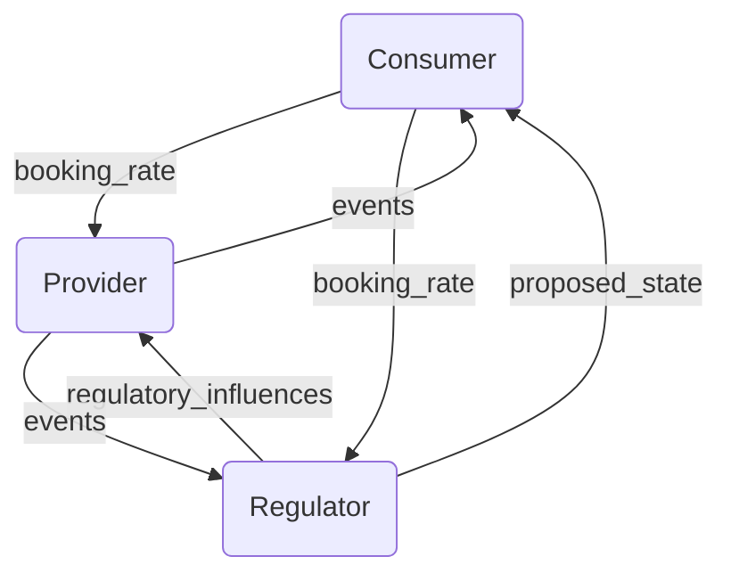

# Agent-Profile und Abhängigkeiten

Agenten sind **informationsbeschränkt**: Sie sehen nur das, was in `configs/agent_profiles.json` erlaubt ist. Numerische Ground Truth kommt aus Python — Agenten dürfen keine Kennzahlen erfinden.

## Profil-Struktur

| Feld | Bedeutung |
| --- | --- |
| `observes` | Kontextfelder im Prompt (Metriken, Faktoren, Events) |
| `may_propose` | Erlaubte Output-Typen (`events`, `factor_state F2`, …) |
| `must_not_output` | Verbotene Begriffe/Felder (z. B. `ticket_price`, `booking_rate`) |
| `depends_on` | Logische Abhängigkeit von anderen Agenten/Umgebung |

Implementierung: `src/agents/agent_dependencies.py`, Filter in `src/agents/agent_node.py`.
Anwendernahe Fassung im Dashboard unter «Dokumentation → Die drei Akteure».

## Abhängigkeitsgraph

## Agent-spezifische Profile

### Consumer

| | |
| --- | --- |
| **Beobachtet** | market_metrics, population_stats, event_log_recent, Faktoren F1, F5, F6 |
| **Darf vorschlagen** | — (nur Events über Response-Schema) |
| **Verboten** | ticket_price, booking_rate, numeric_shares |
| **Abhängig von** | provider.events, regulator.proposed_state |

Booking wird **beobachtet** (über population_stats), aber nicht als freie Zahl im Output genannt.

### Provider

| | |
| --- | --- |
| **Beobachtet** | market_metrics, booking_rate, cost_pressure, event_log_recent, F3, F4 |
| **Darf vorschlagen** | events |
| **Verboten** | ticket_price, carbon_tax_level |
| **Abhängig von** | regulatory_influences, consumer.booking_rate |

### Regulator

| | |
| --- | --- |
| **Beobachtet** | market_metrics, F2, F6, F7, event_log_recent, population_stats |
| **Darf vorschlagen** | factor_state F2, factor_state F6 |
| **Verboten** | ticket_price, tax_level_numeric |
| **Abhängig von** | provider.events, consumer.booking_rate |

Faktorvorschläge werden in Python gegen `factor_rules` geprüft. Provider und Consumer dürfen **keine** Faktorzustände vorschlagen.

## Faktor-Berechtigungen

**`configs/agent_profiles.json` ist die einzige Quelle** (seit P0.5). Wer einen Faktor vorschlagen darf, steht dort als Eintrag `factor_state <ID>` in `may_propose` — eine dort ergänzte Berechtigung wirkt ohne Codeänderung.

Bis P0.5 gab es die Angabe doppelt: zusätzlich als hartcodiertes Dict `AGENT_FACTOR_PERMISSIONS` in `src/market/factor_dynamics.py`. Beide stimmten überein, aber nichts hielt sie synchron — und die durchsetzende war die hartcodierte. Eine neue Zeile in der JSON wäre still ins Leere gelaufen. Das Dict ist entfernt, ein Test hält fest, dass es nicht zurückkommt.

Geprüft wird an **einer** Stelle: [`src/agents/agent_permissions.py`](../src/agents/agent_permissions.py) — `may_propose_factor(profile, factor_id)`. Sowohl der Parser in `agent_node` als auch die Durchsetzung in `factor_dynamics.validate_factor_proposals` rufen sie. Vorher prüfte jede für sich, mit gegenläufigem Verhalten ohne Profil: Der Parser ließ dann alles durch, die Durchsetzung nichts. **Ohne Profil ist jetzt nichts erlaubt** — wer nicht ausdrücklich darf, darf nicht.

**Und ein fehlendes Profil ist ein Fehler, kein Sonderfall** (ergänzt 2026-08-27). Genau daran hängt der Preis der Vereinfachung: `config_loader` vergibt kein Profil, wenn `agent_profiles.json` fehlt oder den Agenten nicht kennt — und seit P0.5 heißt das *nichts erlaubt*. Nachgestellt: Datei weggeschoben, Lauf gestartet; er rechnet klaglos zu Ende, kein Agent kann noch einen Faktor vorschlagen, und nichts sagt es. Vor P0.5 blieb derselbe Fall folgenlos, weil das hartcodierte Dict die Rechte trug. `validation.py` weist einen Agenten ohne Profil deshalb jetzt ab, bevor der Lauf beginnt.

Heute erlaubt: Regulator `F2`, `F6`. Provider und Consumer nichts.

## Reaktion auf Events

Agenten erhalten `event_log_recent` und `depends_on`-Kontext. Delta-Events (`[delta:booking:…]`, `[delta:price:…]`) stammen aus Python (`src/orchestration/event_deltas.py`) und dienen als **verbindliche** Referenz für Narrative.

## Tests

- `tests/test_agent_profiling.py` — Prompt-Filter, Parser-Grenzen
- `tests/test_factor_dynamics.py` — `validate_factor_proposals` für Regulator
- `tests/test_agent_permissions.py` — beide Prüfstellen stimmen überein; eine in der JSON ergänzte Berechtigung reicht bis in die Durchsetzung

## Konfiguration

Quelle: `configs/agent_profiles.json` · geladen via `src/config_loader.py`
