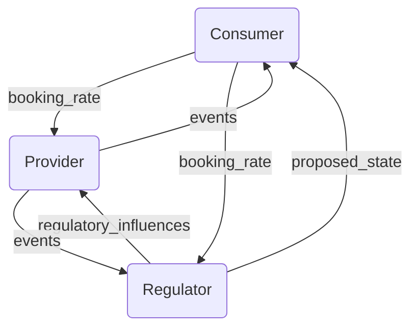

# Agent-Profile und Abhängigkeiten

Agenten sind **informationsbeschränkt**: Sie sehen nur das, was in `configs/agent_profiles.json` erlaubt ist. Numerische Ground Truth kommt aus Python — Agenten dürfen keine Kennzahlen erfinden.

## Profil-Struktur

| Feld | Bedeutung |
| --- | --- |
| `observes` | Kontextfelder im Prompt (Metriken, Faktoren, Events) |
| `may_propose` | Erlaubte Output-Typen (`events`, `factor_state F2`, …) |
| `must_not_output` | Verbotene Begriffe/Felder (z. B. `ticket_price`, `booking_rate`) |
| `depends_on` | Logische Abhängigkeit von anderen Agenten/Umgebung |

Implementierung: `src/agent_dependencies.py`, Filter in `src/nodes/agent_node.py`.

## Abhängigkeitsgraph



## Agent-spezifische Profile

### Consumer

| | |
| --- | --- |
| **Beobachtet** | market_metrics, population_stats, event_log_recent, Faktoren F1, F5, F6 |
| **Darf vorschlagen** | — (nur Events über Response-Schema) |
| **Verboten** | ticket_price, booking_rate, numeric_shares |
| **Abhängig von** | provider.events, regulator.proposed_state |

Booking wird **beobachtet** (über population_stats), aber nicht als freie Zahl im Output genannt.

### Provider

| | |
| --- | --- |
| **Beobachtet** | market_metrics, booking_rate, cost_pressure, event_log_recent, F3, F4 |
| **Darf vorschlagen** | events |
| **Verboten** | ticket_price, carbon_tax_level |
| **Abhängig von** | regulatory_influences, consumer.booking_rate |

### Regulator

| | |
| --- | --- |
| **Beobachtet** | market_metrics, F2, F6, F7, event_log_recent, population_stats |
| **Darf vorschlagen** | factor_state F2, factor_state F6 |
| **Verboten** | ticket_price, tax_level_numeric |
| **Abhängig von** | provider.events, consumer.booking_rate |

Faktorvorschläge werden in Python gegen `factor_rules` geprüft (`AGENT_FACTOR_PERMISSIONS` in `src/factor_dynamics.py`). Provider und Consumer dürfen **keine** Faktorzustände vorschlagen.

## Faktor-Berechtigungen (Code)

```python
AGENT_FACTOR_PERMISSIONS = {
    "regulator": {"F2", "F6"},
    "provider": set(),
    "consumer": set(),
}
```

## Reaktion auf Events

Agenten erhalten `event_log_recent` und `depends_on`-Kontext. Delta-Events (`[delta:booking:…]`, `[delta:price:…]`) stammen aus Python (`src/event_deltas.py`) und dienen als **verbindliche** Referenz für Narrative.

## Tests

- `tests/test_agent_profiling.py` — Prompt-Filter, Parser-Grenzen
- `tests/test_factor_dynamics.py` — `validate_factor_proposals` für Regulator

## Konfiguration

Quelle: `configs/agent_profiles.json` · geladen via `src/config_loader.py`
