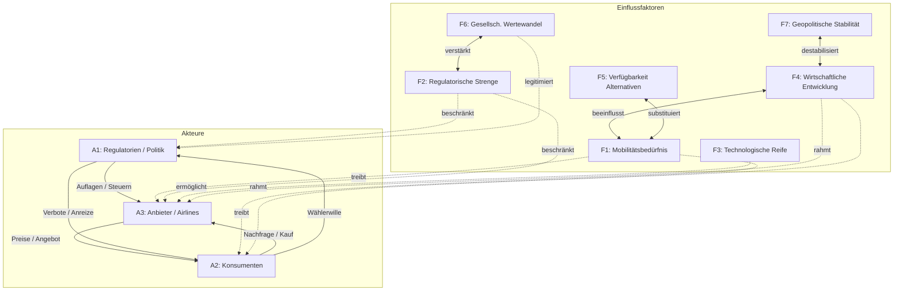
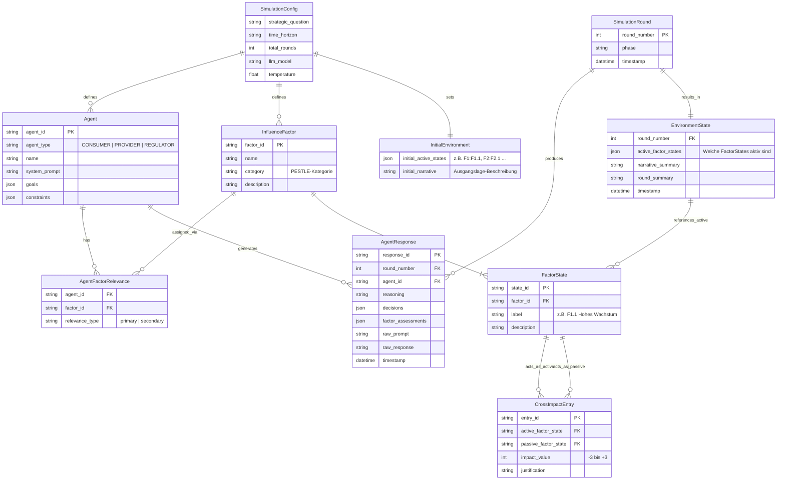
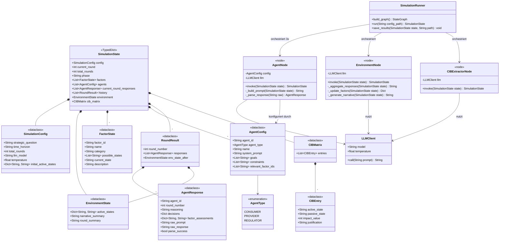

# Challenge 1: Domänenrepräsentation

## Projektkontext

| Attribut | Wert |
|----------|------|
| **Forschungsprojekt** | Entwicklung einer prototypischen multiagentischen Simulationsumgebung für die Szenarioplanung im Strategic Foresight |
| **Challenge** | C1 – Domänenrepräsentation |
| **Domäne** | System Flugverkehr |
| **Methodik** | Ludewig, J. & Lichter, H. (2023): Software Engineering – Grundlagen, Menschen, Prozesse, Techniken. 4. Aufl., dpunkt.verlag. |
| **Technischer Stack** | Python, LangGraph, Ollama (lokale LLMs) |
| **Stand** | Analyse (Systemabgrenzung, Glossar, Stakeholder, Anforderungen, Modelle)  |

---

## Inhaltsverzeichnis

- [1 Problemdomäne verstehen & abgrenzen](#1-problemdomäne-verstehen--abgrenzen)
  - [1.1 Festgelegte Systemgrenzen](#11-festgelegte-systemgrenzen)
  - [1.2 Herleitung der Akteure](#12-herleitung-der-akteure)
    - [1.2.1 MVP-Akteure für Workbench](#121-mvp-akteure-für-workbench)
    - [1.2.2 Weitere Akteure](#122-weitere-akteure)
    - [1.2.3 Sub-Agenten Überlegung](#123-sub-agenten-überlegung)
    - [1.2.4 Akteurübersicht](#124-akteurs-übersicht)
  - [1.3 Herleitung der Einflussfaktoren](#13-herleitung-der-einflussfaktoren)
  - [1.4 Faktor-Zustände](#14-faktor-zustände)
  - [1.5 Beziehungstypen](#15-beziehungstypen)
  - [1.6 Domänenstruktur (Übersicht)](#16-domänenstruktur-übersicht)
- [2 Begriffslexikon / Glossar](#2-begriffslexikon--glossar)
  - [2.1 Systemkonzepte](#21-systemkonzepte)
  - [2.2 Akteure](#22-akteure)
  - [2.3 Einflussfaktoren](#23-einflussfaktoren)
- [3 Stakeholder-Identifikation](#3-stakeholder-identifikation)
- [4 Anforderungserhebung](#4-anforderungserhebung)
  - [4.1 Funktionale Anforderungen (User Stories)](#41-funktionale-anforderungen-user-stories)
  - [4.2 Nicht-funktionale Anforderungen](#42-nicht-funktionale-anforderungen)
  - [4.3 Abgrenzung (Out of Scope)](#43-abgrenzung-out-of-scope)
- [5 Modelle & Diagramme](#5-modelle--diagramme)
  - [5.1 ERM](#51-erm)
  - [5.2 Klassendiagramme](#52-klassendiagramme)
  - [5.3 Aktivitätsdiagramm](#53-aktivitätsdiagramm)

---

## 1 Problemdomäne verstehen & abgrenzen

> **Methodische Grundlage:** Orientiert an Ludewig & Lichter, Kap. 15.2.3, beginnen wir damit, den IST-Zustand festzustellen und die Domäne zu verstehen und abzugrenzen. Ziel ist es, den Untersuchungsgegenstand so zu beschreiben, dass alle Beteiligten ein gemeinsames Verständnis des zu modellierenden Systems entwickeln.

### 1.1 Festgelegte Systemgrenzen

| Parameter | Festlegung | Begründung |
|-----------|------------|------------|
| **Zeitlicher Horizont** | 10 Jahre (2025–2035) | Lang genug für strukturelle Veränderungen, kurz genug für plausible Annahmen |
| **Geographischer Scope** | International | Regularien sind meistens international geregelt |
| **Szenariotyp** | Explorativ (Was kann passieren?) | Vorgabe & CIB-Matrix |
| **Akteure & Faktoren** | 3 Akteure, 7 Faktoren | MVP für Weiterentwicklung |

### 1.2 Herleitung der Akteure 
(MANU)

### 1.2.1 MVP-Akteure für Workbench
| MVP-Akteure | Beschreibung |
|-----------|------------|
| Konsumenten | Privat- und Geschäftsreisende → treffen Reiseentscheidungen |
| Anbieter | Fluggesellschaften → setzen Preise, Routen, investieren |
| Regulatorien | EU-Kommission, nationale Regierungen, (EASA, ICAO) → setzen Rahmenbedingungen |

Begründung:
xxx einfachheit, modular weiterbauen

### 1.2.2 Weitere Akteure
Nachfolgend weitere identifizierte Akteure, die jedoch nicht in der ersten Iteration berücksichtigt werden.
| Weitere Akteure | Beschreibung |
|-----------|------------|
| Konsumenten | Privat- und Geschäftsreisende → treffen Reiseentscheidungen |
| Anbieter | Fluggesellschaften → setzen Preise, Routen, investieren |
| Regulatorien | EU-Kommission, nationale Regierungen, (EASA, ICAO) → setzen Rahmenbedingungen |

### 1.2.3 Sub-Agenten Überlegung
Verlinkung einer weiteren Idee mit Hilfe von Subagenten, die wir jedoch auch nicht in der ersten Iteration berücksichtigen, um im späteren Verlauf die beste Modellierung zu identifizieren.
VERLINKUNG

Im weiteren Verlauf prüfen wir alle Alternativen und bauen den Prototyp nach Best Practices aus.

### 1.2.4 Akteurübersicht

MERMAID JS GRAPH

---

### 1.3 Herleitung der Einflussfaktoren 
(HAIKO)

Preiselastizität; Preisdispersion -> 3.3 / 3.4

Tabelle Megatrends

Die Einflussfaktoren wurden mittels einer PESTLE-Analyse (Political, Economic, Social, Technological, Legal, Environmental) identifiziert und mit den Megatrends aus dem Zukunftsinstitut (2025) abgeglichen:

| # | Einflussfaktor | PESTLE-Kategorie | Beschreibung | Bezug zu Megatrends |
|---|---|---|---|---|
| **F1** | Mobilitätsbedürfnis / Nachfrage | Social | Wie stark wollen Menschen fliegen? | Globalisierung, Identitätsdynamik |
| **F2** | Regulatorische Strenge | Political / Environmental / Legal | Welche klimapolitischen Leitplanken werden gesetzt? | Ökointelligenz |
| **F3** | Technologische Reife (Dekarbonisierung) | Technological | Wie weit sind SAF, E-Aviation, H₂? | Konnektivität, Ökointelligenz |
| **F4** | Wirtschaftliche Entwicklung | Economic | Konjunktur, Kaufkraft, Energiepreise | Globalisierung, Demographischer Wandel|
| **F5** | Verfügbarkeit von Alternativen | Technological / Political / Legal | Schiene, digitale Substitution, Intermodalität | Mobilität, Konnektivität |
| **F6** | Gesellschaftlicher Wertewandel | Social / Environmental | Klimabewusstsein, Flight Shaming, Normen | Ökointelligenz, Identitätsdynamik |
| **F7** | Geopolitische Stabilität | Political / Security | Offene Lufträume, Konflikte, Pandemien | Sicherheit, Globalisierung |

Einflussfaktoren mit Quellen belegen; 

**Prüfung auf Eindeutigkeit:**

| Prüfung | Ergebnis |
|---------|----------|
| F1 vs. F6 | F1 = beobachtbare Nachfrage (Menge), quantifizierbar, F6 = zugrundeliegende Werthaltung → F6 *treibt* F1, aber nicht identisch. **Beide behalten.** |
| F2 vs. F6 | F2 = staatliches Handeln, F6 = gesellschaftliche Haltung → Politik kann der Gesellschaft vorauseilen oder hinterherhinken. **Beide behalten.** |
| F3 vs. F5 | F3 = Technologie im Flugverkehr selbst, F5 = Alternativen außerhalb → klar getrennt. **Beide behalten.** |

**Ergebnis: 7 Einflussfaktoren**, alle eindeutig differenzierbar.

### 1.4 Faktor-Zustände

Jeder Faktor weist einen erkennbaren Unterschied auf:

| Faktor | Zustand 1 (Kontinuität) | Zustand 2 (Transformation) |
|--------|--------------------------|----------------------------|
| **F1** Mobilitätsbedürfnis | F1.1: Globaler Reiseboom, ungebrochenes Wachstum | F1.2: Stagnation & Verzicht, Substitution |
| **F2** Regulatorische Strenge | F2.1: Moderater Klimaschutz, Kompensationsfokus | F2.2: Radikale Dekarbonisierung, Verbote |
| **F3** Technologische Reife | F3.1: Inkrementelle Verbesserungen, SAF teuer | F3.2: Durchbruch bei SAF/E-Fuels/H₂ |
| **F4** Wirtschaftliche Entwicklung | F4.1: Stabiles Wachstum, moderate Inflation | F4.2: Rezession / Stagflation |
| **F5** Verfügbarkeit Alternativen | F5.1: Schiene stagniert, Fliegen alternativlos | F5.2: Massiver Schienenausbau, Intermodalität |
| **F6** Gesellsch. Wertewandel | F6.1: Fliegen bleibt akzeptiert | F6.2: Starkes Klimabewusstsein, Flight Shaming |
| **F7** Geopolitische Stabilität | F7.1: Offene Märkte, Kooperation | F7.2: Fragmentierung, Konflikte |

Info: MVP 2 Zustände -> Iterationen mehr Zustände nach Analyse

### 1.5 Beziehungstypen

| Beziehungstyp | Definition | Beispiel |
|---|---|---|
| **Akteur → Akteur** | Ein Akteur beeinflusst durch sein Handeln die Entscheidungen oder Handlungsmöglichkeiten eines anderen Akteurs | Konsument → Anbieter (Kauf/Kein Kauf)
| **Faktor → Akteur** | Ein Einflussfaktor verändert die Rahmenbedingungen, unter denen ein Akteur agiert | F4 (Rezession) → Anbieter (Kostendruck, Streckenabbau) |
| **Akteur → Faktor** | Ein Akteur beeinflusst durch sein Handeln die Ausprägung eines Einflussfaktors | Anbieter → F6 (Ökonomische Flüge → Akzeptanz CO2-Ausstoß ) |
| **Faktor ↔ Faktor** | Zwei Einflussfaktoren verstärken oder hemmen sich gegenseitig (Cross-Impact) | F6 (Wertewandel) → F2 (legitimiert strengere Regulierung) |

---

## 2 Begriffslexikon / Glossar

> **Methodische Grundlage:** Gemäß Ludewig & Lichter, Kap. 15.3 definiert und klärt ein Begriffslexikon zentrale Begriffe eindeutig, welche möglicherweise von verschiedenen Leuten unterschiedlich ausgelegt werden. Es dient als gemeinsame Sprache zwischen allen Beteiligten und verhindert Missverständnisse. Das Begriffslexikon ist ein lebendes Dokument, das während des gesamten Projekts gepflegt wird.

> *Hinweis*: Begriffslexikon wurde unter Zuhilfename von KI (Claude Opus 4.6) erstellt. KI diente hier zur Ausformulierung der einzelnen Begriffe. Diese werden im nächsten Iterationsschritt überprüft und im Plenum definiert. (Stand 05.04.2026)

**TODO: Begriffslexikon gemeinsam nochmal durchgehen, damit alle konform und auch dem gleichen Stand sind!**

### Struktur jedes Eintrags

| Feld | Beschreibung |
|------|-------------|
| **Begriff** | Kanonischer Name |
| **Synonyme** | Alternative Bezeichnungen |
| **Kategorie** | Systemkonzept / Akteur / Einflussfaktor / Zustand / Beziehung |
| **Definition** | Präzise, eindeutige Beschreibung |
| **Abgrenzung** | Was der Begriff *nicht* meint |
| **Beziehungen** | Verbindungen zu anderen Glossarbegriffen |

### 2.1 Systemkonzepte

#### Soziotechnisches System

| Feld | Inhalt |
|------|--------|
| **Begriff** | Soziotechnisches System |
| **Synonyme** | Soziotechnisches Gefüge, Socio-Technical System |
| **Kategorie** | Systemkonzept |
| **Definition** | Ein System, in dem menschliche (soziale) und technische Komponenten untrennbar miteinander verwoben sind und sich wechselseitig beeinflussen. Im Kontext dieses Projekts bezeichnet es das Zusammenspiel von Akteuren (Menschen, Organisationen, Institutionen) mit technischen Infrastrukturen, Regularien und gesellschaftlichen Normen innerhalb einer Domäne. |
| **Abgrenzung** | Kein rein technisches System (z.B. ein Triebwerk) und kein rein soziales System (z.B. eine Familienstruktur). Die Betonung liegt auf der Wechselwirkung zwischen sozialen und technischen Elementen. |
| **Beziehungen** | Enthält → Akteure, Einflussfaktoren, Wechselwirkungen. Wird untersucht durch → Szenarioplanung. |

#### Domäne

| Feld | Inhalt |
|------|--------|
| **Begriff** | Domäne |
| **Synonyme** | Problemdomäne, Anwendungsdomäne |
| **Kategorie** | Systemkonzept |
| **Definition** | Der fachliche Gegenstandsbereich, der modelliert und simuliert wird. In diesem Projekt ist die Domäne das System Flugverkehr in Europa mit einem Zeithorizont von 2025–2035. Die Domäne umfasst alle relevanten Akteure, Einflussfaktoren und deren Wechselwirkungen, die die Zukunftsentwicklung des europäischen Flugverkehrs bestimmen. |
| **Abgrenzung** | Die Domäne ist nicht das gesamte Mobilitätssystem. Konkurrierende Verkehrsträger (Bahn, Bus) werden als exogener Einflussfaktor modelliert, nicht als Teil der Domäne selbst. |
| **Beziehungen** | Wird repräsentiert durch → Domänenmodell. Enthält → Akteure, Einflussfaktoren. |

#### Szenario

| Feld | Inhalt |
|------|--------|
| **Begriff** | Szenario |
| **Synonyme** | Zukunftsszenario, Szenariobild |
| **Kategorie** | Systemkonzept |
| **Definition** | Eine in sich konsistente, plausible Beschreibung eines möglichen zukünftigen Zustands des soziotechnischen Systems. Ein Szenario ergibt sich aus einer bestimmten Kombination von Faktor-Zuständen und beschreibt qualitativ, wie sich das System unter diesen Bedingungen entwickelt. Ein Szenario ist keine Prognose (keine Wahrscheinlichkeitsaussage), sondern eine explorative Erzählung über eine mögliche Zukunft. |
| **Abgrenzung** | Kein Forecast (wahrscheinlichste Entwicklung), keine Planung (gewünschte Entwicklung). Ein Szenario beschreibt was passieren kann, nicht was passieren wird oder soll. |
| **Beziehungen** | Wird erzeugt durch → Szenarioplanung, Cross-Impact-Analyse. Besteht aus → Kombination von Faktor-Zuständen. Wird beschrieben durch → Simulationsstand / Gesprächsprotokoll. |

#### Szenarioplanung

| Feld | Inhalt |
|------|--------|
| **Begriff** | Szenarioplanung |
| **Synonyme** | Scenario Planning, Szenarioentwicklung |
| **Kategorie** | Systemkonzept |
| **Definition** | Eine strukturierte Methode innerhalb des Strategic Foresight, bei der mehrere plausible Zukunftsszenarien systematisch entwickelt werden. Der Prozess umfasst fünf generische Phasen: (1) Zentrale Fragestellung identifizieren, (2) Haupttreiber identifizieren, (3) Szenariologik bestimmen, (4) Szenarioannahmen beschreiben, (5) Analyse der Szenarien. |
| **Abgrenzung** | Nicht gleichzusetzen mit dem gesamten Strategic-Foresight-Prozess, der auch Environmental Scanning, Visioning und Strategy Development umfasst. |
| **Beziehungen** | Ist Phase von → Strategic Foresight. Nutzt → Einflussfaktoren, Cross-Impact-Analyse. Erzeugt → Szenarien. |

#### Cross-Impact-Bilanz (CIB)

| Feld | Inhalt |
|------|--------|
| **Begriff** | Cross-Impact-Bilanz |
| **Synonyme** | Cross-Impact-Balance-Analyse, CIB, Wechselwirkungsmatrix |
| **Kategorie** | Systemkonzept |
| **Definition** | Eine analytische Methode zur systematischen Erfassung und Bewertung der paarweisen Wechselwirkungen zwischen den Zuständen verschiedener Einflussfaktoren. In einer CIB-Matrix wird für jedes Paar von Faktor-Zuständen numerisch bewertet, wie stark ein aktiver Zustand einen passiven Zustand fördert (positive Werte) oder hemmt (negative Werte). Typische Skala: −3 (stark hemmend) bis +3 (stark fördernd), 0 = kein Einfluss. Aus der Matrix lassen sich konsistente Szenariokombinationen ableiten. |
| **Abgrenzung** | Keine rein qualitative Einschätzung; die CIB quantifiziert Wechselwirkungen auf einer ordinalen Skala. Keine kausale Modellierung im strengen Sinne, sondern eine Expertenbewertung von Einflussrichtung und -stärke. |
| **Beziehungen** | Operiert auf → Einflussfaktoren, Faktor-Zustände. Erzeugt → konsistente Szenariokombinationen. Wird in Challenge 3 reproduziert durch → Multiagentensystem. |

#### Cross-Impact-Bewertung

| Feld | Inhalt |
|------|--------|
| **Begriff** | Cross-Impact-Bewertung |
| **Synonyme** | CIB-Eintrag, Wechselwirkungsbewertung, Cross-Impact Entry |
| **Kategorie** | Systemkonzept |
| **Definition** | Eine einzelne, gerichtete Bewertung der Wechselwirkung zwischen zwei Faktor-Zuständen innerhalb der Cross-Impact-Bilanz. Sie besteht aus dem aktiven Zustand (Ursache), dem passiven Zustand (Wirkung), einem numerischen Wirkungswert (−3 bis +3) und einer textuellen Begründung. |
| **Abgrenzung** | Nicht die gesamte Matrix (→ Cross-Impact-Bilanz), sondern ein einzelner Eintrag darin. |
| **Beziehungen** | Ist Teil von → Cross-Impact-Bilanz. Verweist auf → Faktor-Zustände. |

#### Simulationsstand

| Feld | Inhalt |
|------|--------|
| **Begriff** | Simulationsstand |
| **Synonyme** | Gesprächsprotokoll, Simulation State, Systemzustand |
| **Kategorie** | Systemkonzept |
| **Definition** | Der zu einem bestimmten Simulationszeitpunkt geltende Gesamtzustand des modellierten Systems. Er umfasst (a) die aktuellen Ausprägungen aller Einflussfaktoren, (b) die Positionen und Reaktionen aller Akteure und (c) das kumulierte Gesprächsprotokoll der Agenten-Interaktionen. Der Simulationsstand ist das zentrale Arbeits- und Analyseergebnis der Simulation und dient als Grundlage für die Szenarioableitung. |
| **Abgrenzung** | Kein einzelner Faktorwert, sondern die Gesamtheit aller Systemzustände zu einem Zeitpunkt. |
| **Beziehungen** | Wird erzeugt durch → Multiagentensystem. Wird exploriert durch → Chat-Interface (Challenge 4). Bildet Grundlage für → Szenarioableitung. |

#### Weak Signal

| Feld | Inhalt |
|------|--------|
| **Begriff** | Weak Signal |
| **Synonyme** | Schwaches Signal, Frühindikator |
| **Kategorie** | Systemkonzept |
| **Definition** | Ein schwaches, frühzeitiges Anzeichen für eine möglicherweise bedeutsame zukünftige Veränderung, das zum Zeitpunkt seines Auftretens noch mehrdeutig, unvollständig und leicht zu übersehen ist. Weak Signals können auf entstehende Trends, Diskontinuitäten oder disruptive Entwicklungen hindeuten. Im Kontext dieses Projekts dienen sie (perspektivisch in Challenge 4) als Trigger zur Dynamisierung von Einflussfaktoren. |
| **Abgrenzung** | Kein etablierter Trend (der bereits sichtbar und breit anerkannt ist). Kein Rauschen (zufällige Datenpunkte ohne Bedeutung). Die Unterscheidung zwischen Weak Signal und Rauschen erfordert Interpretation. |
| **Beziehungen** | Kann dynamisieren → Einflussfaktoren. Wird erkannt durch → Environmental Scanning. Relevant für → Challenge 4. |

### 2.2 Akteure 
(HAIKO)

#### A1: Regulatorien / Politik

| Feld | Inhalt |
|------|--------|
| **Begriff** | Regulatorien / Politik |
| **Synonyme** | Regulierer, Regulator, Politische Entscheider |
| **Kategorie** | Akteur |
| **Definition** | Staatliche und überstaatliche Institutionen, die den Ordnungsrahmen für den Flugverkehr setzen. Dazu gehören die EU-Kommission (Emissionshandel ETS, Fit-for-55-Paket), nationale Regierungen (Luftverkehrsteuer, Kurzstreckenverbote), die EASA (European Union Aviation Safety Agency, Zertifizierung neuer Technologien) und die ICAO (internationale Standards). Ihre Handlungslogik folgt politischen Zielen: Klimaschutz, Wirtschaftsförderung, Wählerzufriedenheit, internationale Wettbewerbsfähigkeit. |
| **Abgrenzung** | Nicht die operative Flugsicherung (DFS), die eher technisch-operativ agiert. Nicht die Justiz (Gerichte), die Regeln anwendet, aber nicht gestaltet. |
| **Beziehungen** | Beeinflusst direkt → Anbieter (durch Auflagen, Steuern), Infrastrukturbetreiber (Genehmigungen), Technologieentwickler (Förderung, Zertifizierung). Wird beeinflusst von → Zivilgesellschaft (Druck), Konsumenten (Wählerwille). Primär zugeordnete Einflussfaktoren → F2 (Regulatorische Strenge), F6 (Wertewandel als Treiber politischen Handelns). |

#### A2: Konsumenten / Nachfrager

| Feld | Inhalt |
|------|--------|
| **Begriff** | Konsumenten / Nachfrager |
| **Synonyme** | Passagiere, Fluggäste, Reisende, Demand Side |
| **Kategorie** | Akteur |
| **Definition** | Die Gesamtheit der Personen und Organisationen, die Flugreisen nachfragen. Dies umfasst Privatreisende (Urlaub, Familienbesuche), Geschäftsreisende (Dienstreisen, Konferenzen) und Frachtkunden (Unternehmen mit Luftfrachtbedarf). Ihre Entscheidungen werden getrieben durch Preis, Reisezeit, Komfort, Verfügbarkeit von Alternativen, persönliche Werthaltungen (Klimabewusstsein) und wirtschaftliche Rahmenbedingungen (Kaufkraft). Sie sind die nachfrageseitige Kraft im System. |
| **Abgrenzung** | Nicht die Airlines (die sind Anbieter). Nicht die Zivilgesellschaft als organisierte Interessengruppe – ein Konsument wird zur Zivilgesellschaft, wenn er sich politisch organisiert (z.B. Petition gegen Flughafenausbau), aber nicht wenn er eine individuelle Reiseentscheidung trifft. |
| **Beziehungen** | Beeinflusst direkt → Anbieter (durch Nachfrage und Zahlungsbereitschaft), Regulatorien (als Wähler). Wird beeinflusst von → Anbieter (Preise, Angebot), Zivilgesellschaft (soziale Normen), Regulatorien (Steuern, Verbote). Primär zugeordnete Einflussfaktoren → F1 (Mobilitätsbedürfnis), F4 (Wirtschaftliche Entwicklung), F6 (Wertewandel). |

#### A3: Anbieter / Airlines

| Feld | Inhalt |
|------|--------|
| **Begriff** | Anbieter / Airlines |
| **Synonyme** | Fluggesellschaften, Carrier, Luftverkehrsgesellschaften, Supply Side |
| **Kategorie** | Akteur |
| **Definition** | Unternehmen, die den Personen- und Frachttransport auf dem Luftweg anbieten. Dazu gehören Full-Service-Carrier (Lufthansa, Air France-KLM), Low-Cost-Carrier (Ryanair, easyJet) und Frachtfluggesellschaften (Cargolux). Ihre Handlungslogik ist primär ökonomisch: Maximierung von Auslastung und Ertrag, Minimierung von Kosten, Reaktion auf Regulierung und Nachfrageverschiebungen. Strategische Entscheidungen umfassen Routennetzplanung, Flotteninvestitionen, Preispolitik und Nachhaltigkeitsstrategien. |
| **Abgrenzung** | Nicht die Flugzeughersteller (→ Technologieentwickler). Nicht die Flughäfen (→ Infrastrukturbetreiber). Airlines nutzen Technologie und Infrastruktur, entwickeln und betreiben diese aber nicht primär selbst. |
| **Beziehungen** | Beeinflusst direkt → Konsumenten (Preise, Angebot, Routen), Infrastrukturbetreiber (Slot-Nachfrage), Technologieentwickler (Bestellungen, Anforderungen). Wird beeinflusst von → Regulatorien (Auflagen, Steuern), Konsumenten (Nachfrage), Technologieentwickler (verfügbare Flugzeuge/Kraftstoffe), Infrastrukturbetreiber (Kapazitäten). Primär zugeordnete Einflussfaktoren → F1 (Nachfrage), F2 (Regulierung), F3 (Technologie), F4 (Wirtschaftslage). |

### 2.3 Einflussfaktoren

#### F1: Mobilitätsbedürfnis / Nachfrage

| Feld | Inhalt |
|------|--------|
| **Begriff** | Mobilitätsbedürfnis |
| **Synonyme** | Flugnachfrage, Reisebedürfnis, Demand for Air Travel |
| **Kategorie** | Einflussfaktor |
| **Definition** | Das aggregierte Bedürfnis von Privatpersonen und Organisationen, den Luftverkehr für Personen- oder Gütertransport zu nutzen. Es wird getrieben durch Faktoren wie Globalisierungsgrad (internationale Verflechtung), Geschäftsreisekultur (vs. Remote Work), touristische Präferenzen (Fernreisen vs. Nahtourismus), demographische Entwicklung und individuelle Werthaltungen. Messgröße (qualitativ): Entwicklung der Passagierzahlen und Frachtvolumina im europäischen Luftverkehr. |
| **Zustände** | **F1.1 – Hohes Wachstum:** Globaler Reiseboom, Fliegen bleibt Standard für Fern- und Geschäftsreisen, steigende Passagierzahlen (+3–5% p.a.). / **F1.2 – Stagnation & Verzicht:** Wertewandel (Flight Shaming), Substitution durch Schiene und Videokonferenzen, stagnierende oder sinkende Passagierzahlen. |
| **Abgrenzung** | Nicht die Zahlungsbereitschaft (→ F4). Nicht das tatsächliche Flugaufkommen (das ist das Ergebnis von Nachfrage, Angebot und Regulierung). F1 beschreibt das Bedürfnis, unabhängig davon, ob es befriedigt wird. |
| **Beziehungen** | Wird beeinflusst von → F4, F5, F6, F7. Beeinflusst → Anbieter, Infrastrukturbetreiber. |

#### F2: Regulatorische Strenge

| Feld | Inhalt |
|------|--------|
| **Begriff** | Regulatorische Strenge |
| **Synonyme** | Klimapolitische Regulierung, Umweltregulierung, Regulatory Stringency |
| **Kategorie** | Einflussfaktor |
| **Definition** | Der Grad, in dem staatliche und überstaatliche Institutionen den Flugverkehr durch verbindliche Vorschriften im Sinne des Klima- und Umweltschutzes einschränken oder verteuern. Dies umfasst CO₂-Bepreisung (EU ETS, CORSIA), Beimischungsquoten für nachhaltige Flugkraftstoffe (SAF-Mandate), Kurzstreckenflugverbote, Nachtflugverbote, Lärmschutzauflagen und Subventionsabbau (Kerosinsteuerbefreiung). |
| **Zustände** | **F2.1 – Moderater Klimaschutz:** Wirtschaftsfokus, Kompensationszertifikate, weiche Regulierung, niedrige CO₂-Preise (<50€/t). / **F2.2 – Radikale Dekarbonisierung:** Strenge CO₂-Steuern (>150€/t), verpflichtende SAF-Quoten (>20%), Kurzstreckenverbote, Flugkontingentierung. |
| **Abgrenzung** | Nicht der gesellschaftliche Wunsch nach Regulierung (→ F6), sondern die tatsächlich erlassenen und durchgesetzten Vorschriften. |
| **Beziehungen** | Wird beeinflusst von → F6, F3, Zivilgesellschaft. Beeinflusst → Anbieter, Technologieentwickler, Infrastrukturbetreiber, Konsumenten. |

#### F3: Technologische Reife (Dekarbonisierung)

| Feld | Inhalt |
|------|--------|
| **Begriff** | Technologische Reife |
| **Synonyme** | Technologischer Reifegrad, Technology Readiness, Dekarbonisierungstechnologie |
| **Kategorie** | Einflussfaktor |
| **Definition** | Der Entwicklungs- und Verfügbarkeitsgrad von Technologien, die eine substanzielle Reduktion der Klimawirkung des Flugverkehrs ermöglichen. Dies umfasst Sustainable Aviation Fuels (SAF) – synthetisches Kerosin, Biokraftstoffe, Power-to-Liquid –, elektrisches Fliegen (batterie-elektrisch für Kurzstrecken), Wasserstoffantriebe (Brennstoffzelle oder Direktverbrennung) und aerodynamische Effizienzgewinne (neue Flugzeugkonfigurationen wie Blended Wing Body). Der Faktor beschreibt nicht nur die technische Machbarkeit, sondern auch die wirtschaftliche Skalierbarkeit. |
| **Zustände** | **F3.1 – Inkrementelle Verbesserung:** SAF bleibt teuer (3–5× Kerosinpreis), E-Fliegen nur für Kleinstflugzeuge, kein Paradigmenwechsel. / **F3.2 – Technologischer Durchbruch:** SAF erreicht Kostenparität, Wasserstoff-Demonstratoren erfolgreich, Skaleneffekte greifen. |
| **Abgrenzung** | Nicht die Regulierung, die Technologieeinsatz vorschreibt (→ F2). Nicht die Investitionsentscheidung der Airlines (→ Akteur Anbieter). F3 beschreibt, was technisch möglich und wirtschaftlich darstellbar ist. |
| **Beziehungen** | Wird beeinflusst von → F4, Regulatorien, Technologieentwickler. Beeinflusst → F2, Anbieter, Konsumenten. |

#### F4: Wirtschaftliche Entwicklung

| Feld | Inhalt |
|------|--------|
| **Begriff** | Wirtschaftliche Entwicklung |
| **Synonyme** | Konjunkturlage, Economic Development, Makroökonomisches Umfeld |
| **Kategorie** | Einflussfaktor |
| **Definition** | Die gesamtwirtschaftliche Lage in Europa und den relevanten Quellmärkten, die Kaufkraft, Investitionsbereitschaft und Kostenstrukturen im Flugverkehr bestimmt. Relevante Indikatoren: BIP-Wachstum, verfügbares Einkommen, Inflationsrate, Energiepreise (insb. Kerosinpreis), Wechselkurse, Arbeitsmarktlage. |
| **Zustände** | **F4.1 – Stabiles Wachstum:** Moderates BIP-Wachstum (1–3% p.a.), stabile Energiepreise, solide Kaufkraft. / **F4.2 – Rezession / Stagflation:** Wirtschaftliche Stagnation oder Schrumpfung, hohe Energiepreise, sinkende Kaufkraft. |
| **Abgrenzung** | Nicht das individuelle Konsumverhalten (→ F1/F6), sondern die makroökonomischen Rahmenbedingungen. |
| **Beziehungen** | Wird beeinflusst von → F7. Beeinflusst → F1, F3, Anbieter, Konsumenten. |

#### F5: Verfügbarkeit von Alternativen

| Feld | Inhalt |
|------|--------|
| **Begriff** | Verfügbarkeit von Alternativen |
| **Synonyme** | Substitutionspotenzial, Intermodale Konkurrenz, Alternative Mobility Options |
| **Kategorie** | Einflussfaktor |
| **Definition** | Der Grad, in dem reale, wettbewerbsfähige Alternativen zum Fliegen für relevante Reisezwecke und -distanzen existieren. Dies umfasst (a) Hochgeschwindigkeitsschiene (TGV, ICE), (b) Fernbusse, (c) digitale Substitution (Videokonferenzen) und (d) intermodale Angebote (nahtlose Bahn-Flug-Kombination). Entscheidend sind Reisezeit, Preis, Komfort und Verfügbarkeit. |
| **Zustände** | **F5.1 – Geringe Alternativen:** Schienenausbau stagniert, intermodale Buchung umständlich, Fliegen bleibt auf vielen Relationen alternativlos. / **F5.2 – Starke Alternativen:** Massiver HGV-Ausbau, nahtlose Intermodalität, Videokonferenz-Kultur – Fliegen wird unter 800km unattraktiv. |
| **Abgrenzung** | Nicht der Wunsch nach Alternativen (→ F6), sondern die tatsächliche Verfügbarkeit und Wettbewerbsfähigkeit. Nicht die Technologieentwicklung im Flugverkehr selbst (→ F3). |
| **Beziehungen** | Wird beeinflusst von → Regulatorien, F4. Beeinflusst → F1, Anbieter, Konsumenten. |

#### F6: Gesellschaftlicher Wertewandel

| Feld | Inhalt |
|------|--------|
| **Begriff** | Gesellschaftlicher Wertewandel |
| **Synonyme** | Normenwandel, Social Value Shift, Klimabewusstsein |
| **Kategorie** | Einflussfaktor |
| **Definition** | Die Veränderung der in der Gesellschaft vorherrschenden Werte, Normen und Einstellungen in Bezug auf Fliegen, Klimaverantwortung und nachhaltigen Konsum. Dieser Faktor beschreibt, inwieweit Klimabewusstsein vom Nischenthema zur dominierenden gesellschaftlichen Norm wird, die individuelles Verhalten und kollektive Erwartungen prägt. |
| **Zustände** | **F6.1 – Fliegen bleibt akzeptiert:** Klimaschutz ist ein Thema unter vielen, Fliegen wird nicht stigmatisiert, individuelle Freiheit dominiert. / **F6.2 – Starkes Klimabewusstsein:** Fliegen wird sozial geächtet (Flight Shaming), Konsumenten bevorzugen aktiv klimafreundliche Optionen. |
| **Abgrenzung** | Nicht das individuelle Reiseverhalten (→ F1). Nicht die politische Umsetzung (→ F2). F6 beschreibt die Tiefenströmung in der Gesellschaft. |
| **Beziehungen** | Wird beeinflusst von → Zivilgesellschaft, Weak Signals. Beeinflusst → F1, F2, Zivilgesellschaft, Anbieter. |

#### F7: Geopolitische Stabilität

| Feld | Inhalt |
|------|--------|
| **Begriff** | Geopolitische Stabilität |
| **Synonyme** | Geopolitische Lage, International Stability, Sicherheitslage |
| **Kategorie** | Einflussfaktor |
| **Definition** | Der Grad an politischer Stabilität, internationaler Kooperation und Sicherheit, der den grenzüberschreitenden Luftverkehr ermöglicht oder einschränkt. Umfasst offene vs. eingeschränkte Lufträume, internationale Abkommen, Sanktionen, Terrorismus- und Pandemierisiken sowie geopolitische Konflikte. |
| **Zustände** | **F7.1 – Stabile Weltordnung:** Offene Lufträume, funktionierende internationale Kooperation, geringe Sicherheitsrisiken. / **F7.2 – Fragmentierte Weltordnung:** Regionale Konflikte, gesperrte Lufträume, Visa-Restriktionen, De-Globalisierung. |
| **Abgrenzung** | Nicht die klimapolitische Regulierung (→ F2), sondern die sicherheits- und geopolitische Dimension. Nicht die wirtschaftlichen Folgen von Konflikten (→ F4). |
| **Beziehungen** | Wird beeinflusst von → exogene Faktoren. Beeinflusst → F1, F4, Anbieter, Infrastrukturbetreiber. |

---

## 3 Stakeholder-Identifikation 
(MANU)

> **Methodische Grundlage:** Gemäß Ludewig & Lichter, Kap. 6.2.3, können Kunden sowohl natürliche als auch juristische Personen sein. Jedoch existieren auch noch weitere, unsichtbare Klienten, welche identifiziert werden müssen. Vor Anforderungserhebung werden die Stakeholder, also alle Personen und Gruppen, die ein Interesse am System haben oder von ihm betroffen sind, identifiziert.

### Kontext

Die Stakeholder sind nicht die Akteure *innerhalb* der Domäne (Regulatorien, Airlines etc.), sondern die Personen, die das Simulationswerkzeug nutzen, bewerten oder davon betroffen sind.

### Stakeholder-Übersicht

| # | Stakeholder | Rolle | Interesse am System | Priorität |
|---|---|---|---|---|
| **S1** | **Foresight-Analyst** | Primärer Nutzer | Möchte mithilfe der Simulation plausible Zukunftsszenarien explorieren, Wechselwirkungen verstehen und Szenarien ableiten. Erwartet nachvollziehbare, qualitativ hochwertige Ergebnisse. |  Hoch |
| **S2** | **Dozent / Betreuer** | Auftraggeber & Prüfer | Bewertet die wissenschaftliche und technische Qualität des Projekts. Erwartet systematisches Vorgehen und angemessene Dokumentation. |  Hoch |
| **S3** | **Systementwickler / Projektteam** | Entwickler & Betreiber | Entwickelt und wartet das System. Benötigt klare Architektur, wartbaren Code, nachvollziehbare Konfiguration. |  Hoch |

---

## 4 Anforderungserhebung

> **Methodische Grundlage:** Gemäß Ludewig & Lichter, Kap. 15.4.4 beschreiben Anforderungen den Nutzen, den eine Software bringen soll (funktionale Anforderungen), und welche Eigenschaften es haben muss (nicht-funktionale Anforderungen). Sie werden aus Sicht der Stakeholder formuliert und müssen eindeutig, prüfbar, konsistent und verfolgbar sein.

---

### 4.1 Funktionale Anforderungen (User Stories)

#### Formatierung
User Stories folgen dem Format (vgl. Ludewig & Lichter, Kap. 15.7.4, S. 377 ff.):
> **Als** [Rolle] **möchte ich** [Funktion], **damit** [Nutzen].

#### Priorisierung
Die Priorisierung der Stories erfolgte mit der Methode MoSCoW
* **M (Must-have):**
* **S (Should-have):**
* **C (Could-have):**
* **W (Won't-have):**

---

### Rolle: Foresight-Analyst
*Der Analyst konfiguriert die Simulation und nutzt die Ergebnisse für strategische Berichte.*

| ID | User Story | Priorität | Phase |
| :--- | :--- | :--- | :--- |
| **US-A1** | Als Foresight-Analyst möchte ich eine vorgefertigte Konfigurationsdatei (z.B. JSON) hochladen können, in der die Basis-Prompts und Ziele der drei Hauptakteure (Konsument, Anbieter, Regulator) hinterlegt sind, damit ich die Simulation schnell starten kann. | Must | Setup |
| **US-A2** | Als Foresight-Analyst möchte ich eine zentrale strategische Fragestellung (z.B. „Zukunft des Flugverkehrs 2040“) eingeben können, damit die Agenten einen klaren Rahmen haben. | Must | Setup |
| **US-A3** | Als Foresight-Analyst möchte ich den Simulationslauf mit einem einfachen Klick auf „Start“ initiieren können, damit das System die Gesprächsrunden automatisch abarbeitet. | Must | Simulation |
| **US-A4** | Als Foresight-Analyst möchte ich nach Abschluss das vollständige Gesprächsprotokoll im Klartext lesen können, um qualitative Argumentationslinien nachzuvollziehen. | Must | Output |
| **US-A5** | Als Foresight-Analyst möchte ich am Ende eine maschinell abgeleitete Cross-Impact-Bilanz (CIB) und eine Visualisierung erhalten, um die gegenseitige Beeinflussung der Akteure zu sehen. | Must | Output |
| **US-A6** | Als Foresight-Analyst möchte ich das Protokoll und die CIB-Matrix lokal abspeichern können, um sie für spätere Berichte zu nutzen. | Should | Output |
| **US-A7** | Als Foresight-Analyst möchte ich die geladenen Agenten-Prompts vor dem Start im UI anpassen können, um Nuancen ohne JSON-Änderung zu testen. | Should | Setup |

### Rolle: Dozenten / Evaluatoren
*Diese Gruppe prüft die methodische Qualität und die logische Konsistenz der Simulation im Hinblick auf ein Forschungsprojekt.*

| ID | User Story | Priorität | Phase |
| :--- | :--- | :--- | :--- |
| **US-E1** | Als Evaluator möchte ich die final verwendeten System-Prompts transparent einsehen können, um deren Qualität zu bewerten. | Must | Evaluation |
| **US-E2** | Als Evaluator möchte ich den Log der Agenten lesen können, um auf logische Argumentation oder Halluzinationen zu prüfen. | Must | Evaluation |
| **US-E3** | Als Evaluator möchte ich nachvollziehen können, wie die CIB-Matrix generiert wird, um die methodische Quantifizierung zu validieren. | Must | Evaluation |
| **US-E4** | Als Forscher möchte ich in den Logs erkennen können, ob "emergentes Verhalten" (neue Argumente außerhalb des Prompts) stattfindet. | Could | Analyse |

### Rolle: Systementwickler (wir)
*Verantwortlich für Architektur, Stabilität und Modell-Integration.*

| ID | User Story | Priorität | Phase |
| :--- | :--- | :--- | :--- |
| **US-D1** | Als Systementwickler möchte ich jeden gesendeten Prompt und jede Antwort im Hintergrund loggen, um Fehlerursachen (Prompt vs. Modell) zu finden. | Must | Architektur |
| **US-D2** | Als Systementwickler möchte ich den Langgraph-State nach jedem Agenten-Zug zwischenspeichern, um bei Abstürzen dort fortfahren zu können. | Should | Architektur |
| **US-D3** | Als Systementwickler möchte ich das verwendete lokale Modell zentral in einer Config ändern können, um die Performance verschiedener LLMs zu testen. | Should | Setup |

---

### 4.2 Nicht-funktionale Anforderungen (NFA)

| ID | Kategorie | Anforderung | Priorität |
|:---|:---|:---|:---:|
| **NFA-01** | **Nachvollziehbarkeit** | Das System muss durch Prompting und Systemgrenzen Halluzinationen minimieren. Ergebnisse müssen auf den Simulationsstand zurückführbar sein. | **Must** |
| **NFA-02** | **Reproduzierbarkeit** | Bei identischer Konfiguration und identischem LLM (Temperature = 0) soll die Simulation vergleichbare Ergebnisse liefern. | **Should** |
| **NFA-03** | **Konfigurierbarkeit** | Die Domäne (Akteure, Ziele) muss ausschließlich über Konfigurationsdateien anpassbar sein, ohne den Kerncode zu ändern. | **Must** |
| **NFA-04** | **Lokalität** | Das System muss vollständig lokal laufen können. | **Must** |
| **NFA-05** | **Dokumentation** | Alle Systemkomponenten und Nutzungsprozesse müssen in Markdown dokumentiert sein. | **Must** |
| **NFA-06** | **Modularität** | Das System muss modular aufgebaut sein (Trennung von LangGraph-Logik, Prompt-Management und Extraktion). | **Must** |
| **NFA-07** | **Performance** | Eine vollständige Simulationsrunde soll schnell durchlaufen können. | **Could** |
| **NFA-08** | **Transparenz** | Alle verwendeten Prompts und Entscheidungslogiken müssen für den Nutzer offenliegen. | **Should** |

---

### 4.3 Abgrenzung (Out of Scope)

| ID | Aspekt | Begründung |
|:---|:---|:---|
| **OOS-01** | Grafische Benutzeroberfläche (GUI) | Prototyp; CLI/Konfigurationsdateien/Notebooks ausreichend |
| **OOS-02** | Qualitative Simulation | Fokus auf qualitative Simulation durch LLM-basierte Agenten |
| **OOS-03** | Mehrsprachigkeit | Prototyp arbeitet primär auf Deutsch oder Englisch |
| **OOS-04** | Mehrbenutzerbetrieb | Einzelplatz-Prototyp |
| **OOS-05** | Persistente Datenbank | Dateibasierte Speicherung (JSON/Markdown) ausreichend |

## 5 Modelle & Diagramme

(MARC)
> **Methodische Grundlage:** Die folgenden Modelle bilden die Grundlage für die prototypische Implementierung der Simulationsumgebung mit Langgraph. Sie sind bewusst auf den MVP zugeschnitten (3 Akteure, 7 Faktoren, Environment-Node) und so gestaltet, dass sie modular erweiterbar sind. Die Diagramme orientieren sich an Ludewig & Lichter, Kap. 16 (Modellierung) und wurden auf die Besonderheiten einer LLM-basierten Multi-Agenten-Simulation angepasst.

> **Stereotypen-Legende:**
> | Stereotyp | Bedeutung |
> |-----------|-----------|
> | `<<TypedDict>>` | Python-TypedDict – zentraler Langgraph-State |
> | `<<dataclass>>` | Python-Dataclass – strukturierter Datencontainer |
> | `<<enumeration>>` | Python-Enum – fester Wertebereich |
> | `<<node>>` | Langgraph-Node – Verarbeitungseinheit im Graphen |

---

### 5.0 Fachliches Domänenmodell

Bevor die technischen Modelle folgen, zeigt das fachliche Domänenmodell die Struktur aus Abschnitt 1 als Übersicht. Es visualisiert die vier Beziehungstypen aus 1.5 und die Zuordnung der Einflussfaktoren zu den Akteuren aus dem Glossar (2.2).

> **Lesehilfe:** Durchgezogene Pfeile = Akteur-Akteur-Beziehungen. Gestrichelte Pfeile = Faktor-Akteur-Zuordnung. Doppelpfeile = Faktor-Faktor-Wechselwirkung (Cross-Impact, exemplarisch).

Dieses Modell ist die fachliche Grundlage. Die folgenden technischen Modelle übersetzen es in eine implementierbare Struktur.

---

### 5.1 ERM

Das Entity-Relationship-Modell zeigt die Datenstruktur der Simulation – welche Entitäten existieren, welche Attribute sie tragen und wie sie zueinander in Beziehung stehen. Es bildet die Grundlage für den `SimulationState`, der in Langgraph als `TypedDict` durch den Graphen fließt.

> *Hinweis:* Da der MVP dateibasiert arbeitet (kein persistenter Datenbankbetrieb, vgl. OOS-05), ist dieses ERM ein logisches Modell – es beschreibt die Informationsstruktur, nicht ein physisches Datenbankschema.

**Wesentliche Design-Entscheidungen:**

| Entscheidung | Begründung |
|---|---|
| `AgentFactorRelevance` als Zuordnung | Bildet die in Glossar 2.2 beschriebene Primärzuordnung (z.B. Regulator → F2, F6) explizit ab. Wird beim Prompt-Bau genutzt, um dem Agenten seine relevanten Faktoren mitzugeben. |
| `InitialEnvironment` als eigene Entität | Macht explizit, welche Faktor-Zustände zu Beginn aktiv sind. Im MVP: alle Faktoren starten auf Zustand 1 (Kontinuität), konfigurierbar via JSON. |
| Kein `Simulation`-Container | Im MVP gibt es einen Lauf. Die Config *ist* die Simulation. Erweiterbar durch spätere Kapselung. |
| Kein `is_active`-Flag auf `FactorState` | Welche Zustände aktiv sind, wird ausschließlich im `EnvironmentState` referenziert → eine Wahrheitsquelle. |
| `CrossImpactEntry` ohne `round_id` | Die CIB wird post-hoc aus der gesamten History extrahiert, nicht pro Runde erzeugt. |
| Genau 2 Zustände pro Faktor | MVP-Vereinfachung. Spätere Iterationen können auf n Zustände erweitern (Kardinalität `||--|{` erlaubt das bereits). |

**Mapping auf Langgraph:**

| Entität | Langgraph-Bezug |
|---------|-----------------|
| SimulationConfig + InitialEnvironment | Aus JSON-Config geladen, Teil des initialen State |
| Agent + AgentFactorRelevance | Konfiguration für einen Langgraph-Node (Relevanz fließt in Prompt-Template ein) |
| InfluenceFactor / FactorState | Teil des State-Dicts, wird pro Runde evaluiert |
| SimulationRound | Ein voller Durchlauf des Langgraph-Graphen |
| AgentResponse | Output eines Agent-Nodes |
| EnvironmentState | State-Snapshot nach dem Environment-Node |
| CrossImpactEntry | Output des CIB-Extractor-Nodes am Ende |

---

### 5.2 Klassendiagramm

> Langgraph-Konvention: Datenklassen repräsentieren den State, Verarbeitungsklassen (`<<node>>`) repräsentieren die Nodes.

**Zentrale Design-Entscheidungen:**

| Entscheidung | Begründung |
|---|---|
| Eine parametrisierte `AgentNode`-Klasse statt drei Subklassen | Der Unterschied zwischen Consumer, Provider und Regulator liegt im Prompt, nicht im Code. Neue Akteure erfordern nur eine neue Config, keine neue Klasse. |
| Sequentielle Agenten-Reihenfolge | **MVP-Entscheidung:** Einfachste Implementierung in Langgraph (lineare Edge-Kette). Der Regulator sieht bewusst, was Consumer und Provider sagten – das bildet ab, dass Politik auf Markt und Gesellschaft reagiert. Der daraus entstehende Informationsbias wird als bekannte Limitation akzeptiert und in späteren Iterationen durch Fan-Out/Fan-In adressiert. |
| Prompt-Bau per Template | `_build_prompt()` nutzt ein String-Template mit Platzhaltern: Rolle, Ziele, aktuell aktive Faktor-Zustände, Zusammenfassung der letzten Runde, Responses vorheriger Agenten der aktuellen Runde. Im MVP wird nur die letzte Runde als Kontext mitgegeben (nicht die gesamte History), um das Context-Window lokal lauffähiger Modelle nicht zu überlasten. |
| JSON-Output-Schema für Parsing | `_parse_response()` erwartet vom LLM eine JSON-Antwort mit definierten Feldern (`reasoning`, `decisions`, `factor_assessments`). Das System-Prompt enthält eine Output-Schema-Vorgabe. Fallback bei Parse-Fehler: Raw-Response wird gespeichert, `decisions` und `factor_assessments` bleiben leer. |

**Mapping auf Langgraph-Konzepte:**

| Klasse | Langgraph-Konzept | Beschreibung |
|--------|-------------------|--------------|
| `SimulationState` | `TypedDict` | Zentraler State, der durch den Graphen fließt |
| `AgentNode` (3 Instanzen) | Nodes | Gleiche Klasse, verschiedene Configs → 3 Nodes im Graphen |
| `EnvironmentNode` | Node | Aggregiert Responses, aktualisiert Faktoren, erzeugt Narrativ |
| `CIBExtractorNode` | Node | Post-hoc CIB-Extraktion aus gesamter History |
| `SimulationRunner.build_graph()` | `StateGraph` Builder | Registriert Nodes, definiert Edges + Conditional Edge |
| Runden-Schleife | Conditional Edge | `round < total_rounds` → zurück zu Consumer-Node, sonst weiter zu CIB |

**Faktor-Zustandsdynamik im MVP:**
- Jeder Faktor hat genau 2 Zustände (Kontinuität / Transformation)
- Pro Runde kann der EnvironmentNode den aktiven Zustand eines Faktors wechseln (binäre Entscheidung durch LLM)
- Im MVP ist kein Zurückwechsel vorgesehen (Transformation ist irreversibel) – das vereinfacht die Simulation und erzeugt klarere Szenarioverläufe
- Spätere Iterationen können reversible Wechsel und mehr als 2 Zustände einführen

---

### 5.3 Aktivitätsdiagramm

Das Aktivitätsdiagramm zeigt den vollständigen Ablauf einer Simulation von der Konfiguration bis zur Ergebnissicherung. Jede Aktivität entspricht einem Langgraph-Node, jeder Pfeil einer Edge.

```mermaid
flowchart TD
    Start((●)) --> LoadConfig

    subgraph SETUP ["Phase: Setup"]
        LoadConfig["Config laden<br/>(JSON einlesen)<br/>─────────────<br/>• strategic_question<br/>• agents + prompts + relevant_factors<br/>• factors + states<br/>• initial_active_states<br/>• llm_model, total_rounds"]
        InitState["State initialisieren<br/>─────────────<br/>• round = 0<br/>• factors = aus Config<br/>• active_states = initial_active_states<br/>• history = leer<br/>• environment = Ausgangslage"]
        LoadConfig --> InitState
    end

    InitState --> NewRound

    subgraph ROUND ["Phase: Simulationsrunde (N Durchläufe)"]
        NewRound["round += 1<br/>current_round_responses = leer"]

        NewRound --> ConsumerAgent

        subgraph AGENTS ["Agent-Nodes (sequentiell – MVP-Entscheidung)"]
            ConsumerAgent["CONSUMER AGENT<br/>═══════════════<br/>Prompt-Template:<br/>Rolle + Ziele +<br/>relevante Faktoren +<br/>aktuelle Zustände +<br/>letzte Runde (Summary)<br/>→ LLM-Call → JSON-Parse<br/>═══════════════<br/>→ AgentResponse"]

            ProviderAgent["PROVIDER AGENT<br/>═══════════════<br/>Prompt-Template:<br/>Airline-Perspektive +<br/>Consumer-Response +<br/>relevante Faktoren +<br/>aktuelle Zustände<br/>→ LLM-Call → JSON-Parse<br/>═══════════════<br/>→ AgentResponse"]

            RegulatorAgent["REGULATOR AGENT<br/>═══════════════<br/>Prompt-Template:<br/>Politik-Perspektive +<br/>Consumer + Provider Responses +<br/>gesellschaftl. Druck +<br/>relevante Faktoren<br/>→ LLM-Call → JSON-Parse<br/>═══════════════<br/>→ AgentResponse"]

            ConsumerAgent --> ProviderAgent
            ProviderAgent --> RegulatorAgent
        end

        RegulatorAgent --> EnvironmentNode

        EnvironmentNode["ENVIRONMENT NODE<br/>═══════════════<br/>1. Responses aggregieren<br/>2. Faktoren aktualisieren<br/>   (aktive Zustände: binärer Wechsel,<br/>    irreversibel im MVP)<br/>3. Narrativ generieren (LLM)<br/>4. RoundResult → history<br/>═══════════════<br/>→ aktualisierter State"]
    end

    EnvironmentNode --> Decision{{"round < total_rounds?"}}

    Decision -->|"JA → State wird<br/>nächste Runde"| NewRound
    Decision -->|NEIN| CIBNode

    subgraph FINALIZE ["Phase: Finalisierung"]
        CIBNode["CIB EXTRACTOR<br/>═══════════════<br/>round_summaries durchgehen →<br/>LLM bewertet Faktor-<br/>Wechselwirkungen<br/>(-3 bis +3 pro Paar)<br/>═══════════════<br/>→ CIB-Matrix"]

        SaveResults["Ergebnisse speichern<br/>─────────────<br/>• Protokoll (Markdown)<br/>• CIB-Matrix (JSON)<br/>• Narrativ-Zusammenfassung"]

        CIBNode --> SaveResults
    end

    SaveResults --> Ende((◉))
```

**State-Fluss durch den Graphen:**

```mermaid
flowchart LR
    StateN["State<sub>n</sub><br/>(Rundenstart)"]
    Consumer["Consumer<br/>Agent"]
    StateN1["State<sub>n+1</sub>"]
    Provider["Provider<br/>Agent"]
    StateN2["State<sub>n+2</sub>"]
    Regulator["Regulator<br/>Agent"]
    StateN3["State<sub>n+3</sub>"]
    Environment["Environment<br/>Node"]
    StateN4["State<sub>n+4</sub><br/>(Rundenende)"]
    Decision{{"round < max?"}}
    CIB["CIB<br/>Extractor"]
    StateFinal["State<sub>final</sub>"]
    Save["Speichern"]
    Ende((◉))

    StateN --> Consumer --> StateN1 --> Provider --> StateN2 --> Regulator --> StateN3 --> Environment --> StateN4
    StateN4 --> Decision
    Decision -->|"JA: State<sub>n+4</sub> wird<br/>neues State<sub>n</sub>"| Consumer
    Decision -->|NEIN| CIB
    CIB --> StateFinal --> Save --> Ende
```

> Jeder Node empfängt den kompletten `SimulationState`, reichert ihn um seine Ergebnisse an und gibt den aktualisierten State weiter. Der `EnvironmentNode` schreibt am Ende jeder Runde das `RoundResult` in die `history` und leert `current_round_responses` für die nächste Runde. Der State der abgeschlossenen Runde wird direkt zum Eingabe-State der nächsten Runde.

**Bekannte Limitationen des MVP-Ablaufs:**

| Limitation | Beschreibung | Geplante Adressierung |
|---|---|---|
| Sequentieller Informationsbias | Consumer hat nie Kontext aus der aktuellen Runde, Regulator sieht alles. Bewusste MVP-Entscheidung: bildet ab, dass Politik auf Markt reagiert. | Spätere Iteration: Fan-Out/Fan-In (alle Agents parallel, dann Environment) |
| Irreversible Faktor-Wechsel | Ein Faktor kann im MVP nur von Zustand 1 → 2 wechseln, nicht zurück. Das vereinfacht, kann aber Oszillationen nicht abbilden. | Spätere Iteration: Reversible Wechsel mit Schwellenwert |
| Nicht-deterministisches Faktor-Update | Der Environment-Node nutzt ein LLM für die Faktor-Aktualisierung – qualitative Entscheidung, nicht regelbasiert. | Akzeptable Eigenschaft einer qualitativen Simulation; wird in Evaluation reflektiert |
| Context-Window bei CIB-Extraktion | Bei vielen Runden kann die History das Context-Window lokaler Modelle übersteigen. | Der EnvironmentNode erzeugt pro Runde ein `round_summary`. Der CIB-Extractor arbeitet auf diesen Zusammenfassungen, nicht auf Rohdaten. |