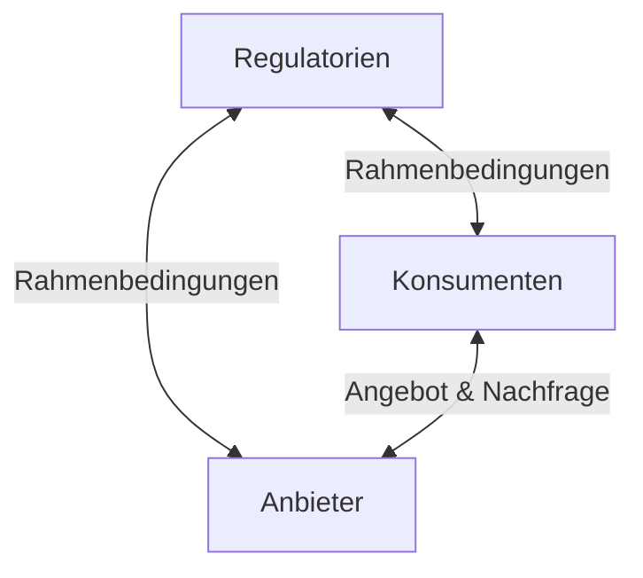
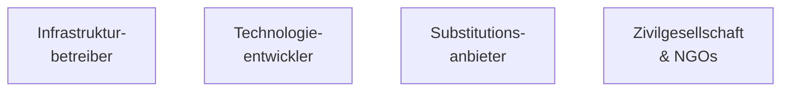
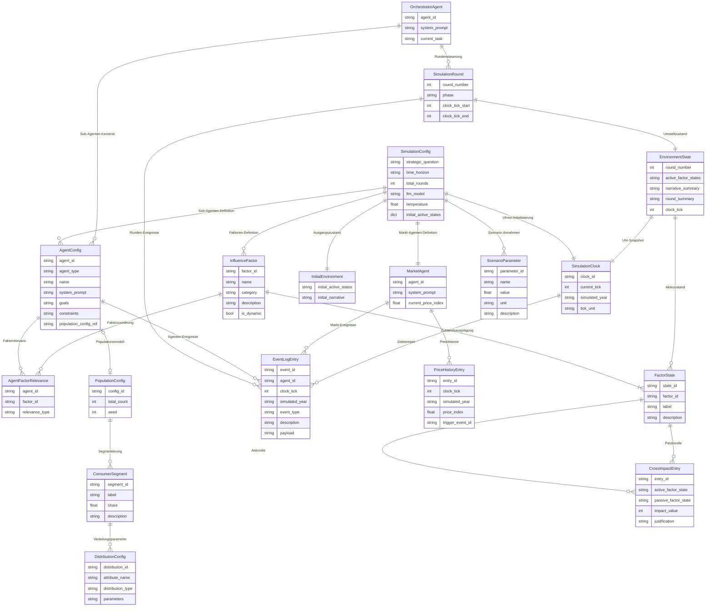

# Challenge 1: Domänenrepräsentation

## Projektkontext

| Attribut | Wert |
|----------|------|
| **Forschungsprojekt** | Entwicklung einer prototypischen multiagentischen Simulationsumgebung für die Szenarioplanung im Strategic Foresight |
| **Challenge** | C1 – Domänenrepräsentation |
| **Domäne** | System Flugverkehr |
| **Methodik** | Ludewig, J. & Lichter, H. (2023): Software Engineering – Grundlagen, Menschen, Prozesse, Techniken. 4. Aufl., dpunkt.verlag. |
| **Technischer Stack** | Python, LangGraph, Ollama (lokale LLMs) |
| **Stand** | Analyse (Systemabgrenzung, Glossar, Stakeholder, Anforderungen, Modelle)  |

---

## Inhaltsverzeichnis

- [1 Problemdomäne verstehen & abgrenzen](#1-problemdomäne-verstehen--abgrenzen)
  - [1.1 Festgelegte Systemgrenzen](#11-festgelegte-systemgrenzen)
  - [1.2 Herleitung der Akteure](#12-herleitung-der-akteure)
    - [1.2.1 MVP-Akteure für Workbench](#121-mvp-akteure-für-workbench)
    - [1.2.2 Weitere Akteure](#122-weitere-akteure)
    - [1.2.3 Sub-Agenten Überlegung](#123-sub-agenten-überlegung)
    - [1.2.4 Akteurübersicht](#124-akteurs-übersicht)
  - [1.3 Herleitung der Einflussfaktoren](#13-herleitung-der-einflussfaktoren)
  - [1.4 Faktor-Zustände](#14-faktor-zustände)
  - [1.5 Beziehungstypen](#15-beziehungstypen)
- [2 Begriffslexikon / Glossar](#2-begriffslexikon--glossar)
  - [2.1 Systemkonzepte](#21-systemkonzepte)
  - [2.2 Akteure](#22-akteure)
  - [2.3 Einflussfaktoren](#23-einflussfaktoren)
- [3 Stakeholder-Identifikation](#3-stakeholder-identifikation)
- [4 Anforderungserhebung](#4-anforderungserhebung)
  - [4.1 Funktionale Anforderungen (User Stories)](#41-funktionale-anforderungen-user-stories)
  - [4.2 Nicht-funktionale Anforderungen](#42-nicht-funktionale-anforderungen)
  - [4.3 Abgrenzung (Out of Scope)](#43-abgrenzung-out-of-scope)
- [5 Modelle & Diagramme](#5-modelle--diagramme)
  - [5.1 ERM](#51-erm)
  - [5.2 Klassendiagramme](#52-klassendiagramme)
  - [5.3 Aktivitätsdiagramm](#53-aktivitätsdiagramm)
- [6 Quellenverzeichnis](#6-quellenverzeichnis)

---

## 1 Problemdomäne verstehen & abgrenzen

> **Methodische Grundlage:** Orientiert an Ludewig & Lichter, Kap. 15.2.3, beginnen wir damit, den IST-Zustand festzustellen und die Domäne zu verstehen und abzugrenzen. Ziel ist es, den Untersuchungsgegenstand so zu beschreiben, dass alle Beteiligten ein gemeinsames Verständnis des zu modellierenden Systems entwickeln.

### 1.1 Festgelegte Systemgrenzen

| Parameter | Festlegung | Begründung |
|-----------|------------|------------|
| **Zeitlicher Horizont** | 10 Jahre (2025–2035) | Lang genug für strukturelle Veränderungen, kurz genug für plausible Annahmen |
| **Geographischer Scope** | International | Regularien sind meistens international geregelt |
| **Szenariotyp** | Explorativ (Was kann passieren?) | Vorgabe & CIB-Matrix |
| **Akteure & Faktoren** | 3 Akteure, 7 Faktoren | MVP für Weiterentwicklung |

### 1.2 Akteure 

Die Identifikation der Akteure ist essenziell, um das soziotechnische System abzubilden. Um die technische und methodische Machbarkeit der Simulationsumgebung (Workbench) zu validieren, setzen wir auf einen iterativen Ansatz. Wir beginnen mit einem Minimum Viable Product (MVP), das im weiteren Verlauf modular erweitert werden kann.

### 1.2.1 MVP-Akteure für Workbench

Für die erste Iteration des Prototyps beschränken wir uns auf die drei fundamentalsten Akteure des Systems, die das klassische Marktdreieck (Angebot, Nachfrage, Rahmenbedingungen) abbilden.

| MVP-Akteure | Beschreibung |
|-----------|------------|
| Konsumenten | Privat- und Geschäftsreisende → treffen Reiseentscheidungen |
| Anbieter | Fluggesellschaften → setzen Preise, Routen, investieren |
| Regulatorien | EU-Kommission, nationale Regierungen, (EASA, ICAO) → setzen Rahmenbedingungen |

Begründung für MVP: Die Beschränkung auf drei Hauptakteure dient in der ersten Entwicklungsphase der Komplexitätsreduktion. So können wir die grundlegende Architektur (Python, LangGraph, Ollama) und die Interaktionslogik der LLM-Agenten testen, ohne an Performanz-Grenzen zu stoßen. Sobald der Basis-Workflow stabil ist, lässt sich dieses Setup dank der modularen Architektur durch weitere Akteure erweitern.

### 1.2.2 Weitere Akteure

Das reale Ökosystem des Flugverkehrs umfasst selbstverständlich weitere Akteure. Nachfolgend sind weitere identifizierte Akteure aufgeführt, die jedoch bewusst nicht in der ersten Iteration berücksichtigt werden, um den Scope des Prototyps nicht zu sprengen:

| Weitere Akteure | Beschreibung |
|-----------|------------|
| Infrastrukturbetreiber | Flughäfen → stellen Kapazitäten bereit und steuern den operativen Betrieb. |
| Technologieentwickler | Flugzeughersteller (Airbus, Boeing), Treibstoffproduzenten → bestimmen den technologischen Fortschritt (F3). |
| Substitutionsanbieter | Bahnunternehmen, Fernbusbetreiber → bieten konkurrierende Verkehrsmittel an und beeinflussen direkt die Verfügbarkeit von Alternativen (F5). |
| Zivilgesellschaft / NGOs | Umweltverbände, Bürgerinitiativen → üben gesellschaftlichen Druck aus und treiben den Wertewandel (F6). |

### 1.2.3 Sub-Agenten Überlegung

Neben der Hinzunahme völlig neuer Akteursgruppen ziehen wir für zukünftige Iterationen auch die Modellierung von sogenannten Sub-Agenten in Betracht. Das bedeutet, dass aggregierte Akteure in spezifischere Untergruppen aufgespalten werden (z.B. die Aufteilung der „Anbieter“ in Low-Cost-Carrier und Full-Service-Carrier, oder der „Konsumenten“ in Geschäftsreisende und Privaturlauber).

Die Modellierungsidee ist unter [subagent.md](/docs/challenge1/subagent.md) zu finden.

Wir berücksichtigen diese auch nicht in der ersten Iteration. Im weiteren Projektverlauf prüfen wir diese Alternativen und bauen den Prototyp anhand der gewonnenen Erkenntnisse nach Best Practices aus, um die für unsere Szenarioplanung optimale Granularität zu identifizieren.

### 1.2.4 Akteurübersicht

---

### 1.3 Herleitung der Einflussfaktoren 
Einflussfaktoren existieren auf verschiedenen Ebenen und Zeitskalen (Horx Zukunftsinstitut GmbH, 2010, S.3-4):

| Ebene | Zeithorizont | Beispiel |
|---|---|---|
| Metatrends | Evolutionäre Konstanten | Steigende Komplexität |
| Megatrends | >50 Jahre, global, alle Lebensbereiche | Digitalisierung, Klimawandel |
| Soziokulturelle Trends | ~10 Jahre | Nachhaltigkeit als Lebensstil |
| Konsumtrends | ~5 Jahre | Nachfrage nach „grünem Fliegen" |
| Mikrotrends | Saison/kurzfristig | Buchungsverhalten bei Krisen |

Für die Szenarioplanung im Flugverkehr sind insbesondere relevant:
- **Megatrends**: Dekarbonisierung, Digitalisierung, Globalisierung/Deglobalisierung, demografischer Wandel
- **Soziokulturelle Trends**: Sustainable Aviation Fuel (SAF), emissionsfreie Antriebe, multimodale Mobilität
- **Konsumtrends**: EU-ETS, CO₂-Bepreisung, Kurzstreckenverbote

Für die Modellierung des Systems „Flugverkehr" ist zudem das Verständnis von Marktmechanismen, Preisbildung und Nachfrageelastizität zentral (basierend auf Evangelinos et al., 2011, S.2 ff.):

Preisdispersion im Luftverkehr entsteht durch:
1. **Preisdifferenzierung** basierend auf unterschiedlichen Nachfrageelastizitäten (Geschäftsreisende vs. Freizeitreisende)
2. **Nachfrageschwankungen** (Peak-Load Pricing bei hoher/niedriger Nachfrage)
3. **Nachfrageunsicherheit** (stochastische Nachfrage erfordert dynamische Preisanpassung)

Zusammenhang zwischen Wettbewerb und Preisdispersion:
- **Monopoleffekt**: Bewirkt, dass zunehmender Wettbewerb die Preisaufschläge reduziert, wobei preisunelastische Passagiere stärker betroffen sind → Preisdispersion sinkt (vgl. Evangelinos et al., 2011, S. 5)
- **Wettbewerbs-/Markeneffekt**: Bewirkt, dass preiselastische Passagiere stärker auf Konkurrenz reagieren → Preisdispersion kann steigen (vgl. Evangelinos et al., 2011, S. 6)
- **Anreizkompatibilitätseffekt**: Beschränkt bei Preisdifferenzierung zweiter Ordnung die Preisdifferenz → Preisdispersion kann sinken (vgl. Evangelinos et al., 2011, S. 7)
- **Nicht-monotone Zusammenhänge**: In konzentrierten Märkten steigt Preisdispersion mit Wettbewerb, in weniger konzentrierten sinkt sie (vgl. Evangelinos et al., 2011, S. 12-15)

**Analogie zum Delay-Effekt (Spritpreis-Beispiel, Sprechstunde):**
Unterschiedliche Nachfragergruppen reagieren unterschiedlich schnell und stark auf Preisänderungen. So reagieren Geschäftsreisende (analog zu Motorradfahrern im Spritpreis-Beispiel) kaum auf höhere Flugpreise, während Freizeitreisende (analog zu Autofahrern) verzögert, aber deutlich reagieren. Die heterogene Elastizität und die zeitliche Verzögerung sind essenziell für die dynamische Simulation.

**Sättigungseffekte:** Ab einem bestimmten Niveau der Nachfrage oder der Kapazitätsauslastung treten Sättigungseffekte ein, bei denen weitere Impulse keinen proportionalen Einfluss mehr haben. Dies ist bei der Dynamisierung der Einflussfaktoren zu berücksichtigen.

Die identifizierten Einflussfaktoren wurden mittels einer PESTLE-Analyse (Political, Economic, Social, Technological, Legal, Environmental) kategorisiert und mit den Megatrends aus dem Zukunftsinstitut (2025) abgeglichen:

| # | Einflussfaktor | PESTLE-Kategorie | Beschreibung | Bezug zu Megatrends |
|---|---|---|---|---|
| **F1** | Mobilitätsbedürfnis / Nachfrage (vgl. Braun et al, 2023, S. 22) | Social | Wie stark wollen Menschen fliegen? | Globalisierung, Identitätsdynamik |
| **F2** | Regulatorische Strenge (vgl. Braun et al, 2023, S. 4) | Political / Environmental / Legal | Welche klimapolitischen Leitplanken werden gesetzt? | Ökointelligenz |
| **F3** | Technologische Reife (Dekarbonisierung) (vgl. Braun et al, 2023, S. 9) | Technological | Wie weit sind SAF, E-Aviation, H₂? | Konnektivität, Ökointelligenz |
| **F4** | Wirtschaftliche Entwicklung (vgl. Braun et al, 2023, S. 9) | Economic | Konjunktur, Kaufkraft, Energiepreise | Globalisierung, Demographischer Wandel|
| **F5** | Verfügbarkeit von Alternativen (vgl. Evangelinos, 2011, S. 6) | Technological / Political / Legal | Schiene, digitale Substitution, Intermodalität | Mobilität, Konnektivität |
| **F6** | Gesellschaftlicher Wertewandel (Horx Zukunftsinstitut GmbH, 2010, S.3) | Social / Environmental | Klimabewusstsein, Flight Shaming, Normen | Ökointelligenz, Identitätsdynamik |
| **F7** | Geopolitische Stabilität (vgl. Braun et al, 2023, S. 9) | Political / Security | Offene Lufträume, Konflikte, Pandemien | Sicherheit, Globalisierung |

**Prüfung auf Eindeutigkeit:**

| Prüfung | Ergebnis |
|---------|----------|
| F1 vs. F6 | F1 = beobachtbare Nachfrage (Menge), quantifizierbar, F6 = zugrundeliegende Werthaltung → F6 *treibt* F1, aber nicht identisch. **Beide behalten.** |
| F2 vs. F6 | F2 = staatliches Handeln, F6 = gesellschaftliche Haltung → Politik kann der Gesellschaft vorauseilen oder hinterherhinken. **Beide behalten.** |
| F3 vs. F5 | F3 = Technologie im Flugverkehr selbst, F5 = Alternativen außerhalb → klar getrennt. **Beide behalten.** |

**Ergebnis: 7 Einflussfaktoren**, alle eindeutig differenzierbar.

### 1.4 Faktor-Zustände

Jeder Faktor weist einen erkennbaren Unterschied auf:

| Faktor | Zustand 1 (Kontinuität) | Zustand 2 (Transformation) |
|--------|--------------------------|----------------------------|
| **F1** Mobilitätsbedürfnis | F1.1: Globaler Reiseboom, ungebrochenes Wachstum | F1.2: Stagnation & Verzicht, Substitution |
| **F2** Regulatorische Strenge | F2.1: Moderater Klimaschutz, Kompensationsfokus | F2.2: Radikale Dekarbonisierung, Verbote |
| **F3** Technologische Reife | F3.1: Inkrementelle Verbesserungen, SAF teuer | F3.2: Durchbruch bei SAF/E-Fuels/H₂ |
| **F4** Wirtschaftliche Entwicklung | F4.1: Stabiles Wachstum, moderate Inflation | F4.2: Rezession / Stagflation |
| **F5** Verfügbarkeit Alternativen | F5.1: Schiene stagniert, Fliegen alternativlos | F5.2: Massiver Schienenausbau, Intermodalität |
| **F6** Gesellsch. Wertewandel | F6.1: Fliegen bleibt akzeptiert | F6.2: Starkes Klimabewusstsein, Flight Shaming |
| **F7** Geopolitische Stabilität | F7.1: Offene Märkte, Kooperation | F7.2: Fragmentierung, Konflikte |

> Hinweis: Für den MVP sind 2 unterschiedliche Zustände ausreichend. In späteren Iterationen besteht die Möglichkeit, weitere Zustände je Faktor zu implementieren.

### 1.5 Beziehungstypen

| Beziehungstyp | Definition | Beispiel |
|---|---|---|
| **Akteur → Akteur** | Ein Akteur beeinflusst durch sein Handeln die Entscheidungen oder Handlungsmöglichkeiten eines anderen Akteurs | Konsument → Anbieter (Kauf/Kein Kauf)
| **Faktor → Akteur** | Ein Einflussfaktor verändert die Rahmenbedingungen, unter denen ein Akteur agiert | F4 (Rezession) → Anbieter (Kostendruck, Streckenabbau) |
| **Akteur → Faktor** | Ein Akteur beeinflusst durch sein Handeln die Ausprägung eines Einflussfaktors | Anbieter → F6 (Ökonomische Flüge → Akzeptanz CO2-Ausstoß ) |
| **Faktor ↔ Faktor** | Zwei Einflussfaktoren verstärken oder hemmen sich gegenseitig (Cross-Impact) | F6 (Wertewandel) → F2 (legitimiert strengere Regulierung) |

---

## 2 Begriffslexikon / Glossar

> **Methodische Grundlage:** Gemäß Ludewig & Lichter, Kap. 15.3, definiert und klärt ein Begriffslexikon zentrale Begriffe eindeutig, welche möglicherweise von verschiedenen Leuten unterschiedlich ausgelegt werden. Es dient als gemeinsame Sprache zwischen allen Beteiligten und verhindert Missverständnisse. Das Begriffslexikon ist ein lebendes Dokument, das während des gesamten Projekts gepflegt wird.

> *Hinweis*: Begriffslexikon wurde unter Zuhilfename von KI (Claude Opus 4.6) erstellt. KI diente hier zur Ausformulierung der einzelnen Begriffe. Diese werden im nächsten Iterationsschritt überprüft und im Plenum definiert.

### Struktur jedes Eintrags

| Feld | Beschreibung |
|------|-------------|
| **Begriff** | Kanonischer Name |
| **Synonyme** | Alternative Bezeichnungen |
| **Kategorie** | Systemkonzept / Akteur / Einflussfaktor / Zustand / Beziehung |
| **Definition** | Präzise, eindeutige Beschreibung |
| **Abgrenzung** | Was der Begriff *nicht* meint |
| **Beziehungen** | Verbindungen zu anderen Glossarbegriffen |

### 2.1 Systemkonzepte

#### Soziotechnisches System

| Feld | Inhalt |
|------|--------|
| **Begriff** | Soziotechnisches System |
| **Synonyme** | Soziotechnisches Gefüge, Socio-Technical System |
| **Kategorie** | Systemkonzept |
| **Definition** | Ein System, in dem menschliche (soziale) und technische Komponenten untrennbar miteinander verwoben sind und sich wechselseitig beeinflussen. Im Kontext dieses Projekts bezeichnet es das Zusammenspiel von Akteuren (Menschen, Organisationen, Institutionen) mit technischen Infrastrukturen, Regularien und gesellschaftlichen Normen innerhalb einer Domäne. |
| **Abgrenzung** | Kein rein technisches System (z.B. ein Triebwerk) und kein rein soziales System (z.B. eine Familienstruktur). Die Betonung liegt auf der Wechselwirkung zwischen sozialen und technischen Elementen. |
| **Beziehungen** | Enthält → Akteure, Einflussfaktoren, Wechselwirkungen. Wird untersucht durch → Szenarioplanung. |

#### Domäne

| Feld | Inhalt |
|------|--------|
| **Begriff** | Domäne |
| **Synonyme** | Problemdomäne, Anwendungsdomäne |
| **Kategorie** | Systemkonzept |
| **Definition** | Der fachliche Gegenstandsbereich, der modelliert und simuliert wird. In diesem Projekt ist die Domäne das System Flugverkehr in Europa mit einem Zeithorizont von 2025–2035. Die Domäne umfasst alle relevanten Akteure, Einflussfaktoren und deren Wechselwirkungen, die die Zukunftsentwicklung des europäischen Flugverkehrs bestimmen. |
| **Abgrenzung** | Die Domäne ist nicht das gesamte Mobilitätssystem. Konkurrierende Verkehrsträger (Bahn, Bus) werden als exogener Einflussfaktor modelliert, nicht als Teil der Domäne selbst. |
| **Beziehungen** | Wird repräsentiert durch → Domänenmodell. Enthält → Akteure, Einflussfaktoren. |

#### Szenario

| Feld | Inhalt |
|------|--------|
| **Begriff** | Szenario |
| **Synonyme** | Zukunftsszenario, Szenariobild |
| **Kategorie** | Systemkonzept |
| **Definition** | Eine in sich konsistente, plausible Beschreibung eines möglichen zukünftigen Zustands des soziotechnischen Systems. Ein Szenario ergibt sich aus einer bestimmten Kombination von Faktor-Zuständen und beschreibt qualitativ, wie sich das System unter diesen Bedingungen entwickelt. Ein Szenario ist keine Prognose (keine Wahrscheinlichkeitsaussage), sondern eine explorative Erzählung über eine mögliche Zukunft. |
| **Abgrenzung** | Kein Forecast (wahrscheinlichste Entwicklung), keine Planung (gewünschte Entwicklung). Ein Szenario beschreibt was passieren kann, nicht was passieren wird oder soll. |
| **Beziehungen** | Wird erzeugt durch → Szenarioplanung, Cross-Impact-Analyse. Besteht aus → Kombination von Faktor-Zuständen. Wird beschrieben durch → Simulationsstand / Gesprächsprotokoll. |

#### Szenarioplanung

| Feld | Inhalt |
|------|--------|
| **Begriff** | Szenarioplanung |
| **Synonyme** | Scenario Planning, Szenarioentwicklung |
| **Kategorie** | Systemkonzept |
| **Definition** | Eine strukturierte Methode innerhalb des Strategic Foresight, bei der mehrere plausible Zukunftsszenarien systematisch entwickelt werden. Der Prozess umfasst fünf generische Phasen: (1) Zentrale Fragestellung identifizieren, (2) Haupttreiber identifizieren, (3) Szenariologik bestimmen, (4) Szenarioannahmen beschreiben, (5) Analyse der Szenarien. |
| **Abgrenzung** | Nicht gleichzusetzen mit dem gesamten Strategic-Foresight-Prozess, der auch Environmental Scanning, Visioning und Strategy Development umfasst. |
| **Beziehungen** | Ist Phase von → Strategic Foresight. Nutzt → Einflussfaktoren, Cross-Impact-Analyse. Erzeugt → Szenarien. |

#### Cross-Impact-Bilanz (CIB)

| Feld | Inhalt |
|------|--------|
| **Begriff** | Cross-Impact-Bilanz |
| **Synonyme** | Cross-Impact-Balance-Analyse, CIB, Wechselwirkungsmatrix |
| **Kategorie** | Systemkonzept |
| **Definition** | Eine analytische Methode zur systematischen Erfassung und Bewertung der paarweisen Wechselwirkungen zwischen den Zuständen verschiedener Einflussfaktoren. In einer CIB-Matrix wird für jedes Paar von Faktor-Zuständen numerisch bewertet, wie stark ein aktiver Zustand einen passiven Zustand fördert (positive Werte) oder hemmt (negative Werte). Typische Skala: −3 (stark hemmend) bis +3 (stark fördernd), 0 = kein Einfluss. Aus der Matrix lassen sich konsistente Szenariokombinationen ableiten. |
| **Abgrenzung** | Keine rein qualitative Einschätzung; die CIB quantifiziert Wechselwirkungen auf einer ordinalen Skala. Keine kausale Modellierung im strengen Sinne, sondern eine Expertenbewertung von Einflussrichtung und -stärke. |
| **Beziehungen** | Operiert auf → Einflussfaktoren, Faktor-Zustände. Erzeugt → konsistente Szenariokombinationen. Wird in Challenge 3 reproduziert durch → Multiagentensystem. |

#### Cross-Impact-Bewertung

| Feld | Inhalt |
|------|--------|
| **Begriff** | Cross-Impact-Bewertung |
| **Synonyme** | CIB-Eintrag, Wechselwirkungsbewertung, Cross-Impact Entry |
| **Kategorie** | Systemkonzept |
| **Definition** | Eine einzelne, gerichtete Bewertung der Wechselwirkung zwischen zwei Faktor-Zuständen innerhalb der Cross-Impact-Bilanz. Sie besteht aus dem aktiven Zustand (Ursache), dem passiven Zustand (Wirkung), einem numerischen Wirkungswert (−3 bis +3) und einer textuellen Begründung. |
| **Abgrenzung** | Nicht die gesamte Matrix (→ Cross-Impact-Bilanz), sondern ein einzelner Eintrag darin. |
| **Beziehungen** | Ist Teil von → Cross-Impact-Bilanz. Verweist auf → Faktor-Zustände. |

#### Simulationsstand

| Feld | Inhalt |
|------|--------|
| **Begriff** | Simulationsstand |
| **Synonyme** | Gesprächsprotokoll, Simulation State, Systemzustand |
| **Kategorie** | Systemkonzept |
| **Definition** | Der zu einem bestimmten Simulationszeitpunkt geltende Gesamtzustand des modellierten Systems. Er umfasst (a) die aktuellen Ausprägungen aller Einflussfaktoren, (b) die Positionen und Reaktionen aller Akteure und (c) das kumulierte Gesprächsprotokoll der Agenten-Interaktionen. Der Simulationsstand ist das zentrale Arbeits- und Analyseergebnis der Simulation und dient als Grundlage für die Szenarioableitung. |
| **Abgrenzung** | Kein einzelner Faktorwert, sondern die Gesamtheit aller Systemzustände zu einem Zeitpunkt. |
| **Beziehungen** | Wird erzeugt durch → Multiagentensystem. Wird exploriert durch → Chat-Interface (Challenge 4). Bildet Grundlage für → Szenarioableitung. |

#### Weak Signal

| Feld | Inhalt |
|------|--------|
| **Begriff** | Weak Signal |
| **Synonyme** | Schwaches Signal, Frühindikator |
| **Kategorie** | Systemkonzept |
| **Definition** | Ein schwaches, frühzeitiges Anzeichen für eine möglicherweise bedeutsame zukünftige Veränderung, das zum Zeitpunkt seines Auftretens noch mehrdeutig, unvollständig und leicht zu übersehen ist. Weak Signals können auf entstehende Trends, Diskontinuitäten oder disruptive Entwicklungen hindeuten. Im Kontext dieses Projekts dienen sie (perspektivisch in Challenge 4) als Trigger zur Dynamisierung von Einflussfaktoren. |
| **Abgrenzung** | Kein etablierter Trend (der bereits sichtbar und breit anerkannt ist). Kein Rauschen (zufällige Datenpunkte ohne Bedeutung). Die Unterscheidung zwischen Weak Signal und Rauschen erfordert Interpretation. |
| **Beziehungen** | Kann dynamisieren → Einflussfaktoren. Wird erkannt durch → Environmental Scanning. Relevant für → Challenge 4. |

### 2.2 Akteure 

#### A1: Regulatorien / Politik

| Feld | Inhalt |
|------|--------|
| **Begriff** | Regulatorien / Politik |
| **Synonyme** | Regulierer, Regulator, Politische Entscheider |
| **Kategorie** | Akteur |
| **Definition** | Staatliche und überstaatliche Institutionen, die den Ordnungsrahmen für den Flugverkehr setzen. Dazu gehören die EU-Kommission (Emissionshandel ETS, Fit-for-55-Paket), nationale Regierungen (Luftverkehrsteuer, Kurzstreckenverbote), die EASA (European Union Aviation Safety Agency, Zertifizierung neuer Technologien) und die ICAO (internationale Standards). Ihre Handlungslogik folgt politischen Zielen: Klimaschutz, Wirtschaftsförderung, Wählerzufriedenheit, internationale Wettbewerbsfähigkeit. |
| **Abgrenzung** | Nicht die operative Flugsicherung (DFS), die eher technisch-operativ agiert. Nicht die Justiz (Gerichte), die Regeln anwendet, aber nicht gestaltet. |
| **Beziehungen** | Beeinflusst direkt → Anbieter (durch Auflagen, Steuern), Infrastrukturbetreiber (Genehmigungen), Technologieentwickler (Förderung, Zertifizierung). Wird beeinflusst von → Zivilgesellschaft (Druck), Konsumenten (Wählerwille). Primär zugeordnete Einflussfaktoren → F2 (Regulatorische Strenge), F6 (Wertewandel als Treiber politischen Handelns). |

#### A2: Konsumenten / Nachfrager

| Feld | Inhalt |
|------|--------|
| **Begriff** | Konsumenten / Nachfrager |
| **Synonyme** | Passagiere, Fluggäste, Reisende, Demand Side |
| **Kategorie** | Akteur |
| **Definition** | Die Gesamtheit der Personen und Organisationen, die Flugreisen nachfragen. Dies umfasst Privatreisende (Urlaub, Familienbesuche), Geschäftsreisende (Dienstreisen, Konferenzen) und Frachtkunden (Unternehmen mit Luftfrachtbedarf). Ihre Entscheidungen werden getrieben durch Preis, Reisezeit, Komfort, Verfügbarkeit von Alternativen, persönliche Werthaltungen (Klimabewusstsein) und wirtschaftliche Rahmenbedingungen (Kaufkraft). Sie sind die nachfrageseitige Kraft im System. |
| **Abgrenzung** | Nicht die Airlines (die sind Anbieter). Nicht die Zivilgesellschaft als organisierte Interessengruppe – ein Konsument wird zur Zivilgesellschaft, wenn er sich politisch organisiert (z.B. Petition gegen Flughafenausbau), aber nicht wenn er eine individuelle Reiseentscheidung trifft. |
| **Beziehungen** | Beeinflusst direkt → Anbieter (durch Nachfrage und Zahlungsbereitschaft), Regulatorien (als Wähler). Wird beeinflusst von → Anbieter (Preise, Angebot), Zivilgesellschaft (soziale Normen), Regulatorien (Steuern, Verbote). Primär zugeordnete Einflussfaktoren → F1 (Mobilitätsbedürfnis), F4 (Wirtschaftliche Entwicklung), F6 (Wertewandel). |

#### A3: Anbieter / Airlines

| Feld | Inhalt |
|------|--------|
| **Begriff** | Anbieter / Airlines |
| **Synonyme** | Fluggesellschaften, Carrier, Luftverkehrsgesellschaften, Supply Side |
| **Kategorie** | Akteur |
| **Definition** | Unternehmen, die den Personen- und Frachttransport auf dem Luftweg anbieten. Dazu gehören Full-Service-Carrier (Lufthansa, Air France-KLM), Low-Cost-Carrier (Ryanair, easyJet) und Frachtfluggesellschaften (Cargolux). Ihre Handlungslogik ist primär ökonomisch: Maximierung von Auslastung und Ertrag, Minimierung von Kosten, Reaktion auf Regulierung und Nachfrageverschiebungen. Strategische Entscheidungen umfassen Routennetzplanung, Flotteninvestitionen, Preispolitik und Nachhaltigkeitsstrategien. |
| **Abgrenzung** | Nicht die Flugzeughersteller (→ Technologieentwickler). Nicht die Flughäfen (→ Infrastrukturbetreiber). Airlines nutzen Technologie und Infrastruktur, entwickeln und betreiben diese aber nicht primär selbst. |
| **Beziehungen** | Beeinflusst direkt → Konsumenten (Preise, Angebot, Routen), Infrastrukturbetreiber (Slot-Nachfrage), Technologieentwickler (Bestellungen, Anforderungen). Wird beeinflusst von → Regulatorien (Auflagen, Steuern), Konsumenten (Nachfrage), Technologieentwickler (verfügbare Flugzeuge/Kraftstoffe), Infrastrukturbetreiber (Kapazitäten). Primär zugeordnete Einflussfaktoren → F1 (Nachfrage), F2 (Regulierung), F3 (Technologie), F4 (Wirtschaftslage). |

#### A4: Infrastrukturbetreiber / Flughäfen

| Feld | Inhalt |
|------|--------|
| **Begriff** | Infrastrukturbetreiber / Flughäfen |
| **Synonyme** | Airports, Flughafenbetreiber, Bodeninfrastruktur |
| **Kategorie** | Akteur |
| **Definition** | Organisationen, die die physische Infrastruktur für den Flugverkehr bereitstellen und betreiben. Dazu gehören Flughafenbetreibergesellschaften (Fraport, Aéroports de Paris, Schiphol Group) sowie Flugsicherungsorganisationen (DFS, Eurocontrol) und Bodenabfertigungsdienste. Ihre Handlungslogik ist geprägt durch langfristige Investitionszyklen (Pistenausbau, Terminalerweiterung dauern Jahrzehnte), lokalpolitische Spannungen (Lärmschutz, Nachtflugverbote) und die Abhängigkeit von Airline-Nachfrage. Sie sind Enabler und Engpass zugleich. |
| **Abgrenzung** | Nicht die Airlines, die die Infrastruktur nutzen. Nicht die staatliche Regulierung, obwohl viele Flughäfen in öffentlicher Hand sind – ihre operative Logik (Kapazitätsplanung, Entgelte) unterscheidet sich von der politischen Logik (Gesetze, Steuern). |
| **Beziehungen** | Beeinflusst direkt → Anbieter (Kapazitäten, Entgelte, Slots), Konsumenten (Erreichbarkeit, Reisequalität). Wird beeinflusst von → Regulatorien (Genehmigungen, Umweltauflagen), Anbieter (Nachfrage nach Slots), Zivilgesellschaft (Proteste gegen Ausbau/Lärm). Primär zugeordnete Einflussfaktoren → F1 (Nachfrage), F2 (Regulierung), F7 (Geopolitik). |

#### A5: Technologieentwickler

| Feld | Inhalt |
|------|--------|
| **Begriff** | Technologieentwickler |
| **Synonyme** | Hersteller, OEMs, Innovatoren, Technology Providers |
| **Kategorie** | Akteur |
| **Definition** | Unternehmen und Forschungseinrichtungen, die die technologischen Grundlagen des Flugverkehrs entwickeln und bereitstellen. Dies umfasst Flugzeughersteller (Airbus, Boeing, Embraer), Triebwerkshersteller (Rolls-Royce, CFM, Pratt & Whitney), SAF-Produzenten (Neste, SkyNRG), Startups im Bereich E-Aviation und Urban Air Mobility (Lilium, Volocopter) sowie Forschungseinrichtungen (DLR, Fraunhofer). Ihre Handlungslogik ist geprägt durch extrem lange Entwicklungszyklen (10–15 Jahre für ein neues Flugzeugmuster), hohe Investitionskosten und Zertifizierungsanforderungen. |
| **Abgrenzung** | Nicht die Airlines, die Technologie einsetzen. Nicht die Regulatoren, die Technologie zertifizieren. Der Fokus liegt auf Akteuren, die neue technologische Optionen schaffen. |
| **Beziehungen** | Beeinflusst direkt → Anbieter (verfügbare Flugzeuge, Kraftstoffoptionen), Regulatorien (Machbarkeitsnachweis ermöglicht strengere Regulierung). Wird beeinflusst von → Regulatorien (Förderprogramme, Zertifizierung), Anbieter (Bestellungen), wirtschaftliche Entwicklung (Investitionsbereitschaft). Primär zugeordnete Einflussfaktoren → F3 (Technologische Reife), F4 (Wirtschaftslage). |

#### A6: Zivilgesellschaft / NGOs

| Feld | Inhalt |
|------|--------|
| **Begriff** | Zivilgesellschaft / NGOs |
| **Synonyme** | Nichtregierungsorganisationen, Bürgerinitiativen, Civil Society, Interessengruppen |
| **Kategorie** | Akteur |
| **Definition** | Organisierte gesellschaftliche Gruppen, die im öffentlichen Diskurs Einfluss auf die Entwicklung des Flugverkehrs nehmen, ohne selbst am Marktgeschehen (Angebot/Nachfrage) direkt teilzunehmen. Dazu gehören Umwelt-NGOs (Greenpeace, BUND, Transport & Environment), Klimabewegungen (Fridays for Future, Stay Grounded), Bürgerinitiativen (Fluglärm-Gegner, Ausbau-Gegner) und Think Tanks (Agora Verkehrswende). Ihre Handlungslogik ist wertegetrieben: Sie setzen Themen auf die Agenda, mobilisieren öffentliche Meinung, betreiben Lobbyarbeit und schaffen sozialen Druck. |
| **Abgrenzung** | Nicht der einzelne Konsument in seiner Kaufentscheidung – sondern die organisierte, politische Artikulation gesellschaftlicher Werte und Interessen. Nicht die Medien (die berichten, aber keine eigene Agenda im Flugverkehr verfolgen). Nicht die Politik (die entscheidet, nicht nur fordert). |
| **Beziehungen** | Beeinflusst direkt → Regulatorien (Lobbyarbeit, öffentlicher Druck), Konsumenten (Normbildung, Awareness-Kampagnen), Anbieter (Reputationsrisiko). Wird beeinflusst von → gesellschaftlicher Wertewandel (Mobilisierungspotenzial), Regulatorien (werden Forderungen umgesetzt, sinkt der Druck). Primär zugeordnete Einflussfaktoren → F6 (Wertewandel), F2 (Regulierung als Ziel). |
### 2.3 Einflussfaktoren

#### F1: Mobilitätsbedürfnis / Nachfrage

| Feld | Inhalt |
|------|--------|
| **Begriff** | Mobilitätsbedürfnis |
| **Synonyme** | Flugnachfrage, Reisebedürfnis, Demand for Air Travel |
| **Kategorie** | Einflussfaktor |
| **Definition** | Das aggregierte Bedürfnis von Privatpersonen und Organisationen, den Luftverkehr für Personen- oder Gütertransport zu nutzen. Es wird getrieben durch Faktoren wie Globalisierungsgrad (internationale Verflechtung), Geschäftsreisekultur (vs. Remote Work), touristische Präferenzen (Fernreisen vs. Nahtourismus), demographische Entwicklung und individuelle Werthaltungen. Messgröße (qualitativ): Entwicklung der Passagierzahlen und Frachtvolumina im europäischen Luftverkehr. |
| **Zustände** | **F1.1 – Hohes Wachstum:** Globaler Reiseboom, Fliegen bleibt Standard für Fern- und Geschäftsreisen, steigende Passagierzahlen (+3–5% p.a.). / **F1.2 – Stagnation & Verzicht:** Wertewandel (Flight Shaming), Substitution durch Schiene und Videokonferenzen, stagnierende oder sinkende Passagierzahlen. |
| **Abgrenzung** | Nicht die Zahlungsbereitschaft (→ F4). Nicht das tatsächliche Flugaufkommen (das ist das Ergebnis von Nachfrage, Angebot und Regulierung). F1 beschreibt das Bedürfnis, unabhängig davon, ob es befriedigt wird. |
| **Beziehungen** | Wird beeinflusst von → F4, F5, F6, F7. Beeinflusst → Anbieter, Infrastrukturbetreiber. |

#### F2: Regulatorische Strenge

| Feld | Inhalt |
|------|--------|
| **Begriff** | Regulatorische Strenge |
| **Synonyme** | Klimapolitische Regulierung, Umweltregulierung, Regulatory Stringency |
| **Kategorie** | Einflussfaktor |
| **Definition** | Der Grad, in dem staatliche und überstaatliche Institutionen den Flugverkehr durch verbindliche Vorschriften im Sinne des Klima- und Umweltschutzes einschränken oder verteuern. Dies umfasst CO₂-Bepreisung (EU ETS, CORSIA), Beimischungsquoten für nachhaltige Flugkraftstoffe (SAF-Mandate), Kurzstreckenflugverbote, Nachtflugverbote, Lärmschutzauflagen und Subventionsabbau (Kerosinsteuerbefreiung). |
| **Zustände** | **F2.1 – Moderater Klimaschutz:** Wirtschaftsfokus, Kompensationszertifikate, weiche Regulierung, niedrige CO₂-Preise (<50€/t). / **F2.2 – Radikale Dekarbonisierung:** Strenge CO₂-Steuern (>150€/t), verpflichtende SAF-Quoten (>20%), Kurzstreckenverbote, Flugkontingentierung. |
| **Abgrenzung** | Nicht der gesellschaftliche Wunsch nach Regulierung (→ F6), sondern die tatsächlich erlassenen und durchgesetzten Vorschriften. |
| **Beziehungen** | Wird beeinflusst von → F6, F3, Zivilgesellschaft. Beeinflusst → Anbieter, Technologieentwickler, Infrastrukturbetreiber, Konsumenten. |

#### F3: Technologische Reife (Dekarbonisierung)

| Feld | Inhalt |
|------|--------|
| **Begriff** | Technologische Reife |
| **Synonyme** | Technologischer Reifegrad, Technology Readiness, Dekarbonisierungstechnologie |
| **Kategorie** | Einflussfaktor |
| **Definition** | Der Entwicklungs- und Verfügbarkeitsgrad von Technologien, die eine substanzielle Reduktion der Klimawirkung des Flugverkehrs ermöglichen. Dies umfasst Sustainable Aviation Fuels (SAF) – synthetisches Kerosin, Biokraftstoffe, Power-to-Liquid –, elektrisches Fliegen (batterie-elektrisch für Kurzstrecken), Wasserstoffantriebe (Brennstoffzelle oder Direktverbrennung) und aerodynamische Effizienzgewinne (neue Flugzeugkonfigurationen wie Blended Wing Body). Der Faktor beschreibt nicht nur die technische Machbarkeit, sondern auch die wirtschaftliche Skalierbarkeit. |
| **Zustände** | **F3.1 – Inkrementelle Verbesserung:** SAF bleibt teuer (3–5× Kerosinpreis), E-Fliegen nur für Kleinstflugzeuge, kein Paradigmenwechsel. / **F3.2 – Technologischer Durchbruch:** SAF erreicht Kostenparität, Wasserstoff-Demonstratoren erfolgreich, Skaleneffekte greifen. |
| **Abgrenzung** | Nicht die Regulierung, die Technologieeinsatz vorschreibt (→ F2). Nicht die Investitionsentscheidung der Airlines (→ Akteur Anbieter). F3 beschreibt, was technisch möglich und wirtschaftlich darstellbar ist. |
| **Beziehungen** | Wird beeinflusst von → F4, Regulatorien, Technologieentwickler. Beeinflusst → F2, Anbieter, Konsumenten. |

#### F4: Wirtschaftliche Entwicklung

| Feld | Inhalt |
|------|--------|
| **Begriff** | Wirtschaftliche Entwicklung |
| **Synonyme** | Konjunkturlage, Economic Development, Makroökonomisches Umfeld |
| **Kategorie** | Einflussfaktor |
| **Definition** | Die gesamtwirtschaftliche Lage in Europa und den relevanten Quellmärkten, die Kaufkraft, Investitionsbereitschaft und Kostenstrukturen im Flugverkehr bestimmt. Relevante Indikatoren: BIP-Wachstum, verfügbares Einkommen, Inflationsrate, Energiepreise (insb. Kerosinpreis), Wechselkurse, Arbeitsmarktlage. |
| **Zustände** | **F4.1 – Stabiles Wachstum:** Moderates BIP-Wachstum (1–3% p.a.), stabile Energiepreise, solide Kaufkraft. / **F4.2 – Rezession / Stagflation:** Wirtschaftliche Stagnation oder Schrumpfung, hohe Energiepreise, sinkende Kaufkraft. |
| **Abgrenzung** | Nicht das individuelle Konsumverhalten (→ F1/F6), sondern die makroökonomischen Rahmenbedingungen. |
| **Beziehungen** | Wird beeinflusst von → F7. Beeinflusst → F1, F3, Anbieter, Konsumenten. |

#### F5: Verfügbarkeit von Alternativen

| Feld | Inhalt |
|------|--------|
| **Begriff** | Verfügbarkeit von Alternativen |
| **Synonyme** | Substitutionspotenzial, Intermodale Konkurrenz, Alternative Mobility Options |
| **Kategorie** | Einflussfaktor |
| **Definition** | Der Grad, in dem reale, wettbewerbsfähige Alternativen zum Fliegen für relevante Reisezwecke und -distanzen existieren. Dies umfasst (a) Hochgeschwindigkeitsschiene (TGV, ICE), (b) Fernbusse, (c) digitale Substitution (Videokonferenzen) und (d) intermodale Angebote (nahtlose Bahn-Flug-Kombination). Entscheidend sind Reisezeit, Preis, Komfort und Verfügbarkeit. |
| **Zustände** | **F5.1 – Geringe Alternativen:** Schienenausbau stagniert, intermodale Buchung umständlich, Fliegen bleibt auf vielen Relationen alternativlos. / **F5.2 – Starke Alternativen:** Massiver HGV-Ausbau, nahtlose Intermodalität, Videokonferenz-Kultur – Fliegen wird unter 800km unattraktiv. |
| **Abgrenzung** | Nicht der Wunsch nach Alternativen (→ F6), sondern die tatsächliche Verfügbarkeit und Wettbewerbsfähigkeit. Nicht die Technologieentwicklung im Flugverkehr selbst (→ F3). |
| **Beziehungen** | Wird beeinflusst von → Regulatorien, F4. Beeinflusst → F1, Anbieter, Konsumenten. |

#### F6: Gesellschaftlicher Wertewandel

| Feld | Inhalt |
|------|--------|
| **Begriff** | Gesellschaftlicher Wertewandel |
| **Synonyme** | Normenwandel, Social Value Shift, Klimabewusstsein |
| **Kategorie** | Einflussfaktor |
| **Definition** | Die Veränderung der in der Gesellschaft vorherrschenden Werte, Normen und Einstellungen in Bezug auf Fliegen, Klimaverantwortung und nachhaltigen Konsum. Dieser Faktor beschreibt, inwieweit Klimabewusstsein vom Nischenthema zur dominierenden gesellschaftlichen Norm wird, die individuelles Verhalten und kollektive Erwartungen prägt. |
| **Zustände** | **F6.1 – Fliegen bleibt akzeptiert:** Klimaschutz ist ein Thema unter vielen, Fliegen wird nicht stigmatisiert, individuelle Freiheit dominiert. / **F6.2 – Starkes Klimabewusstsein:** Fliegen wird sozial geächtet (Flight Shaming), Konsumenten bevorzugen aktiv klimafreundliche Optionen. |
| **Abgrenzung** | Nicht das individuelle Reiseverhalten (→ F1). Nicht die politische Umsetzung (→ F2). F6 beschreibt die Tiefenströmung in der Gesellschaft. |
| **Beziehungen** | Wird beeinflusst von → Zivilgesellschaft, Weak Signals. Beeinflusst → F1, F2, Zivilgesellschaft, Anbieter. |

#### F7: Geopolitische Stabilität

| Feld | Inhalt |
|------|--------|
| **Begriff** | Geopolitische Stabilität |
| **Synonyme** | Geopolitische Lage, International Stability, Sicherheitslage |
| **Kategorie** | Einflussfaktor |
| **Definition** | Der Grad an politischer Stabilität, internationaler Kooperation und Sicherheit, der den grenzüberschreitenden Luftverkehr ermöglicht oder einschränkt. Umfasst offene vs. eingeschränkte Lufträume, internationale Abkommen, Sanktionen, Terrorismus- und Pandemierisiken sowie geopolitische Konflikte. |
| **Zustände** | **F7.1 – Stabile Weltordnung:** Offene Lufträume, funktionierende internationale Kooperation, geringe Sicherheitsrisiken. / **F7.2 – Fragmentierte Weltordnung:** Regionale Konflikte, gesperrte Lufträume, Visa-Restriktionen, De-Globalisierung. |
| **Abgrenzung** | Nicht die klimapolitische Regulierung (→ F2), sondern die sicherheits- und geopolitische Dimension. Nicht die wirtschaftlichen Folgen von Konflikten (→ F4). |
| **Beziehungen** | Wird beeinflusst von → exogene Faktoren. Beeinflusst → F1, F4, Anbieter, Infrastrukturbetreiber. |

---

## 3 Stakeholder

> **Methodische Grundlage:** Gemäß Ludewig & Lichter, Kap. 6.2.3, können Kunden sowohl natürliche als auch juristische Personen sein. Jedoch existieren auch noch weitere, unsichtbare Klienten, welche identifiziert werden müssen. Vor Anforderungserhebung werden die Stakeholder, also alle Personen und Gruppen, die ein Interesse am System haben oder von ihm betroffen sind, identifiziert.

### Kontext

Die Stakeholder sind nicht die Akteure *innerhalb* der Domäne (Regulatorien, Airlines etc.), sondern die Personen, die das Simulationswerkzeug nutzen, bewerten oder davon betroffen sind.

### Stakeholder-Übersicht

| # | Stakeholder | Rolle | Interesse am System | Priorität |
|---|---|---|---|---|
| **S1** | **Foresight-Analyst** | Primärer Nutzer | Möchte mithilfe der Simulation plausible Zukunftsszenarien explorieren, Wechselwirkungen verstehen und Szenarien ableiten. Erwartet nachvollziehbare, qualitativ hochwertige Ergebnisse. |  Hoch |
| **S2** | **Dozent** | Auftraggeber & Prüfer | Bewertet die wissenschaftliche und technische Qualität des Projekts. Erwartet systematisches Vorgehen und angemessene Dokumentation. |  Hoch |
| **S3** | **Systementwickler (wir)** | Entwickler & Betreiber | Entwickelt und wartet das System. Benötigt klare Architektur, wartbaren Code, nachvollziehbare Konfiguration. |  Hoch |

---

## 4 Anforderungserhebung

> **Methodische Grundlage:** Gemäß Ludewig & Lichter, Kap. 15.4.4, beschreiben Anforderungen den Nutzen, den eine Software bringen soll (funktionale Anforderungen), und welche Eigenschaften es haben muss (nicht-funktionale Anforderungen). Sie werden aus Sicht der Stakeholder formuliert und müssen eindeutig, prüfbar, konsistent und verfolgbar sein.

---

### 4.1 Funktionale Anforderungen (User Stories)

#### Formatierung
User Stories folgen dem Format (vgl. Ludewig & Lichter, 2023, Kap. 15.7.4, S. 377 ff.):
> **Als** [Rolle] **möchte ich** [Funktion], **damit** [Nutzen].

#### Priorisierung
Die Priorisierung der Stories erfolgte mit der Methode MoSCoW (vgl. Rezazadeh & Tabatabaie, 2011, S. 1)
* **M (Must-have):**
* **S (Should-have):**
* **C (Could-have):**
* **W (Won't-have):**

---

### Rolle: Foresight-Analyst
*Der Analyst konfiguriert die Simulation und nutzt die Ergebnisse für strategische Berichte.*

| ID | User Story | Priorität | Phase |
| :--- | :--- | :--- | :--- |
| **US-A1** | Als Foresight-Analyst möchte ich eine vorgefertigte Konfigurationsdatei (z.B. JSON) hochladen können, in der die Basis-Prompts und Ziele der drei Hauptakteure (Konsument, Anbieter, Regulator) hinterlegt sind, damit ich die Simulation schnell starten kann. | Must | Setup |
| **US-A2** | Als Foresight-Analyst möchte ich eine zentrale strategische Fragestellung (z.B. „Zukunft des Flugverkehrs 2040“) eingeben können, damit die Agenten einen klaren Rahmen haben. | Must | Setup |
| **US-A3** | Als Foresight-Analyst möchte ich den Simulationslauf mit einem einfachen Klick auf „Start“ initiieren können, damit das System die Gesprächsrunden automatisch abarbeitet. | Must | Simulation |
| **US-A4** | Als Foresight-Analyst möchte ich nach Abschluss das vollständige Gesprächsprotokoll im Klartext lesen können, um qualitative Argumentationslinien nachzuvollziehen. | Must | Output |
| **US-A5** | Als Foresight-Analyst möchte ich am Ende eine maschinell abgeleitete Cross-Impact-Bilanz (CIB) und eine Visualisierung erhalten, um die gegenseitige Beeinflussung der Akteure zu sehen. | Must | Output |
| **US-A6** | Als Foresight-Analyst möchte ich das Protokoll und die CIB-Matrix lokal abspeichern können, um sie für spätere Berichte zu nutzen. | Should | Output |
| **US-A7** | Als Foresight-Analyst möchte ich die geladenen Agenten-Prompts vor dem Start im UI anpassen können, um Nuancen ohne JSON-Änderung zu testen. | Should | Setup |
| **US-A8** | Als Foresight-Analyst möchte ich Konsumenten-Segmente mit unterschiedlicher Preiselastizität und Marktanteilen konfigurieren können (z.B. Geschäftsreisende 35%, Privatreisende 40%, umweltbewusste Mittelschicht 25%), damit die Simulation heterogene Nachfragergruppen abbildet. | Must | Setup |
| **US-A9** | Als Foresight-Analyst möchte ich Szenarioparameter (z.B. Nachfragewachstum 10% p.a., Kerosinpreisanstieg 15%) vor dem Simulationsstart konfigurieren können, damit ich verschiedene Zukunftsannahmen systematisch durchspielen kann. | Must | Setup |
| **US-A10** | Als Foresight-Analyst möchte ich in den Ergebnissen segmentspezifische Analysen sehen können (z.B. „Geschäftsreisende reagieren kaum, Privatreisende weichen auf Bahn aus"), damit ich differenzierte strategische Schlussfolgerungen ziehen kann. | Should | Output |

### Rolle: Dozenten / Evaluatoren
*Diese Gruppe prüft die methodische Qualität und die logische Konsistenz der Simulation im Hinblick auf ein Forschungsprojekt.*

| ID | User Story | Priorität | Phase |
| :--- | :--- | :--- | :--- |
| **US-E1** | Als Evaluator möchte ich die final verwendeten System-Prompts transparent einsehen können, um deren Qualität zu bewerten. | Must | Evaluation |
| **US-E2** | Als Evaluator möchte ich den Log der Agenten lesen können, um auf logische Argumentation oder Halluzinationen zu prüfen. | Must | Evaluation |
| **US-E3** | Als Evaluator möchte ich nachvollziehen können, wie die CIB-Matrix generiert wird, um die methodische Quantifizierung zu validieren. | Must | Evaluation |
| **US-E4** | Als Forscher möchte ich in den Logs erkennen können, ob "emergentes Verhalten" (neue Argumente außerhalb des Prompts) stattfindet. | Could | Analyse |

### Rolle: Systementwickler (wir)
*Verantwortlich für Architektur, Stabilität und Modell-Integration.*

| ID | User Story | Priorität | Phase |
| :--- | :--- | :--- | :--- |
| **US-D1** | Als Systementwickler möchte ich jeden gesendeten Prompt und jede Antwort im Hintergrund loggen, um Fehlerursachen (Prompt vs. Modell) zu finden. | Must | Architektur |
| **US-D2** | Als Systementwickler möchte ich den Langgraph-State nach jedem Agenten-Zug zwischenspeichern, um bei Abstürzen dort fortfahren zu können. | Should | Architektur |
| **US-D3** | Als Systementwickler möchte ich das verwendete lokale Modell zentral in einer Config ändern können, um die Performance verschiedener LLMs zu testen. | Should | Setup |

---

### 4.2 Nicht-funktionale Anforderungen (NFA)

| ID | Kategorie | Anforderung | Priorität |
|:---|:---|:---|:---:|
| **NFA-01** | **Nachvollziehbarkeit** | Das System muss durch Prompting und Systemgrenzen Halluzinationen minimieren. Ergebnisse müssen auf den Simulationsstand zurückführbar sein. | **Must** |
| **NFA-02** | **Reproduzierbarkeit** | Bei identischer Konfiguration und identischem LLM (Temperature = 0) soll die Simulation vergleichbare Ergebnisse liefern. Stochastische Populationsmodelle nutzen konfigurierbare Seeds für deterministische Reproduzierbarkeit. | **Should** |
| **NFA-03** | **Konfigurierbarkeit** | Die Domäne (Akteure, Ziele) muss ausschließlich über Konfigurationsdateien anpassbar sein, ohne den Kerncode zu ändern. | **Must** |
| **NFA-04** | **Lokalität** | Das System muss vollständig lokal laufen können. | **Must** |
| **NFA-05** | **Dokumentation** | Alle Systemkomponenten und Nutzungsprozesse müssen in Markdown dokumentiert sein. | **Must** |
| **NFA-06** | **Modularität** | Das System muss modular aufgebaut sein (Trennung von LangGraph-Logik, Prompt-Management und Extraktion). | **Must** |
| **NFA-07** | **Performance** | Eine vollständige Simulationsrunde soll in 15 Minuten durchlaufen können. | **Could** |
| **NFA-08** | **Transparenz** | Alle verwendeten Prompts und Entscheidungslogiken müssen für den Nutzer offenliegen. | **Should** |

---

### 4.3 Abgrenzung (Out of Scope)

| ID | Aspekt | Begründung |
|:---|:---|:---|
| **OOS-01** | Grafische Benutzeroberfläche (GUI) | Prototyp; CLI/Konfigurationsdateien/Notebooks ausreichend |
| **OOS-02** | Rein quantitative Simulation | Die Simulation ist primär qualitativ (LLM-basierte Agenten). Konsumentenheterogenität wird über stochastische Verteilungen formal modelliert und parametrisiert den qualitativen Diskurs, ersetzt ihn aber nicht. Eine vollständig quantitative Aggregation (z.B. exakte Nachfrageberechnung über Elastizitätsfunktionen) ist nicht Gegenstand des MVP. |
| **OOS-03** | Mehrsprachigkeit | Prototyp arbeitet primär auf Deutsch oder Englisch |
| **OOS-04** | Mehrbenutzerbetrieb | Einzelplatz-Prototyp |
| **OOS-05** | Persistente Datenbank | Dateibasierte Speicherung (JSON/Markdown) ausreichend |

## 5 Modelle & Diagramme

> **Methodische Grundlage:** Die folgenden Modelle bilden die Grundlage für die prototypische Implementierung der Simulationsumgebung mit LangGraph. Sie sind bewusst auf den MVP zugeschnitten (3 Sub-Agenten, 1 Markt-Agent, 7 Faktoren, Orchestrator, Environment-Node) und so gestaltet, dass sie modular erweiterbar sind. Die Diagramme orientieren sich an Ludewig & Lichter, Kap. 16 (Modellierung) und wurden auf die Besonderheiten einer LLM-basierten Multi-Agenten-Simulation angepasst.

> **Einordnung Simulationsparadigma:** Das Modell ist ein hybrider Simulationsansatz. Es übernimmt aus der Discrete-Event Simulation (Banks et al., 2010) das Kernprinzip, dass Ereignisse während der Simulation zu strukturierten, geloggten Objekten mit Simulationsuhr-Zeitstempel gemacht werden, auf die andere Agenten in Folgerunden reagieren können. Eine vollständige DES-Implementierung (Future Event List als Priority Queue, Agent-to-Agent-Kommunikation) ist mit LangGraph im Rahmen dieses Projekts nicht zielführend umsetzbar. Die Agenten selbst folgen dem Agent-Based Simulation (ABS) Paradigma: Sie sind aktiv, entscheidend und besitzen individuelle Ziele und Constraints. Faktor-Wechselwirkungen orientieren sich konzeptuell an System Dynamics (CIB).

> **Populationsheterogenität und Marktdynamik:** Ein zentrales Modellierungsprinzip ist die Abbildung heterogener Konsumentenpopulationen. Reale Märkte bestehen nicht aus einem homogenen Nachfrager, sondern aus unterschiedlichen Konsumenten-Segmenten mit variierender Preiselastizität, Einkommensniveau und Umweltbewusstsein (vgl. Evangelinos et al., 2011, S. 2 ff.). Ein Geschäftsreisender reagiert auf eine Preiserhöhung von 20% kaum (niedrige Preiselastizität), während ein preisbewusster Privatreisender bei derselben Erhöhung auf die Bahn umsteigt (hohe Preiselastizität). Diese Heterogenität wird durch **stochastische Verteilungen** (z.B. Normalverteilung für Einkommensniveaus, bimodale Verteilung für Preiselastizität) formal beschrieben und über das `PopulationConfig`-Modell konfigurierbar gemacht. Die Verteilungen werden mittels `scipy.stats` parametrisiert und dienen als strukturierter Kontext für die qualitative Argumentation der LLM-Agenten. Zusätzlich ermöglichen **Szenarioparameter** (z.B. „Nachfragewachstum 10% p.a.", „Kerosinpreisanstieg 15%") die gezielte Steuerung von Simulationsannahmen, ohne den Kerncode zu ändern. Die qualitative Simulation wird damit nicht ersetzt, sondern durch eine formale Populationsmodellierung parametrisiert: Der LLM-Consumer-Agent erhält die Segmentdaten als Kontext und argumentiert differenziert über die Reaktionen verschiedener Nachfragergruppen.

> **Leitendes Design-Prinzip – Trennung von Simulation und Ergebnisverarbeitung:** Das Event-Log (`event_log`) ist die primäre und unveränderliche Ausgabe der Simulation. Es protokolliert alle Ereignisse mit Simulationsuhr-Zeitstempel. Alle Auswertungsschritte (CIB-Extraktion, Narrativ-Generierung, Preishistorie-Analyse) operieren ausschließlich *auf* diesem Log und verändern es nicht. `CIBExtractorNode` und `SaveResults` sind bewusst außerhalb des Simulations-Loops positioniert. Das ermöglicht es, dieselbe Simulation mit unterschiedlichen Auswertungslogiken zu analysieren, ohne sie erneut laufen zu lassen.

> **Stereotypen-Legende:**
> | Stereotyp | Bedeutung |
> |-----------|-----------|
> | `<<TypedDict>>` | Python-TypedDict – zentraler LangGraph-State |
> | `<<dataclass>>` | Python-Dataclass – strukturierter Datencontainer |
> | `<<enumeration>>` | Python-Enum – fester Wertebereich |
> | `<<node>>` | LangGraph-Node – Verarbeitungseinheit im Graphen |
>
> *Die Stereotypen `<<TypedDict>>`, `<<dataclass>>` und `<<node>>` sind projektspezifische Erweiterungen der UML-Notation für die LangGraph-Architektur und keine UML-Standard-Stereotypen.*

---

### 5.1 ERM

Das Entity-Relationship-Modell zeigt die Datenstruktur der Simulation – welche Entitäten existieren, welche Attribute sie tragen und wie sie zueinander in Beziehung stehen. Es bildet die Grundlage für den `SimulationState`, der in LangGraph als `TypedDict` durch den Graphen fließt.

> *Hinweis:* Da der MVP dateibasiert arbeitet (kein persistenter Datenbankbetrieb, vgl. OOS-05), ist dieses ERM ein **konzeptionelles Modell** – es beschreibt die Informationsstruktur, nicht ein physisches Datenbankschema. Datentypen und Schlüssel werden erst im Klassendiagramm (5.2) spezifiziert.

**Wesentliche Änderungen gegenüber dem Vormodell:**

| Änderung | Begründung |
|---|---|
| `OrchestratorAgent` als neue Entität | Explizite Modellierung der steuernden Instanz über den Sub-Agenten |
| `MarketAgent` als neue Entität | Der Markt wird als eigenständiger Agent mit Preishistorie modelliert |
| `SimulationClock` als neue Entität | Logische Simulationsuhr mit Bezug zum modellierten Zeithorizont 2025–2035 |
| `EventLogEntry` als zentrale Ereignisstruktur | Jede Agenten-Aktion wird als diskretes Ereignis mit Zeitstempel geloggt |
| `InfluenceFactor.is_dynamic` Flag | Agenten können im Simulationsverlauf neue Faktoren vorschlagen |
| `PopulationConfig` als neue Entität | Modellierung heterogener Konsumentenpopulationen mit segmentspezifischer Preiselastizität |
| `ConsumerSegment` als neue Entität | Abbildung unterschiedlicher Nachfragergruppen (Geschäftsreisende, Privatreisende etc.) mit eigenen Verteilungsparametern |
| `DistributionConfig` als neue Entität | Formale Beschreibung stochastischer Verteilungen (Normalverteilung, bimodale Verteilung etc.) für Konsumenten-Attribute |
| `ScenarioParameter` als neue Entität | Konfigurierbare Simulationsannahmen (Nachfragewachstum, Preisveränderungen) als steuerbare Inputs |

> **Hinweis zu `OrchestratorAgent`:** Die Beziehung „Sub-Agenten-Kenntnis" beschreibt, dass der Orchestrator weiß, welche Sub-Agenten existieren und in welcher Reihenfolge er sie im MVP aufruft. Er orchestriert deren *Ausführung*, nicht ihre Konfiguration – die `AgentConfig` bleibt eine eigenständige Entität.

> **Hinweis zu `MarketAgent`:** Obwohl der Markt-Agent konzeptuell auch als `AgentConfig` mit `type = MARKET` modelliert werden könnte, rechtfertigt das Attribut `current_price_index` sowie die exklusive Beziehung zur `PriceHistoryEntry` eine eigene Entität. Der Markt-Agent hat damit eine strukturell andere Rolle als die drei Sub-Agenten.

> **Hinweis zu `EventLogEntry`:** Der `EventLogEntry` ist die zentrale Umsetzung des DES-Kernprinzips. Jede relevante Aktion eines Agenten (z.B. „Anbieter erhöht Preis um 10%", „Regulierung verschärft CO₂-Grenzwert") wird als strukturiertes Ereignis mit `clock_tick` und `simulated_year` festgehalten. Andere Agenten können auf diese Einträge in Folgerunden reagieren. Das Log ist damit sowohl Protokoll als auch reaktive Datenstruktur – wird aber selbst nie verändert (vgl. Trennungs-Prinzip).

> **Hinweis zu `InfluenceFactor.is_dynamic`:** Das Flag markiert Faktoren, die im Simulationsverlauf durch Agenten-Vorschläge hinzugefügt wurden, im Gegensatz zu den 7 initial konfigurierten Faktoren. Im MVP werden dynamisch hinzugefügte Faktoren geloggt und ratifiziert, aber noch nicht vollständig in die CIB-Matrix integriert.

> **Hinweis zu `PopulationConfig` und `ConsumerSegment`:** Die Konsumentenpopulation wird nicht als homogene Masse modelliert, sondern in differenzierte Segmente aufgeteilt (z.B. preissensitive Privatreisende, preisunelastische Geschäftsreisende, umweltbewusste Mittelschicht). Jedes Segment besitzt einen `share` (Marktanteil, Summe aller Segmente = 1.0) und wird über `DistributionConfig`-Einträge mit stochastischen Verteilungen für Attribute wie Preiselastizität, Einkommensniveau und Umweltbewusstsein parametrisiert. Diese Segmentdaten fließen als strukturierter Kontext in die Prompts des Consumer-Agenten, der darauf basierend segmentspezifisch argumentiert. Die `PopulationConfig` ist optional an `AgentConfig` gebunden – nur Agenten vom Typ `CONSUMER` nutzen sie.

> **Hinweis zu `DistributionConfig`:** Beschreibt eine stochastische Verteilung (z.B. Normalverteilung, bimodale Verteilung, Beta-Verteilung) mit ihren Parametern (µ, σ, Schiefe etc.) für ein Konsumenten-Attribut. Die Verteilungen werden mittels `scipy.stats` instanziiert und formalisieren die Heterogenität innerhalb eines Segments. Beispiel: Die Preiselastizität von Privatreisenden folgt einer Normalverteilung mit µ=0.7 und σ=0.15, was bedeutet, dass die meisten Privatreisenden preissensitiv sind, aber die Ausprägung streut.

> **Hinweis zu `ScenarioParameter`:** Konfigurierbare Annahmen, die als steuerbare Inputs in die Simulation einfließen (z.B. „Nachfragewachstum: 10% p.a.", „Kerosinpreisanstieg: 15%", „SAF-Beimischungsquote: 5%"). Szenarioparameter werden vor Simulationsstart festgelegt und beeinflussen die Argumentation aller Agenten. Sie sind bewusst von den Einflussfaktoren getrennt: Faktoren beschreiben *Zustände* des Systems, Szenarioparameter beschreiben *Annahmen über Veränderungsraten*.

---

### 5.2 Klassendiagramm

> LangGraph-Konvention: Datenklassen repräsentieren den State, Verarbeitungsklassen (`<<node>>`) repräsentieren die Nodes.

**Zentrale Design-Entscheidungen:**

| Entscheidung | Begründung |
|---|---|
| **Strikte Trennung von Simulation und Ergebnisverarbeitung** | Das `event_log` ist die primäre, unveränderliche Ausgabe der Simulation. `CIBExtractorNode` und `SaveResults` sind außerhalb des Simulations-Loops positioniert und operieren ausschließlich lesend auf dem Log. Das ermöglicht es, unterschiedliche Auswertungslogiken auf denselben Simulationsdaten anzuwenden, ohne die Simulation erneut laufen zu lassen. |
| `OrchestratorNode` als explizite Klasse | Macht die Steuerungslogik sichtbar und trennbar vom fachlichen Verhalten der Sub-Agenten. Im MVP steuert er eine feste Reihenfolge; `_decide_next_agent()` ist als Erweiterungspunkt für dynamisches Routing in späteren Iterationen vorgesehen. |
| `SimulationClock` im State | Die Uhr ist Teil des gemeinsamen State. `tick()` wird ausschließlich vom `EnvironmentNode` am Ende jeder Runde aufgerufen. Jeder Agent liest den aktuellen `clock_tick` lesend aus dem State und schreibt ihn in seine `EventLogEntry`. |
| `EventLogEntry` mit `EventType`-Enum | Agenten produzieren strukturierte Ereignisse mit Zeitstempel. `AgentResponse` bleibt als Container für den LLM-Output erhalten, wird aber um `event_log_entries` ergänzt, die der `SimulationState` akkumuliert. |
| `MarketAgentNode` als eigene Klasse | Der Markt aggregiert Preis-Signale aus Consumer- und Provider-Events und pflegt eine eigene `PriceHistory`. Diese strukturell andere Aufgabe rechtfertigt eine eigene Node-Klasse statt einer weiteren `AgentNode`-Instanz. |
| Eine parametrisierte `AgentNode`-Klasse für Sub-Agenten | Der Unterschied zwischen Consumer, Provider und Regulator liegt im Prompt, nicht im Code. Neue Akteure erfordern nur eine neue Config, keine neue Klasse. |
| `InfluenceFactor`-Liste zur Laufzeit erweiterbar | Neue Faktoren können als `EventLogEntry` vom Typ `NEW_FACTOR` vorgeschlagen und vom `EnvironmentNode` via `_ratify_new_factors()` ratifiziert werden. |
| Komposition vs. Aggregation | `SimulationState` besitzt `SimulationConfig`, `SimulationClock`, `RoundResult` und `CIBMatrix` exklusiv (Komposition). `FactorState` und `AgentConfig` werden aus externer Config geladen und könnten unabhängig existieren (Aggregation). |
| **Populationsheterogenität über Konsumenten-Segmente** | Reale Märkte bestehen aus heterogenen Nachfragern mit unterschiedlicher Preiselastizität (vgl. Evangelinos et al., 2011). Statt eines monolithischen Consumer-Agenten definiert `PopulationConfig` differenzierte Segmente (z.B. Geschäftsreisende, Privatreisende), deren Attribute über `DistributionConfig` mit stochastischen Verteilungen (`scipy.stats`) parametrisiert werden. Der Consumer-Agent erhält die Segmentdaten als Kontext und argumentiert segmentspezifisch. |
| **Stochastische Verteilungen als formale Grundlage** | `DistributionConfig` beschreibt Verteilungstyp und Parameter für Konsumenten-Attribute. Unterstützt werden u.a. Normalverteilung (Einkommen), bimodale Verteilung (Preiselastizität: elastisch vs. inelastisch), Beta-Verteilung (Umweltbewusstsein). Die Formalisierung über 2–3 Verteilungen macht die Populationsheterogenität konfigurierbar und reproduzierbar (über Seeds). |
| **Szenarioparameter als steuerbare Inputs** | `ScenarioParameter` ermöglicht es, Annahmen wie Nachfragewachstum, Preisveränderungen oder Technologie-Adoptionsraten vor Simulationsstart zu konfigurieren. Im Gegensatz zu Einflussfaktoren (Systemzustände) beschreiben Szenarioparameter Veränderungsraten und exogene Annahmen. |

```mermaid
classDiagram
    direction TB

    class SimulationState {
        <<TypedDict>>
        +SimulationConfig config
        +SimulationClock clock
        +int current_round
        +int total_rounds
        +String phase
        +List~FactorState~ factors
        +List~AgentConfig~ agents
        +AgentConfig market_agent
        +List~AgentResponse~ current_round_responses
        +List~EventLogEntry~ event_log
        +List~PriceHistoryEntry~ price_history
        +List~RoundResult~ history
        +EnvironmentState environment
        +CIBMatrix cib_matrix
    }

    class SimulationClock {
        <<dataclass>>
        +int current_tick
        +String simulated_year
        +String tick_unit
        +tick() void
        +get_timestamp() String
    }

    class SimulationConfig {
        <<dataclass>>
        +String strategic_question
        +String time_horizon
        +int total_rounds
        +String llm_model
        +float temperature
        +Dict~String,String~ initial_active_states
        +List~ScenarioParameter~ scenario_parameters
    }

    class EnvironmentState {
        <<dataclass>>
        +Dict~String,String~ active_states
        +String narrative_summary
        +String round_summary
        +int clock_tick
    }

    class FactorState {
        <<dataclass>>
        +String factor_id
        +String name
        +String category
        +List~String~ possible_states
        +String description
        +bool is_dynamic
    }

    class AgentConfig {
        <<dataclass>>
        +String agent_id
        +AgentType agent_type
        +String name
        +String system_prompt
        +List~String~ goals
        +List~String~ constraints
        +List~String~ relevant_factor_ids
        +PopulationConfig population_config
    }

    class AgentResponse {
        <<dataclass>>
        +String agent_id
        +int round_number
        +int clock_tick
        +String reasoning
        +Dict decisions
        +Dict~String,String~ factor_assessments
        +List~EventLogEntry~ event_log_entries
        +Dict segment_analysis
        +String raw_prompt
        +String raw_response
        +bool parse_success
    }

    class EventLogEntry {
        <<dataclass>>
        +String event_id
        +String agent_id
        +int clock_tick
        +String simulated_year
        +EventType event_type
        +String description
        +Dict payload
    }

    class PriceHistoryEntry {
        <<dataclass>>
        +int clock_tick
        +String simulated_year
        +float price_index
        +String trigger_event_id
    }

    class RoundResult {
        <<dataclass>>
        +int round_number
        +int clock_tick
        +List~AgentResponse~ responses
        +List~EventLogEntry~ round_events
        +EnvironmentState env_state_after
    }

    class AgentType {
        <<enumeration>>
        CONSUMER
        PROVIDER
        REGULATOR
        MARKET
        ORCHESTRATOR
    }

    class EventType {
        <<enumeration>>
        PRICE_CHANGE
        REGULATION_CHANGE
        DEMAND_SHIFT
        FACTOR_STATE_CHANGE
        NEW_FACTOR
        MARKET_UPDATE
    }

    class CIBMatrix {
        <<dataclass>>
        +List~CIBEntry~ entries
    }

    class CIBEntry {
        <<dataclass>>
        +String active_state
        +String passive_state
        +int impact_value
        +String justification
    }

    class PopulationConfig {
        <<dataclass>>
        +int total_count
        +List~ConsumerSegment~ segments
        +int seed
    }

    class ConsumerSegment {
        <<dataclass>>
        +String segment_id
        +String label
        +float share
        +String description
        +DistributionConfig price_elasticity
        +DistributionConfig income_level
        +DistributionConfig eco_awareness
    }

    class DistributionConfig {
        <<dataclass>>
        +DistributionType type
        +Dict parameters
        +String description
    }

    class DistributionType {
        <<enumeration>>
        NORMAL
        BIMODAL
        UNIFORM
        LOGNORMAL
        BETA
    }

    class ScenarioParameter {
        <<dataclass>>
        +String parameter_id
        +String name
        +float value
        +String unit
        +String description
    }

    SimulationState *-- SimulationConfig : Konfiguration
    SimulationState *-- SimulationClock : Simulationsuhr
    SimulationState *-- EnvironmentState : Umweltzustand
    SimulationState o-- "*" FactorState : Faktoren
    SimulationState o-- "*" AgentConfig : Agenten
    SimulationState *-- "*" RoundResult : Verlauf
    SimulationState *-- "*" EventLogEntry : Ereignislog
    SimulationState *-- "*" PriceHistoryEntry : Preishistorie
    SimulationState *-- CIBMatrix : Wirkungsmatrix
    CIBMatrix *-- "*" CIBEntry : Einträge
    RoundResult *-- "*" AgentResponse : Antworten
    RoundResult *-- "*" EventLogEntry : Ereignisse
    RoundResult *-- EnvironmentState : Zustandsschnappschuss
    AgentResponse *-- "*" EventLogEntry : Ereignisse
    AgentConfig --> AgentType : Rollentyp
    EventLogEntry --> EventType : Ereignistyp
    EnvironmentState --> SimulationClock : Uhrschnappschuss

    class OrchestratorNode {
        <<node>>
        -LLMClient llm
        +invoke(SimulationState state) SimulationState
        -_decide_next_agent(SimulationState state) String
        -_check_termination(SimulationState state) bool
    }

    class AgentNode {
        <<node>>
        -AgentConfig config
        -LLMClient llm
        +invoke(SimulationState state) SimulationState
        -_build_prompt(SimulationState state) String
        -_build_population_context(PopulationConfig pop) String
        -_parse_response(String raw) AgentResponse
        -_create_event_entries(AgentResponse r) List~EventLogEntry~
    }

    class MarketAgentNode {
        <<node>>
        -LLMClient llm
        +invoke(SimulationState state) SimulationState
        -_read_price_signals(SimulationState state) List~EventLogEntry~
        -_update_price_index(List~EventLogEntry~ signals) float
        -_create_price_entry(float price, int tick) PriceHistoryEntry
        -_create_event_entry(SimulationState state) EventLogEntry
    }

    class EnvironmentNode {
        <<node>>
        -LLMClient llm
        +invoke(SimulationState state) SimulationState
        -_aggregate_events(SimulationState state) String
        -_update_factors(SimulationState state) Dict
        -_ratify_new_factors(SimulationState state) List~FactorState~
        -_generate_narrative(SimulationState state) String
        -_advance_clock(SimulationState state) SimulationClock
    }

    class CIBExtractorNode {
        <<node>>
        -LLMClient llm
        +invoke(SimulationState state) SimulationState
        -_read_event_log(SimulationState state) List~EventLogEntry~
        -_extract_cib_entries(List~EventLogEntry~ log) List~CIBEntry~
    }

    class LLMClient {
        +String model
        +float temperature
        +call(String prompt) String
    }

    class SimulationRunner {
        +build_graph() StateGraph
        +run(String config_path) SimulationState
        +save_results(SimulationState state, String path) void
    }

    OrchestratorNode --> LLMClient : LLM-Zugriff
    AgentNode --> LLMClient : LLM-Zugriff
    AgentNode --> AgentConfig : Konfiguration
    MarketAgentNode --> LLMClient : LLM-Zugriff
    EnvironmentNode --> LLMClient : LLM-Zugriff
    CIBExtractorNode --> LLMClient : LLM-Zugriff
    SimulationRunner --> OrchestratorNode : Orchestrierung
    SimulationRunner --> AgentNode : Orchestrierung
    SimulationRunner --> MarketAgentNode : Orchestrierung
    SimulationRunner --> EnvironmentNode : Orchestrierung
    SimulationRunner --> CIBExtractorNode : Orchestrierung
    SimulationRunner --> SimulationState : Zustandsverwaltung
    SimulationConfig *-- "*" ScenarioParameter : Szenarioparameter
    AgentConfig o-- PopulationConfig : Populationsmodell
    PopulationConfig *-- "*" ConsumerSegment : Segmente
    ConsumerSegment *-- DistributionConfig : Preiselastizität
    ConsumerSegment *-- DistributionConfig : Einkommensniveau
    ConsumerSegment *-- DistributionConfig : Umweltbewusstsein
    DistributionConfig --> DistributionType : Verteilungstyp
    AgentNode --> PopulationConfig : Populationskontext
```

**Mapping auf LangGraph-Konzepte:**

| Klasse | LangGraph-Konzept | Beschreibung |
|--------|-------------------|--------------|
| `SimulationState` | `TypedDict` | Zentraler State, der durch den Graphen fließt |
| `OrchestratorNode` | Entry-Node | Startet jede Runde, legt Sub-Agenten-Reihenfolge fest (MVP: fix), prüft Abbruchbedingung |
| `AgentNode` (3 Instanzen) | Nodes | Gleiche Klasse, verschiedene Configs → Consumer, Provider, Regulator. Consumer-Instanz nutzt `PopulationConfig` für segmentspezifische Prompt-Anreicherung via `_build_population_context()` |
| `MarketAgentNode` | Node | Liest Preis-Events, aktualisiert Preisindex, schreibt Preishistorie |
| `EnvironmentNode` | Node | Aggregiert Events, aktualisiert Faktoren, takt Uhr weiter, schreibt RoundResult |
| `CIBExtractorNode` | Node (außerhalb Loop) | Liest Event-Log nach Simulationsende, extrahiert CIB – verändert Log nicht |
| `SimulationRunner.build_graph()` | `StateGraph` Builder | Registriert Nodes, definiert Edges + Conditional Edge |
| `PopulationConfig` | Config-Daten | Definiert Konsumenten-Segmente und deren Verteilungsparameter, wird beim Setup geladen |
| `ScenarioParameter` | Config-Daten | Konfigurierbare Simulationsannahmen, die als Kontext in alle Agent-Prompts einfließen |

---

### 5.3 Ablaufdiagramm

> *Das folgende Ablaufdiagramm visualisiert den Simulationsprozess als Flowchart (Mermaid-Syntax). Es orientiert sich an UML-Aktivitätsdiagrammen. Die Trennung von Simulations-Loop und Ergebnisverarbeitung ist durch separate Subgraphen sichtbar gemacht.*

```mermaid
flowchart TD
    Start((●)) --> LoadConfig

    subgraph SETUP ["Phase: Setup"]
        LoadConfig["Config laden (JSON)
        ─────────────
        • strategic_question
        • agents + prompts + relevant_factors
        • factors + states
        • initial_active_states
        • llm_model, total_rounds
        • tick_unit, time_horizon
        • scenario_parameters
        • population_config (Segmente,
          Verteilungen, Preiselastizität)"]
        InitState["State initialisieren
        ─────────────
        • round = 0
        • clock.tick = 0, clock.year = 2025
        • factors = aus Config
        • active_states = initial
        • event_log = leer
        • price_history = leer
        • history = leer
        • population = Segmente geladen
        • scenario_params = geladen"]
        LoadConfig --> InitState
    end

    InitState --> Orchestrator

    subgraph LOOP ["Phase: Simulations-Loop (N Durchläufe)"]

        Orchestrator["ORCHESTRATOR NODE
        ═══════════════
        • round += 1
        • Reihenfolge festlegen
          (MVP: fix)
          • current_round_responses leeren"]

        Orchestrator --> ConsumerAgent

        subgraph AGENTS ["Sub-Agenten (sequentiell – MVP)"]
            ConsumerAgent["CONSUMER AGENT
            ───────────────
            Prompt: Rolle + Ziele +
            relevante Faktoren +
            letzte EventLog-Einträge +
            Populationskontext:
              Segmente + Preiselastizität +
              Szenarioparameter
            → LLM → JSON-Parse
            → AgentResponse
              (inkl. segment_analysis)
            → EventLogEntries
               (clock_tick aus State)"]

            ProviderAgent["PROVIDER AGENT
            ───────────────
            Prompt: Airline-Perspektive +
            Consumer-Events aus Log +
            Consumer segment_analysis +
            relevante Faktoren +
            Szenarioparameter
            → LLM → JSON-Parse
            → AgentResponse
            → EventLogEntries
               (clock_tick aus State)"]

            RegulatorAgent["REGULATOR AGENT
            ───────────────
            Prompt: Politik-Perspektive +
            Consumer + Provider Events +
            gesellschaftl. Druck
            → LLM → JSON-Parse
            → AgentResponse
            → EventLogEntries
               (clock_tick aus State)"]

            ConsumerAgent --> ProviderAgent
            ProviderAgent --> RegulatorAgent
        end

        RegulatorAgent --> MarketAgent

        MarketAgent["MARKET AGENT
        ═══════════════
        • Preis-Events aus Log lesen
        • price_index aktualisieren
        • PriceHistoryEntry schreiben
          (clock_tick)
          • MARKET_UPDATE Event
            → event_log"]

        MarketAgent --> EnvironmentNode

        EnvironmentNode["ENVIRONMENT NODE
        ═══════════════
        1. Events aggregieren
        2. Faktoren aktualisieren
           (inkl. Segment-Reaktionen)
        3. Uhr vorrücken 
            clock.tick += 1
        4. Narrativ generieren
           (segmentspezifisch)
        5. RoundResult → history"]
    end

    EnvironmentNode --> Decision{{"round < total_rounds?"}}
    Decision -->|"Ja"| Orchestrator
    Decision -->|"Nein"| AuswertungStart

    subgraph AUSWERTUNG ["Phase: Ergebnisauswertung (liest event_log, verändert ihn nicht)"]
        AuswertungStart["Eingabe:
        vollständiges event_log"]
        CIBNode["CIB EXTRACTOR
        ═══════════════
        Event-Log + Round-Summaries
        → LLM bewertet
        Faktor-Wechselwirkungen
        (-3 bis +3)
        → CIB-Matrix"]
        AuswertungStart --> CIBNode
    end

    CIBNode --> AusgabeStart

    subgraph AUSGABE ["Phase: Ergebnisausgabe"]
        AusgabeStart["Alle Auswertungen\nabgeschlossen"]
        SaveResults["Ergebnisse speichern
        ─────────────
        • Event-Log (JSON)
        • Preishistorie (JSON)
        • CIB-Matrix (JSON)
        • Segment-Analyse (JSON)
        • Narrativ (Markdown)"]
        AusgabeStart --> SaveResults
    end

    SaveResults --> Ende((◉))
```

**State-Fluss durch den Graphen:**

```mermaid
flowchart LR
    S0["State₀\n(Rundenstart)"]
    Orch["Orchestrator"]
    S1["State₁"]
    Con["Consumer"]
    S2["State₂"]
    Pro["Provider"]
    S3["State₃"]
    Reg["Regulator"]
    S4["State₄"]
    Mkt["Market"]
    S5["State₅"]
    Env["Environment"]
    S6["State₆\n(Rundenende)"]
    Dec{{"round < max?"}}
    CIB["CIB Extractor"]
    SF["Stateₓ\n(final)"]
    Save["Speichern"]
    End((◉))

    S0 --> Orch --> S1 --> Con --> S2 --> Pro --> S3 --> Reg --> S4 --> Mkt --> S5 --> Env --> S6
    S6 --> Dec
    Dec -->|"Ja"| Orch
    Dec -->|"Nein"| CIB --> SF --> Save --> End
```

> **State-Propagation:** Jeder Node empfängt den kompletten `SimulationState`, reichert ihn an und gibt den aktualisierten State weiter. Der `EnvironmentNode` schreibt das `RoundResult` in die `history`, rückt die Simulationsuhr vor (`clock.tick += 1`) und leert `current_round_responses` für die nächste Runde. Der `CIBExtractorNode` liest ausschließlich aus dem `event_log` – er ist der einzige Node, der den State nach Simulationsende noch verändert, aber nur um `cib_matrix` zu befüllen. Das `event_log` selbst bleibt unverändert. Die `PopulationConfig` und `ScenarioParameter` bleiben über den gesamten Simulationslauf konstant im State und werden von jedem Agent-Node lesend als Prompt-Kontext genutzt.

**Bekannte Limitationen des MVP-Ablaufs:**

| Limitation | Beschreibung | Geplante Adressierung |
|---|---|---|
| Sequentieller Informationsbias | Consumer sieht nie Events der aktuellen Runde; Regulator sieht alles. Bildet im MVP bewusst ab, dass Politik auf Markt und Gesellschaft reagiert. | Spätere Iteration: Fan-Out/Fan-In (Agents parallel, dann Environment) |
| Fixer Orchestrator-Workflow | `_decide_next_agent()` ist im MVP als Erweiterungspunkt vorgesehen, gibt aber eine feste Reihenfolge zurück. | Dynamisches Routing via LangGraph Conditional Edges |
| Irreversible Faktor-Wechsel | Ein Faktor kann im MVP nur von Zustand 1 → 2 wechseln, nicht zurück. | Reversible Wechsel mit Schwellenwert in späteren Iterationen |
| Simulationsuhr ohne empirische Kalibrierung | Mapping (Tick → Kalenderjahr) ist konfigurierbar, aber noch nicht an den Zeithorizont 2025–2035 kalibriert. | Kalibrierung vor Challenge 2 |
| Dynamische Faktoren ohne CIB-Integration | `NEW_FACTOR`-Events werden geloggt und ratifiziert, fließen aber im MVP nicht in die CIB-Berechnung ein. | Vollständige CIB-Integration in späteren Iterationen |
| CIB-Extraktion bei vielen Runden | Bei langer Simulation kann die Event-Log-History das Context-Window lokaler Modelle übersteigen. | CIB-Extractor arbeitet primär auf `round_summary`-Einträgen, nicht auf Rohdaten |
| Statische Populationsverteilung | Konsumenten-Segmente und ihre Anteile bleiben über den Simulationslauf konstant. In der Realität verschieben sich Segmentanteile dynamisch (z.B. wachsende umweltbewusste Mittelschicht). | Dynamische Segment-Anteile in späteren Iterationen, gesteuert durch Events und Faktoränderungen |
| Qualitative Segment-Analyse | Die segmentspezifische Analyse erfolgt qualitativ durch den LLM. Eine quantitative Aggregation (z.B. exakte Nachfrageberechnung pro Segment via Elastizitätsfunktionen) ist im MVP nicht implementiert. | Optional: quantitative Aggregationsschicht über `scipy.stats` in späteren Iterationen |

### 5.4 Umsetzungsstand AP2 (Agentenlogik & Prompting)

Im Rahmen von AP2 wurde die Agentenlogik fuer die drei MVP-Agenten modular in der bestehenden Projektstruktur umgesetzt:

- `src/nodes/agent_node.py`: einheitliche `AgentNode`-Klasse mit `_build_prompt()`, `_parse_response()` und `_create_event_entries()`; Consumer-Prompts enthalten jetzt Populationskontext und Szenarioparameter, sowie optional `segment_analysis`.
- `src/prompts/consumer.md`, `src/prompts/provider.md`, `src/prompts/regulator.md`: getrennte rollenbezogene Prompt-Templates (inkl. neuer Kontext-Blocks und `segment_analysis`-Feld im Output).
- `docs/challenge2/agent_output_schema.md`: verbindliches JSON-Ausgabeformat inkl. Parse/Fallback-Regeln fuer `segment_analysis`.
- `tests/test_agent_node.py`: Mock-State-basierte Tests fuer valides Parsing, Parse-Fallback und `segment_analysis`.

**Prompt-Strategie (Vgl. White et al., 2023):**

1. **System Prompt** definiert Rolle, Handlungsrahmen und Grenzen.
2. **Task Prompt** fordert rundenbezogene Entscheidungen mit Aktionen, moeglichen State-Changes und Events.
3. **Output-Anweisung** erzwingt ein strikt parserfreundliches JSON-Objekt.

Verwendete Prompt-Pattern aus dem Prompt Pattern Catalog (White et al., 2023):

- **Persona Pattern**: klare Rollenidentitaet pro Agent fuer konsistente Perspektive.
- **Template Pattern**: festes JSON-Schema zur Reduktion von Formatabweichungen.
- **Context Manager Pattern**: Einbettung von Faktoren, globalem Kontext und relevanten letzten Events.
- **Reflection Pattern**: verpflichtendes `reasoning`-Feld fuer nachvollziehbare Entscheidungslogik.

**Robustheit im Parsing:**

- Unterstuetzt direktes JSON, JSON-Codeblocks und eingebettetes JSON in Freitext.
- Bei fehlerhaftem JSON wird eine sichere Default-`AgentResponse` erstellt (`NO_OP_PARSE_FALLBACK`).
- `segment_analysis` wird optional geparst; bei fehlendem/fehlerhaftem Feld wird `{}` verwendet.
- Event-Erzeugung bleibt stabil durch agentenspezifische Default-Eventtypen (Consumer/Provider/Regulator).

## 6. Quellenverzeichnis

- Braun, S., Dienes, K., Leyh, J., Rieck, A. & Letzgus, M. (2023). *#futuredistricts2053 – Strategische Zukunftsszenarien und Handlungsanforderungen für die Quartiersentwicklung*. Fraunhofer IAO.
- Evangelinos, C., Obermeyer, A. & Püschel, R. (2011). *Preisdispersion und Wettbewerb im Luftverkehr: Ein theoretischer und empirischer Überblick*. Diskussionsbeiträge aus dem Institut für Wirtschaft und Verkehr, Nr. 2/2011, Technische Universität Dresden.
- Horx, M., Huber, J., Steinle, A. & Wenzel, E. (2007). *Zukunft machen: Wie Sie von Trends zu Business-Innovationen kommen*. Campus Verlag.
- Ludewig, J. & Lichter, H. (2023). *Software Engineering – Grundlagen, Menschen, Prozesse, Techniken.* 4. Aufl., dpunkt.verlag.
- Rezazadeh, H. & Tabatabaie, M. (2011). *Time boxing planning: buffered moscow rules.* ACM SIGSOFT Software Engineering Notes, 36(6), S. 1–5.
- White, J., Fu, Q., Hays, S., Sandborn, M., Olea, C., Gilbert, H., Elnashar, A., Spencer-Smith, J. & Schmidt, D. C. (2023). *A Prompt Pattern Catalog to Enhance Prompt Engineering with ChatGPT*. arXiv:2302.11382.