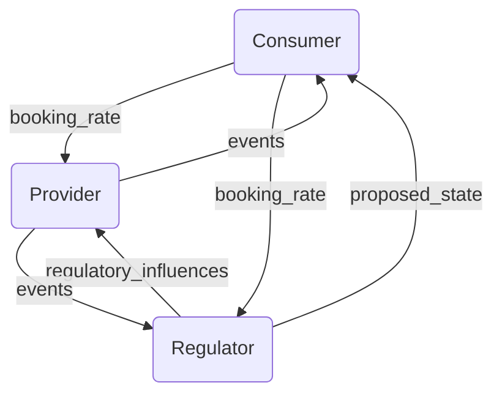

# M7 Agent Profiles und Abhängigkeiten

Dieses Dokument beschreibt die Profile und Informationsgrenzen der Agenten (Consumer, Provider, Regulator) basierend auf der Meilenstein 7 Spezifikation.

## Profil-Struktur (`agent_profiles.json`)
Die Simulation nutzt Profile, um zu steuern, was Agenten sehen können (`observes`), was sie vorschlagen dürfen (`may_propose`), was sie nicht ausgeben dürfen (`must_not_output`) und von wem sie in ihrer Entscheidungsfindung abhängig sind (`depends_on`).

## Abhängigkeitsgraph

Das folgende Mermaid-Diagramm visualisiert, welche Agenten auf die Outputs der anderen Agenten oder der Umgebung reagieren (basierend auf `depends_on`).

## Agent-spezifische Profile

### Consumer
- **Beobachtet:** market_metrics, population_stats, event_log_recent, factors F1, F5, F6
- **Verboten:** ticket_price, booking_rate, numeric_shares (Agent darf keine quantitativen Berechnungen erfinden)
- **Abhängig von:** provider.events, regulator.proposed_state

### Provider
- **Beobachtet:** market_metrics, booking_rate, cost_pressure, event_log_recent, factors F3, F4
- **Darf vorschlagen:** events
- **Verboten:** ticket_price, carbon_tax_level
- **Abhängig von:** regulatory_influences, consumer.booking_rate

### Regulator
- **Beobachtet:** market_metrics, factors F2, F6, F7, event_log_recent, population_stats
- **Darf vorschlagen:** factor_state F2, factor_state F6
- **Verboten:** ticket_price, tax_level_numeric
- **Abhängig von:** provider.events, consumer.booking_rate
