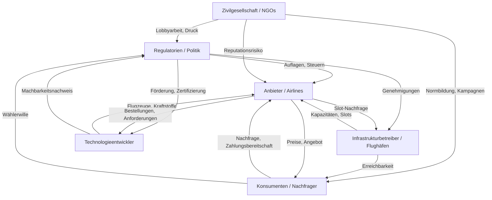
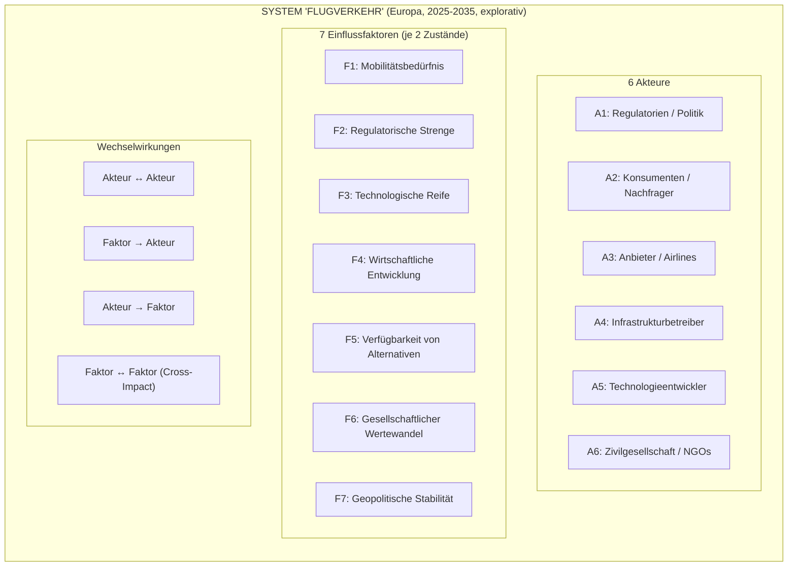
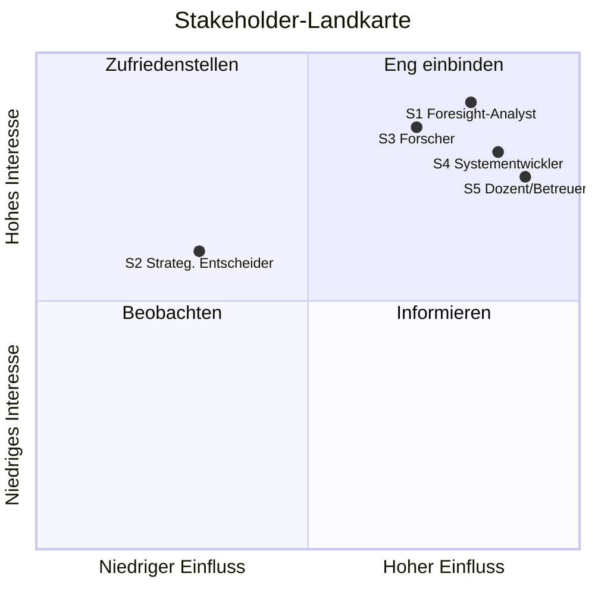
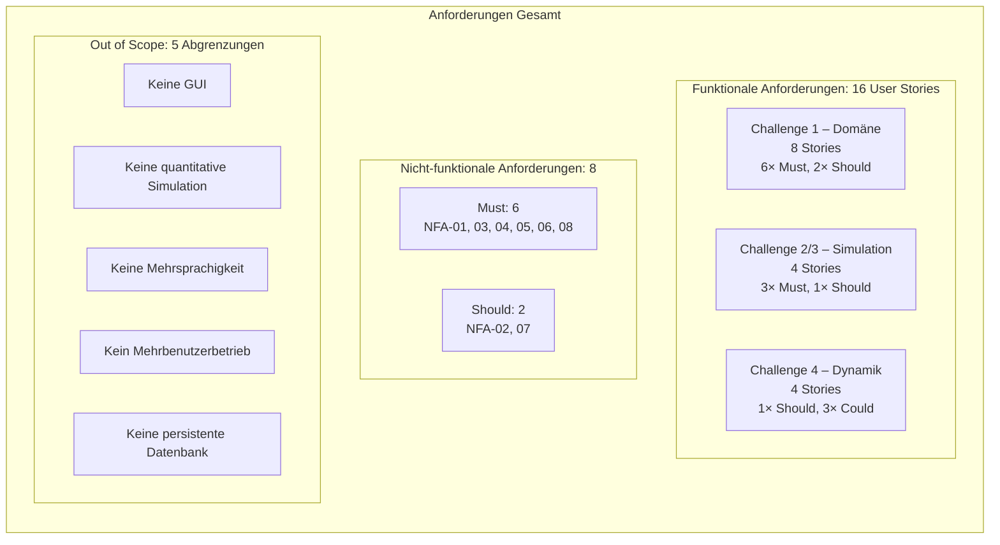

# Challenge 1: Domänenrepräsentation – Phase A: Analyse

## Projektkontext

| Attribut | Wert |
|----------|------|
| **Forschungsprojekt** | Entwicklung einer prototypischen multiagentischen Simulationsumgebung für die Szenarioplanung im Strategic Foresight |
| **Challenge** | C1 – Domänenrepräsentation |
| **Domäne** | System Flugverkehr (Europa) |
| **Methodik** | Ludewig, J. & Lichter, H. (2023): Software Engineering – Grundlagen, Menschen, Prozesse, Techniken. 4. Aufl., dpunkt.verlag. |
| **Technischer Stack** | Python, LangGraph, Ollama (lokale LLMs) |
| **Stand** | Phase A: Analyse (Systemabgrenzung, Glossar, Stakeholder, Anforderungen)  |

---

## Inhaltsverzeichnis

- [A.1 Problemdomäne verstehen & abgrenzen](#a1-problemdomäne-verstehen--abgrenzen)
  - [A.1.1 Festgelegte Systemgrenzen](#a11-festgelegte-systemgrenzen)
  - [A.1.2 Herleitung der Akteure](#a12-herleitung-der-akteure)
  - [A.1.3 Herleitung der Einflussfaktoren](#a13-herleitung-der-einflussfaktoren)
  - [A.1.4 Faktor-Zustände](#a14-faktor-zustände)
  - [A.1.5 Beziehungstypen](#a15-beziehungstypen)
  - [A.1.6 Domänenstruktur (Übersicht)](#a16-domänenstruktur-übersicht)
- [A.2 Begriffslexikon / Glossar](#a2-begriffslexikon--glossar)
  - [A.2.1 Systemkonzepte](#a21-systemkonzepte)
  - [A.2.2 Akteure](#a22-akteure)
  - [A.2.3 Einflussfaktoren](#a23-einflussfaktoren)
- [A.3 Stakeholder-Identifikation](#a3-stakeholder-identifikation)
- [A.4 Anforderungserhebung](#a4-anforderungserhebung)
  - [A.4.1 Funktionale Anforderungen (User Stories)](#a41-funktionale-anforderungen-user-stories)
  - [A.4.2 Nicht-funktionale Anforderungen](#a42-nicht-funktionale-anforderungen)
  - [A.4.3 Abgrenzung (Out of Scope)](#a43-abgrenzung-out-of-scope)
  - [A.4.4 Zusammenfassung der Anforderungen](#a44-zusammenfassung-der-anforderungen)
  - [A.4.5 Rückverfolgbarkeitsmatrix](#a45-rückverfolgbarkeitsmatrix)

---

## A.1 Problemdomäne verstehen & abgrenzen

> **Methodische Grundlage:** Orientiert an Ludewig & Lichter, Kap. 15.2.3, beginnen wir damit, den IST-Zustand festzustellen und die Domäne zu verstehen und abzugrenzen. Ziel ist es, den Untersuchungsgegenstand so zu beschreiben, dass alle Beteiligten ein gemeinsames Verständnis des zu modellierenden Systems entwickeln.

### A.1.1 Festgelegte Systemgrenzen

| Parameter | Festlegung | Begründung |
|-----------|------------|------------|
| **Zeitlicher Horizont** | 10 Jahre (2025–2035) | Lang genug für strukturelle Veränderungen, kurz genug für plausible Annahmen |
| **Geographischer Scope** | Europa (DACH-Fokus, EU-Regulatorik) | Kohärenter Regulierungsraum (EU ETS, Fit-for-55); ausreichende Komplexität für den Prototyp |
| **Szenariotyp** | Explorativ (Was kann passieren?) | Entspricht Challenge 4: Explorationsmöglichkeiten |
| **Akteure & Faktoren** | So viele wie sinnvoll begründbar | Systematische Herleitung in A.1.2 und A.1.3 |

### A.1.2 Herleitung der Akteure

Ausgehend vom "Markt-Dreieck" der Vorlesung (Regulatorien-Konsumenten-Anbieter) wurde geprüft, welche weiteren Akteure eine eigenständige Handlungslogik im System Flugverkehr besitzen:

| Potentieller Akteur | Beschreibung | Eigenständige Handlungslogik? | Entscheidung |
|---|---|---|---|
| **Regulatorien / Politik** | EU-Kommission, nationale Regierungen, (EASA, ICAO) → setzen Rahmenbedingungen | Ja, politische Ziellogik (Klimaschutz, Wirtschaft, Wählerwille) | Eigener Akteur ✅ |
| **Konsumenten / Nachfrager** | Privat- und Geschäftsreisende → treffen Reiseentscheidungen | Ja, Nachfrage (Preis, Werte, Alternativen) | Eigener Akteur ✅ |
| **Anbieter / Airlines** | Fluggesellschaften → setzen Preise, Routen, investieren | Ja, Angebot | Eigener Akteur ✅ |
| **Infrastrukturbetreiber (Flughäfen)** | Bsp.: Fraport etc. → Kapazitäten, Ausbau | Ja, eigene Interessen (Wachstum), nicht deckungsgleich mit Airlines | Eigener Akteur ✅ |
| **Technologieentwickler** | Airbus, Boeing, Aviation-Startups etc. | Ja, eigene Innovationslogik, lange Entwicklungszyklen | Eigener Akteur ✅ |
| **Zivilgesellschaft / NGOs** | Greenpeace, Fridays for Future, Greenpeace, Bürgerinitiativen | Ja, wertegetriebene Agenda, eigenständige Einflussmechanismen (Lobbyismus, Mobilisierung) | Eigener Akteur ✅ |
| **Konkurrierende Verkehrsträger** | DB, Fernbusse etc. | Reagieren aktiv, aber sind nicht primär Teil des *Flugverkehrs*-Systems | Als exogener Einflussfaktor (F5) |
| **Medien** | Berichterstattung, öffentliche Meinung | Keine eigene Agenda im Flugverkehr | Kein eigener Akteur |
| **Investoren / Kapitalmärkte** | Finanzierung | Wirken primär durch Anbieter und Technologieentwickler | Implizit in anderen Akteuren |

**Ergebnis: 6 Akteure**

**Begründung für die Anzahl:**
- **Weniger als 6:** Das ursprüngliche Dreieck (3 Akteure) unterschlägt, dass Technologieentwickler, Infrastruktur und Zivilgesellschaft eigene Handlungslogiken haben, die nicht in den drei Basisakteuren aufgehen.
- **Mehr als 6:** Weitere Aufspaltung (z.B. Privatreisende vs. Geschäftsreisende) würde die Simulation komplexer machen, ohne für den Prototyp wesentlich mehr Erkenntnisgewinn zu liefern. Erweiterung in späteren Iterationen denkbar.

#### Akteurs-Übersicht

---

### A.1.3 Herleitung der Einflussfaktoren

Die Einflussfaktoren wurden mittels einer PESTLE-Analyse (Political, Economic, Social, Technological, Legal, Environmental) identifiziert und mit den Megatrends aus dem Zukunftsinstitut (2025) abgeglichen:

| # | Einflussfaktor | PESTLE-Kategorie | Beschreibung | Bezug zu Megatrends |
|---|---|---|---|---|
| **F1** | Mobilitätsbedürfnis / Nachfrage | Social | Wie stark wollen Menschen fliegen? | Globalisierung, Identitätsdynamik |
| **F2** | Regulatorische Strenge | Political / Environmental / Legal | Welche klimapolitischen Leitplanken werden gesetzt? | Ökointelligenz |
| **F3** | Technologische Reife (Dekarbonisierung) | Technological | Wie weit sind SAF, E-Aviation, H₂? | Konnektivität, Ökointelligenz |
| **F4** | Wirtschaftliche Entwicklung | Economic | Konjunktur, Kaufkraft, Energiepreise | Globalisierung, Demographischer Wandel|
| **F5** | Verfügbarkeit von Alternativen | Technological / Political / Legal | Schiene, digitale Substitution, Intermodalität | Mobilität, Konnektivität |
| **F6** | Gesellschaftlicher Wertewandel | Social / Environmental | Klimabewusstsein, Flight Shaming, Normen | Ökointelligenz, Identitätsdynamik |
| **F7** | Geopolitische Stabilität | Political / Security | Offene Lufträume, Konflikte, Pandemien | Sicherheit, Globalisierung |

**Prüfung auf Eindeutigkeit:**

| Prüfung | Ergebnis |
|---------|----------|
| F1 vs. F6 | F1 = beobachtbare Nachfrage (Menge), quantifizierbar, F6 = zugrundeliegende Werthaltung → F6 *treibt* F1, aber nicht identisch. **Beide behalten.** |
| F2 vs. F6 | F2 = staatliches Handeln, F6 = gesellschaftliche Haltung → Politik kann der Gesellschaft vorauseilen oder hinterherhinken. **Beide behalten.** |
| F3 vs. F5 | F3 = Technologie im Flugverkehr selbst, F5 = Alternativen außerhalb → klar getrennt. **Beide behalten.** |

**Ergebnis: 7 Einflussfaktoren**, alle eindeutig differenzierbar.

### A.1.4 Faktor-Zustände

Jeder Faktor weist einen erkennbaren Unterschied auf:

| Faktor | Zustand 1 (Kontinuität) | Zustand 2 (Transformation) |
|--------|--------------------------|----------------------------|
| **F1** Mobilitätsbedürfnis | F1.1: Globaler Reiseboom, ungebrochenes Wachstum | F1.2: Stagnation & Verzicht, Substitution |
| **F2** Regulatorische Strenge | F2.1: Moderater Klimaschutz, Kompensationsfokus | F2.2: Radikale Dekarbonisierung, Verbote |
| **F3** Technologische Reife | F3.1: Inkrementelle Verbesserungen, SAF teuer | F3.2: Durchbruch bei SAF/E-Fuels/H₂ |
| **F4** Wirtschaftliche Entwicklung | F4.1: Stabiles Wachstum, moderate Inflation | F4.2: Rezession / Stagflation |
| **F5** Verfügbarkeit Alternativen | F5.1: Schiene stagniert, Fliegen alternativlos | F5.2: Massiver Schienenausbau, Intermodalität |
| **F6** Gesellsch. Wertewandel | F6.1: Fliegen bleibt akzeptiert | F6.2: Starkes Klimabewusstsein, Flight Shaming |
| **F7** Geopolitische Stabilität | F7.1: Offene Märkte, Kooperation | F7.2: Fragmentierung, Konflikte |

### A.1.5 Beziehungstypen

| Beziehungstyp | Definition | Beispiel |
|---|---|---|
| **Akteur → Akteur** | Ein Akteur beeinflusst durch sein Handeln die Entscheidungen oder Handlungsmöglichkeiten eines anderen Akteurs | Zivilgesellschaft → Regulatorien (Lobbyarbeit erzeugt politischen Druck) |
| **Faktor → Akteur** | Ein Einflussfaktor verändert die Rahmenbedingungen, unter denen ein Akteur agiert | F4 (Rezession) → Anbieter (Kostendruck, Streckenabbau) |
| **Akteur → Faktor** | Ein Akteur beeinflusst durch sein Handeln die Ausprägung eines Einflussfaktors | Technologieentwickler → F3 (Innovation erhöht technologische Reife) |
| **Faktor ↔ Faktor** | Zwei Einflussfaktoren verstärken oder hemmen sich gegenseitig (Cross-Impact) | F6 (Wertewandel) → F2 (legitimiert strengere Regulierung) |

### A.1.6 Domänenstruktur (Übersicht)

---

## A.2 Begriffslexikon / Glossar

> **Methodische Grundlage:** Gemäß Ludewig & Lichter, Kap. 15.3 definiert und klärt ein Begriffslexikon zentrale Begriffe eindeutig, welche möglicherweise von verschiedenen Leuten unterschiedlich ausgelegt werden. Es dient als gemeinsame Sprache zwischen allen Beteiligten und verhindert Missverständnisse. Das Begriffslexikon ist ein lebendes Dokument, das während des gesamten Projekts gepflegt wird.

Hinweis: Begriffslexikon mithilfe KI-erstellt. (**Gemeinsam nochmal durchgehen, damit alle konform und auch dem gleichen Stand sind!**)

### Struktur jedes Eintrags

| Feld | Beschreibung |
|------|-------------|
| **Begriff** | Kanonischer Name |
| **Synonyme** | Alternative Bezeichnungen |
| **Kategorie** | Systemkonzept / Akteur / Einflussfaktor / Zustand / Beziehung |
| **Definition** | Präzise, eindeutige Beschreibung |
| **Abgrenzung** | Was der Begriff *nicht* meint |
| **Beziehungen** | Verbindungen zu anderen Glossarbegriffen |

### A.2.1 Systemkonzepte

#### Soziotechnisches System

| Feld | Inhalt |
|------|--------|
| **Begriff** | Soziotechnisches System |
| **Synonyme** | Soziotechnisches Gefüge, Socio-Technical System |
| **Kategorie** | Systemkonzept |
| **Definition** | Ein System, in dem menschliche (soziale) und technische Komponenten untrennbar miteinander verwoben sind und sich wechselseitig beeinflussen. Im Kontext dieses Projekts bezeichnet es das Zusammenspiel von Akteuren (Menschen, Organisationen, Institutionen) mit technischen Infrastrukturen, Regularien und gesellschaftlichen Normen innerhalb einer Domäne. |
| **Abgrenzung** | Kein rein technisches System (z.B. ein Triebwerk) und kein rein soziales System (z.B. eine Familienstruktur). Die Betonung liegt auf der Wechselwirkung zwischen sozialen und technischen Elementen. |
| **Beziehungen** | Enthält → Akteure, Einflussfaktoren, Wechselwirkungen. Wird untersucht durch → Szenarioplanung. |

#### Domäne

| Feld | Inhalt |
|------|--------|
| **Begriff** | Domäne |
| **Synonyme** | Problemdomäne, Anwendungsdomäne |
| **Kategorie** | Systemkonzept |
| **Definition** | Der fachliche Gegenstandsbereich, der modelliert und simuliert wird. In diesem Projekt ist die Domäne das System Flugverkehr in Europa mit einem Zeithorizont von 2025–2035. Die Domäne umfasst alle relevanten Akteure, Einflussfaktoren und deren Wechselwirkungen, die die Zukunftsentwicklung des europäischen Flugverkehrs bestimmen. |
| **Abgrenzung** | Die Domäne ist nicht das gesamte Mobilitätssystem. Konkurrierende Verkehrsträger (Bahn, Bus) werden als exogener Einflussfaktor modelliert, nicht als Teil der Domäne selbst. |
| **Beziehungen** | Wird repräsentiert durch → Domänenmodell. Enthält → Akteure, Einflussfaktoren. |

#### Szenario

| Feld | Inhalt |
|------|--------|
| **Begriff** | Szenario |
| **Synonyme** | Zukunftsszenario, Szenariobild |
| **Kategorie** | Systemkonzept |
| **Definition** | Eine in sich konsistente, plausible Beschreibung eines möglichen zukünftigen Zustands des soziotechnischen Systems. Ein Szenario ergibt sich aus einer bestimmten Kombination von Faktor-Zuständen und beschreibt qualitativ, wie sich das System unter diesen Bedingungen entwickelt. Ein Szenario ist keine Prognose (keine Wahrscheinlichkeitsaussage), sondern eine explorative Erzählung über eine mögliche Zukunft. |
| **Abgrenzung** | Kein Forecast (wahrscheinlichste Entwicklung), keine Planung (gewünschte Entwicklung). Ein Szenario beschreibt was passieren kann, nicht was passieren wird oder soll. |
| **Beziehungen** | Wird erzeugt durch → Szenarioplanung, Cross-Impact-Analyse. Besteht aus → Kombination von Faktor-Zuständen. Wird beschrieben durch → Simulationsstand / Gesprächsprotokoll. |

#### Szenarioplanung

| Feld | Inhalt |
|------|--------|
| **Begriff** | Szenarioplanung |
| **Synonyme** | Scenario Planning, Szenarioentwicklung |
| **Kategorie** | Systemkonzept |
| **Definition** | Eine strukturierte Methode innerhalb des Strategic Foresight, bei der mehrere plausible Zukunftsszenarien systematisch entwickelt werden. Der Prozess umfasst fünf generische Phasen: (1) Zentrale Fragestellung identifizieren, (2) Haupttreiber identifizieren, (3) Szenariologik bestimmen, (4) Szenarioannahmen beschreiben, (5) Analyse der Szenarien. |
| **Abgrenzung** | Nicht gleichzusetzen mit dem gesamten Strategic-Foresight-Prozess, der auch Environmental Scanning, Visioning und Strategy Development umfasst. |
| **Beziehungen** | Ist Phase von → Strategic Foresight. Nutzt → Einflussfaktoren, Cross-Impact-Analyse. Erzeugt → Szenarien. |

#### Cross-Impact-Bilanz (CIB)

| Feld | Inhalt |
|------|--------|
| **Begriff** | Cross-Impact-Bilanz |
| **Synonyme** | Cross-Impact-Balance-Analyse, CIB, Wechselwirkungsmatrix |
| **Kategorie** | Systemkonzept |
| **Definition** | Eine analytische Methode zur systematischen Erfassung und Bewertung der paarweisen Wechselwirkungen zwischen den Zuständen verschiedener Einflussfaktoren. In einer CIB-Matrix wird für jedes Paar von Faktor-Zuständen numerisch bewertet, wie stark ein aktiver Zustand einen passiven Zustand fördert (positive Werte) oder hemmt (negative Werte). Typische Skala: −3 (stark hemmend) bis +3 (stark fördernd), 0 = kein Einfluss. Aus der Matrix lassen sich konsistente Szenariokombinationen ableiten. |
| **Abgrenzung** | Keine rein qualitative Einschätzung; die CIB quantifiziert Wechselwirkungen auf einer ordinalen Skala. Keine kausale Modellierung im strengen Sinne, sondern eine Expertenbewertung von Einflussrichtung und -stärke. |
| **Beziehungen** | Operiert auf → Einflussfaktoren, Faktor-Zustände. Erzeugt → konsistente Szenariokombinationen. Wird in Challenge 3 reproduziert durch → Multiagentensystem. |

#### Cross-Impact-Bewertung

| Feld | Inhalt |
|------|--------|
| **Begriff** | Cross-Impact-Bewertung |
| **Synonyme** | CIB-Eintrag, Wechselwirkungsbewertung, Cross-Impact Entry |
| **Kategorie** | Systemkonzept |
| **Definition** | Eine einzelne, gerichtete Bewertung der Wechselwirkung zwischen zwei Faktor-Zuständen innerhalb der Cross-Impact-Bilanz. Sie besteht aus dem aktiven Zustand (Ursache), dem passiven Zustand (Wirkung), einem numerischen Wirkungswert (−3 bis +3) und einer textuellen Begründung. |
| **Abgrenzung** | Nicht die gesamte Matrix (→ Cross-Impact-Bilanz), sondern ein einzelner Eintrag darin. |
| **Beziehungen** | Ist Teil von → Cross-Impact-Bilanz. Verweist auf → Faktor-Zustände. |

#### Simulationsstand

| Feld | Inhalt |
|------|--------|
| **Begriff** | Simulationsstand |
| **Synonyme** | Gesprächsprotokoll, Simulation State, Systemzustand |
| **Kategorie** | Systemkonzept |
| **Definition** | Der zu einem bestimmten Simulationszeitpunkt geltende Gesamtzustand des modellierten Systems. Er umfasst (a) die aktuellen Ausprägungen aller Einflussfaktoren, (b) die Positionen und Reaktionen aller Akteure und (c) das kumulierte Gesprächsprotokoll der Agenten-Interaktionen. Der Simulationsstand ist das zentrale Arbeits- und Analyseergebnis der Simulation und dient als Grundlage für die Szenarioableitung. |
| **Abgrenzung** | Kein einzelner Faktorwert, sondern die Gesamtheit aller Systemzustände zu einem Zeitpunkt. |
| **Beziehungen** | Wird erzeugt durch → Multiagentensystem. Wird exploriert durch → Chat-Interface (Challenge 4). Bildet Grundlage für → Szenarioableitung. |

#### Weak Signal

| Feld | Inhalt |
|------|--------|
| **Begriff** | Weak Signal |
| **Synonyme** | Schwaches Signal, Frühindikator |
| **Kategorie** | Systemkonzept |
| **Definition** | Ein schwaches, frühzeitiges Anzeichen für eine möglicherweise bedeutsame zukünftige Veränderung, das zum Zeitpunkt seines Auftretens noch mehrdeutig, unvollständig und leicht zu übersehen ist. Weak Signals können auf entstehende Trends, Diskontinuitäten oder disruptive Entwicklungen hindeuten. Im Kontext dieses Projekts dienen sie (perspektivisch in Challenge 4) als Trigger zur Dynamisierung von Einflussfaktoren. |
| **Abgrenzung** | Kein etablierter Trend (der bereits sichtbar und breit anerkannt ist). Kein Rauschen (zufällige Datenpunkte ohne Bedeutung). Die Unterscheidung zwischen Weak Signal und Rauschen erfordert Interpretation. |
| **Beziehungen** | Kann dynamisieren → Einflussfaktoren. Wird erkannt durch → Environmental Scanning. Relevant für → Challenge 4. |

### A.2.2 Akteure

#### A1: Regulatorien / Politik

| Feld | Inhalt |
|------|--------|
| **Begriff** | Regulatorien / Politik |
| **Synonyme** | Regulierer, Regulator, Politische Entscheider |
| **Kategorie** | Akteur |
| **Definition** | Staatliche und überstaatliche Institutionen, die den Ordnungsrahmen für den Flugverkehr setzen. Dazu gehören die EU-Kommission (Emissionshandel ETS, Fit-for-55-Paket), nationale Regierungen (Luftverkehrsteuer, Kurzstreckenverbote), die EASA (European Union Aviation Safety Agency, Zertifizierung neuer Technologien) und die ICAO (internationale Standards). Ihre Handlungslogik folgt politischen Zielen: Klimaschutz, Wirtschaftsförderung, Wählerzufriedenheit, internationale Wettbewerbsfähigkeit. |
| **Abgrenzung** | Nicht die operative Flugsicherung (DFS), die eher technisch-operativ agiert. Nicht die Justiz (Gerichte), die Regeln anwendet, aber nicht gestaltet. |
| **Beziehungen** | Beeinflusst direkt → Anbieter (durch Auflagen, Steuern), Infrastrukturbetreiber (Genehmigungen), Technologieentwickler (Förderung, Zertifizierung). Wird beeinflusst von → Zivilgesellschaft (Druck), Konsumenten (Wählerwille). Primär zugeordnete Einflussfaktoren → F2 (Regulatorische Strenge), F6 (Wertewandel als Treiber politischen Handelns). |

#### A2: Konsumenten / Nachfrager

| Feld | Inhalt |
|------|--------|
| **Begriff** | Konsumenten / Nachfrager |
| **Synonyme** | Passagiere, Fluggäste, Reisende, Demand Side |
| **Kategorie** | Akteur |
| **Definition** | Die Gesamtheit der Personen und Organisationen, die Flugreisen nachfragen. Dies umfasst Privatreisende (Urlaub, Familienbesuche), Geschäftsreisende (Dienstreisen, Konferenzen) und Frachtkunden (Unternehmen mit Luftfrachtbedarf). Ihre Entscheidungen werden getrieben durch Preis, Reisezeit, Komfort, Verfügbarkeit von Alternativen, persönliche Werthaltungen (Klimabewusstsein) und wirtschaftliche Rahmenbedingungen (Kaufkraft). Sie sind die nachfrageseitige Kraft im System. |
| **Abgrenzung** | Nicht die Airlines (die sind Anbieter). Nicht die Zivilgesellschaft als organisierte Interessengruppe – ein Konsument wird zur Zivilgesellschaft, wenn er sich politisch organisiert (z.B. Petition gegen Flughafenausbau), aber nicht wenn er eine individuelle Reiseentscheidung trifft. |
| **Beziehungen** | Beeinflusst direkt → Anbieter (durch Nachfrage und Zahlungsbereitschaft), Regulatorien (als Wähler). Wird beeinflusst von → Anbieter (Preise, Angebot), Zivilgesellschaft (soziale Normen), Regulatorien (Steuern, Verbote). Primär zugeordnete Einflussfaktoren → F1 (Mobilitätsbedürfnis), F4 (Wirtschaftliche Entwicklung), F6 (Wertewandel). |

#### A3: Anbieter / Airlines

| Feld | Inhalt |
|------|--------|
| **Begriff** | Anbieter / Airlines |
| **Synonyme** | Fluggesellschaften, Carrier, Luftverkehrsgesellschaften, Supply Side |
| **Kategorie** | Akteur |
| **Definition** | Unternehmen, die den Personen- und Frachttransport auf dem Luftweg anbieten. Dazu gehören Full-Service-Carrier (Lufthansa, Air France-KLM), Low-Cost-Carrier (Ryanair, easyJet) und Frachtfluggesellschaften (Cargolux). Ihre Handlungslogik ist primär ökonomisch: Maximierung von Auslastung und Ertrag, Minimierung von Kosten, Reaktion auf Regulierung und Nachfrageverschiebungen. Strategische Entscheidungen umfassen Routennetzplanung, Flotteninvestitionen, Preispolitik und Nachhaltigkeitsstrategien. |
| **Abgrenzung** | Nicht die Flugzeughersteller (→ Technologieentwickler). Nicht die Flughäfen (→ Infrastrukturbetreiber). Airlines nutzen Technologie und Infrastruktur, entwickeln und betreiben diese aber nicht primär selbst. |
| **Beziehungen** | Beeinflusst direkt → Konsumenten (Preise, Angebot, Routen), Infrastrukturbetreiber (Slot-Nachfrage), Technologieentwickler (Bestellungen, Anforderungen). Wird beeinflusst von → Regulatorien (Auflagen, Steuern), Konsumenten (Nachfrage), Technologieentwickler (verfügbare Flugzeuge/Kraftstoffe), Infrastrukturbetreiber (Kapazitäten). Primär zugeordnete Einflussfaktoren → F1 (Nachfrage), F2 (Regulierung), F3 (Technologie), F4 (Wirtschaftslage). |

#### A4: Infrastrukturbetreiber / Flughäfen

| Feld | Inhalt |
|------|--------|
| **Begriff** | Infrastrukturbetreiber / Flughäfen |
| **Synonyme** | Airports, Flughafenbetreiber, Bodeninfrastruktur |
| **Kategorie** | Akteur |
| **Definition** | Organisationen, die die physische Infrastruktur für den Flugverkehr bereitstellen und betreiben. Dazu gehören Flughafenbetreibergesellschaften (Fraport, Aéroports de Paris, Schiphol Group) sowie Flugsicherungsorganisationen (DFS, Eurocontrol) und Bodenabfertigungsdienste. Ihre Handlungslogik ist geprägt durch langfristige Investitionszyklen (Pistenausbau, Terminalerweiterung dauern Jahrzehnte), lokalpolitische Spannungen (Lärmschutz, Nachtflugverbote) und die Abhängigkeit von Airline-Nachfrage. Sie sind Enabler und Engpass zugleich. |
| **Abgrenzung** | Nicht die Airlines, die die Infrastruktur nutzen. Nicht die staatliche Regulierung, obwohl viele Flughäfen in öffentlicher Hand sind – ihre operative Logik (Kapazitätsplanung, Entgelte) unterscheidet sich von der politischen Logik (Gesetze, Steuern). |
| **Beziehungen** | Beeinflusst direkt → Anbieter (Kapazitäten, Entgelte, Slots), Konsumenten (Erreichbarkeit, Reisequalität). Wird beeinflusst von → Regulatorien (Genehmigungen, Umweltauflagen), Anbieter (Nachfrage nach Slots), Zivilgesellschaft (Proteste gegen Ausbau/Lärm). Primär zugeordnete Einflussfaktoren → F1 (Nachfrage), F2 (Regulierung), F7 (Geopolitik). |

#### A5: Technologieentwickler

| Feld | Inhalt |
|------|--------|
| **Begriff** | Technologieentwickler |
| **Synonyme** | Hersteller, OEMs, Innovatoren, Technology Providers |
| **Kategorie** | Akteur |
| **Definition** | Unternehmen und Forschungseinrichtungen, die die technologischen Grundlagen des Flugverkehrs entwickeln und bereitstellen. Dies umfasst Flugzeughersteller (Airbus, Boeing, Embraer), Triebwerkshersteller (Rolls-Royce, CFM, Pratt & Whitney), SAF-Produzenten (Neste, SkyNRG), Startups im Bereich E-Aviation und Urban Air Mobility (Lilium, Volocopter) sowie Forschungseinrichtungen (DLR, Fraunhofer). Ihre Handlungslogik ist geprägt durch extrem lange Entwicklungszyklen (10–15 Jahre für ein neues Flugzeugmuster), hohe Investitionskosten und Zertifizierungsanforderungen. |
| **Abgrenzung** | Nicht die Airlines, die Technologie einsetzen. Nicht die Regulatoren, die Technologie zertifizieren. Der Fokus liegt auf Akteuren, die neue technologische Optionen schaffen. |
| **Beziehungen** | Beeinflusst direkt → Anbieter (verfügbare Flugzeuge, Kraftstoffoptionen), Regulatorien (Machbarkeitsnachweis ermöglicht strengere Regulierung). Wird beeinflusst von → Regulatorien (Förderprogramme, Zertifizierung), Anbieter (Bestellungen), wirtschaftliche Entwicklung (Investitionsbereitschaft). Primär zugeordnete Einflussfaktoren → F3 (Technologische Reife), F4 (Wirtschaftslage). |

#### A6: Zivilgesellschaft / NGOs

| Feld | Inhalt |
|------|--------|
| **Begriff** | Zivilgesellschaft / NGOs |
| **Synonyme** | Nichtregierungsorganisationen, Bürgerinitiativen, Civil Society, Interessengruppen |
| **Kategorie** | Akteur |
| **Definition** | Organisierte gesellschaftliche Gruppen, die im öffentlichen Diskurs Einfluss auf die Entwicklung des Flugverkehrs nehmen, ohne selbst am Marktgeschehen (Angebot/Nachfrage) direkt teilzunehmen. Dazu gehören Umwelt-NGOs (Greenpeace, BUND, Transport & Environment), Klimabewegungen (Fridays for Future, Stay Grounded), Bürgerinitiativen (Fluglärm-Gegner, Ausbau-Gegner) und Think Tanks (Agora Verkehrswende). Ihre Handlungslogik ist wertegetrieben: Sie setzen Themen auf die Agenda, mobilisieren öffentliche Meinung, betreiben Lobbyarbeit und schaffen sozialen Druck. |
| **Abgrenzung** | Nicht der einzelne Konsument in seiner Kaufentscheidung – sondern die organisierte, politische Artikulation gesellschaftlicher Werte und Interessen. Nicht die Medien (die berichten, aber keine eigene Agenda im Flugverkehr verfolgen). Nicht die Politik (die entscheidet, nicht nur fordert). |
| **Beziehungen** | Beeinflusst direkt → Regulatorien (Lobbyarbeit, öffentlicher Druck), Konsumenten (Normbildung, Awareness-Kampagnen), Anbieter (Reputationsrisiko). Wird beeinflusst von → gesellschaftlicher Wertewandel (Mobilisierungspotenzial), Regulatorien (werden Forderungen umgesetzt, sinkt der Druck). Primär zugeordnete Einflussfaktoren → F6 (Wertewandel), F2 (Regulierung als Ziel). |

### A.2.3 Einflussfaktoren

#### F1: Mobilitätsbedürfnis / Nachfrage

| Feld | Inhalt |
|------|--------|
| **Begriff** | Mobilitätsbedürfnis |
| **Synonyme** | Flugnachfrage, Reisebedürfnis, Demand for Air Travel |
| **Kategorie** | Einflussfaktor |
| **Definition** | Das aggregierte Bedürfnis von Privatpersonen und Organisationen, den Luftverkehr für Personen- oder Gütertransport zu nutzen. Es wird getrieben durch Faktoren wie Globalisierungsgrad (internationale Verflechtung), Geschäftsreisekultur (vs. Remote Work), touristische Präferenzen (Fernreisen vs. Nahtourismus), demographische Entwicklung und individuelle Werthaltungen. Messgröße (qualitativ): Entwicklung der Passagierzahlen und Frachtvolumina im europäischen Luftverkehr. |
| **Zustände** | **F1.1 – Hohes Wachstum:** Globaler Reiseboom, Fliegen bleibt Standard für Fern- und Geschäftsreisen, steigende Passagierzahlen (+3–5% p.a.). / **F1.2 – Stagnation & Verzicht:** Wertewandel (Flight Shaming), Substitution durch Schiene und Videokonferenzen, stagnierende oder sinkende Passagierzahlen. |
| **Abgrenzung** | Nicht die Zahlungsbereitschaft (→ F4). Nicht das tatsächliche Flugaufkommen (das ist das Ergebnis von Nachfrage, Angebot und Regulierung). F1 beschreibt das Bedürfnis, unabhängig davon, ob es befriedigt wird. |
| **Beziehungen** | Wird beeinflusst von → F4, F5, F6, F7. Beeinflusst → Anbieter, Infrastrukturbetreiber. |

#### F2: Regulatorische Strenge

| Feld | Inhalt |
|------|--------|
| **Begriff** | Regulatorische Strenge |
| **Synonyme** | Klimapolitische Regulierung, Umweltregulierung, Regulatory Stringency |
| **Kategorie** | Einflussfaktor |
| **Definition** | Der Grad, in dem staatliche und überstaatliche Institutionen den Flugverkehr durch verbindliche Vorschriften im Sinne des Klima- und Umweltschutzes einschränken oder verteuern. Dies umfasst CO₂-Bepreisung (EU ETS, CORSIA), Beimischungsquoten für nachhaltige Flugkraftstoffe (SAF-Mandate), Kurzstreckenflugverbote, Nachtflugverbote, Lärmschutzauflagen und Subventionsabbau (Kerosinsteuerbefreiung). |
| **Zustände** | **F2.1 – Moderater Klimaschutz:** Wirtschaftsfokus, Kompensationszertifikate, weiche Regulierung, niedrige CO₂-Preise (<50€/t). / **F2.2 – Radikale Dekarbonisierung:** Strenge CO₂-Steuern (>150€/t), verpflichtende SAF-Quoten (>20%), Kurzstreckenverbote, Flugkontingentierung. |
| **Abgrenzung** | Nicht der gesellschaftliche Wunsch nach Regulierung (→ F6), sondern die tatsächlich erlassenen und durchgesetzten Vorschriften. |
| **Beziehungen** | Wird beeinflusst von → F6, F3, Zivilgesellschaft. Beeinflusst → Anbieter, Technologieentwickler, Infrastrukturbetreiber, Konsumenten. |

#### F3: Technologische Reife (Dekarbonisierung)

| Feld | Inhalt |
|------|--------|
| **Begriff** | Technologische Reife |
| **Synonyme** | Technologischer Reifegrad, Technology Readiness, Dekarbonisierungstechnologie |
| **Kategorie** | Einflussfaktor |
| **Definition** | Der Entwicklungs- und Verfügbarkeitsgrad von Technologien, die eine substanzielle Reduktion der Klimawirkung des Flugverkehrs ermöglichen. Dies umfasst Sustainable Aviation Fuels (SAF) – synthetisches Kerosin, Biokraftstoffe, Power-to-Liquid –, elektrisches Fliegen (batterie-elektrisch für Kurzstrecken), Wasserstoffantriebe (Brennstoffzelle oder Direktverbrennung) und aerodynamische Effizienzgewinne (neue Flugzeugkonfigurationen wie Blended Wing Body). Der Faktor beschreibt nicht nur die technische Machbarkeit, sondern auch die wirtschaftliche Skalierbarkeit. |
| **Zustände** | **F3.1 – Inkrementelle Verbesserung:** SAF bleibt teuer (3–5× Kerosinpreis), E-Fliegen nur für Kleinstflugzeuge, kein Paradigmenwechsel. / **F3.2 – Technologischer Durchbruch:** SAF erreicht Kostenparität, Wasserstoff-Demonstratoren erfolgreich, Skaleneffekte greifen. |
| **Abgrenzung** | Nicht die Regulierung, die Technologieeinsatz vorschreibt (→ F2). Nicht die Investitionsentscheidung der Airlines (→ Akteur Anbieter). F3 beschreibt, was technisch möglich und wirtschaftlich darstellbar ist. |
| **Beziehungen** | Wird beeinflusst von → F4, Regulatorien, Technologieentwickler. Beeinflusst → F2, Anbieter, Konsumenten. |

#### F4: Wirtschaftliche Entwicklung

| Feld | Inhalt |
|------|--------|
| **Begriff** | Wirtschaftliche Entwicklung |
| **Synonyme** | Konjunkturlage, Economic Development, Makroökonomisches Umfeld |
| **Kategorie** | Einflussfaktor |
| **Definition** | Die gesamtwirtschaftliche Lage in Europa und den relevanten Quellmärkten, die Kaufkraft, Investitionsbereitschaft und Kostenstrukturen im Flugverkehr bestimmt. Relevante Indikatoren: BIP-Wachstum, verfügbares Einkommen, Inflationsrate, Energiepreise (insb. Kerosinpreis), Wechselkurse, Arbeitsmarktlage. |
| **Zustände** | **F4.1 – Stabiles Wachstum:** Moderates BIP-Wachstum (1–3% p.a.), stabile Energiepreise, solide Kaufkraft. / **F4.2 – Rezession / Stagflation:** Wirtschaftliche Stagnation oder Schrumpfung, hohe Energiepreise, sinkende Kaufkraft. |
| **Abgrenzung** | Nicht das individuelle Konsumverhalten (→ F1/F6), sondern die makroökonomischen Rahmenbedingungen. |
| **Beziehungen** | Wird beeinflusst von → F7. Beeinflusst → F1, F3, Anbieter, Konsumenten. |

#### F5: Verfügbarkeit von Alternativen

| Feld | Inhalt |
|------|--------|
| **Begriff** | Verfügbarkeit von Alternativen |
| **Synonyme** | Substitutionspotenzial, Intermodale Konkurrenz, Alternative Mobility Options |
| **Kategorie** | Einflussfaktor |
| **Definition** | Der Grad, in dem reale, wettbewerbsfähige Alternativen zum Fliegen für relevante Reisezwecke und -distanzen existieren. Dies umfasst (a) Hochgeschwindigkeitsschiene (TGV, ICE), (b) Fernbusse, (c) digitale Substitution (Videokonferenzen) und (d) intermodale Angebote (nahtlose Bahn-Flug-Kombination). Entscheidend sind Reisezeit, Preis, Komfort und Verfügbarkeit. |
| **Zustände** | **F5.1 – Geringe Alternativen:** Schienenausbau stagniert, intermodale Buchung umständlich, Fliegen bleibt auf vielen Relationen alternativlos. / **F5.2 – Starke Alternativen:** Massiver HGV-Ausbau, nahtlose Intermodalität, Videokonferenz-Kultur – Fliegen wird unter 800km unattraktiv. |
| **Abgrenzung** | Nicht der Wunsch nach Alternativen (→ F6), sondern die tatsächliche Verfügbarkeit und Wettbewerbsfähigkeit. Nicht die Technologieentwicklung im Flugverkehr selbst (→ F3). |
| **Beziehungen** | Wird beeinflusst von → Regulatorien, F4. Beeinflusst → F1, Anbieter, Konsumenten. |

#### F6: Gesellschaftlicher Wertewandel

| Feld | Inhalt |
|------|--------|
| **Begriff** | Gesellschaftlicher Wertewandel |
| **Synonyme** | Normenwandel, Social Value Shift, Klimabewusstsein |
| **Kategorie** | Einflussfaktor |
| **Definition** | Die Veränderung der in der Gesellschaft vorherrschenden Werte, Normen und Einstellungen in Bezug auf Fliegen, Klimaverantwortung und nachhaltigen Konsum. Dieser Faktor beschreibt, inwieweit Klimabewusstsein vom Nischenthema zur dominierenden gesellschaftlichen Norm wird, die individuelles Verhalten und kollektive Erwartungen prägt. |
| **Zustände** | **F6.1 – Fliegen bleibt akzeptiert:** Klimaschutz ist ein Thema unter vielen, Fliegen wird nicht stigmatisiert, individuelle Freiheit dominiert. / **F6.2 – Starkes Klimabewusstsein:** Fliegen wird sozial geächtet (Flight Shaming), Konsumenten bevorzugen aktiv klimafreundliche Optionen. |
| **Abgrenzung** | Nicht das individuelle Reiseverhalten (→ F1). Nicht die politische Umsetzung (→ F2). F6 beschreibt die Tiefenströmung in der Gesellschaft. |
| **Beziehungen** | Wird beeinflusst von → Zivilgesellschaft, Weak Signals. Beeinflusst → F1, F2, Zivilgesellschaft, Anbieter. |

#### F7: Geopolitische Stabilität

| Feld | Inhalt |
|------|--------|
| **Begriff** | Geopolitische Stabilität |
| **Synonyme** | Geopolitische Lage, International Stability, Sicherheitslage |
| **Kategorie** | Einflussfaktor |
| **Definition** | Der Grad an politischer Stabilität, internationaler Kooperation und Sicherheit, der den grenzüberschreitenden Luftverkehr ermöglicht oder einschränkt. Umfasst offene vs. eingeschränkte Lufträume, internationale Abkommen, Sanktionen, Terrorismus- und Pandemierisiken sowie geopolitische Konflikte. |
| **Zustände** | **F7.1 – Stabile Weltordnung:** Offene Lufträume, funktionierende internationale Kooperation, geringe Sicherheitsrisiken. / **F7.2 – Fragmentierte Weltordnung:** Regionale Konflikte, gesperrte Lufträume, Visa-Restriktionen, De-Globalisierung. |
| **Abgrenzung** | Nicht die klimapolitische Regulierung (→ F2), sondern die sicherheits- und geopolitische Dimension. Nicht die wirtschaftlichen Folgen von Konflikten (→ F4). |
| **Beziehungen** | Wird beeinflusst von → exogene Faktoren. Beeinflusst → F1, F4, Anbieter, Infrastrukturbetreiber. |

---

## A.3 Stakeholder-Identifikation

> **Methodische Grundlage:** Gemäß Ludewig & Lichter, Kap. 6.2.3, können Kunden sowohl natürliche als auch juristische Personen sein. Jedoch existieren auch noch weitere, unsichtbare Klienten, welche identifiziert werden müssen. Vor Anforderungserhebung werden die Stakeholder, also alle Personen und Gruppen, die ein Interesse am System haben oder von ihm betroffen sind, identifiziert.

### Kontext

Die Stakeholder sind nicht die Akteure *innerhalb* der Domäne (Regulatorien, Airlines etc.), sondern die Personen, die das Simulationswerkzeug nutzen, bewerten oder davon betroffen sind.

### Stakeholder-Übersicht

| # | Stakeholder | Rolle | Interesse am System | Priorität |
|---|---|---|---|---|
| **S1** | **Foresight-Analyst / Szenarioplaner** | Primärer Nutzer | Möchte mithilfe der Simulation plausible Zukunftsszenarien explorieren, Wechselwirkungen verstehen und Szenarien ableiten. Erwartet nachvollziehbare, qualitativ hochwertige Ergebnisse. |  Hoch |
| **S2** | **Strategischer Entscheider** | Konsument der Ergebnisse | Nutzt die abgeleiteten Szenarien als Grundlage für strategische Entscheidungen. Erwartet verständliche, verdichtete Szenariobeschreibungen. |  Mittel |
| **S3** | **Forscher / Wissenschaftler** | Evaluator & Weiterentwickler | Bewertet die Qualität der Simulation. Möchte die Methodik verstehen, reproduzieren und erweitern. |  Hoch |
| **S4** | **Systementwickler / Projektteam** | Entwickler & Betreiber | Entwickelt und wartet das System. Benötigt klare Architektur, wartbaren Code, nachvollziehbare Konfiguration. |  Hoch |
| **S5** | **Dozent / Betreuer** | Auftraggeber & Prüfer | Bewertet die wissenschaftliche und technische Qualität des Projekts. Erwartet systematisches Vorgehen und angemessene Dokumentation. |  Hoch |

### Stakeholder-Landkarte

**Primäre Zielpersona für die Anforderungen: S1 (Foresight-Analyst)**
Persona konkretisieren: tbd

---

## A.4 Anforderungserhebung

> **Methodische Grundlage:** Gemäß Ludewig & Lichter, Kap. 15.4.4 beschreiben Anforderungen den Nutzen, den eine Software bringen soll (funktionale Anforderungen), und welche Eigenschaften es haben muss (nicht-funktionale Anforderungen). Sie werden aus Sicht der Stakeholder formuliert und müssen eindeutig, prüfbar, konsistent und verfolgbar sein.

### A.4.1 Funktionale Anforderungen (User Stories)

User Stories folgen dem Format (vgl. Ludewig & Lichter, Kap. 15.7.4, S. 377 ff.):
> **Als** [Rolle] **möchte ich** [Funktion], **damit** [Nutzen].

Prioritäten nach MoSCoW: **M**ust, **S**hould, **C**ould, **W**on't.

#### Domänenmodellierung & Systemkonfiguration (Challenge 1)

| ID | User Story | Priorität | Challenge |
|----|-----------|-----------|-----------|
| **US-1.01** | **Als** Foresight-Analyst **möchte ich** ein soziotechnisches System mit benannten Akteuren definieren können, **damit** ich die relevanten Handlungsträger meiner Domäne im System abbilde. | **Must** | C1 |
| **US-1.02** | **Als** Foresight-Analyst **möchte ich** jedem Akteur eine Beschreibung seiner Handlungslogik, Ziele und Interessen zuweisen können, **damit** die Agenten im System das domänenspezifische Verhalten der Akteure nachbilden. | **Must** | C1 |
| **US-1.03** | **Als** Foresight-Analyst **möchte ich** Einflussfaktoren mit ihren möglichen Zuständen (Ausprägungen) definieren können, **damit** die Unsicherheiten meiner Szenarioanalyse abgebildet sind. | **Must** | C1 |
| **US-1.04** | **Als** Foresight-Analyst **möchte ich** die Beziehungen zwischen Akteuren und Einflussfaktoren beschreiben können, **damit** die Wirkungsstruktur des Systems transparent ist. | **Must** | C1 |
| **US-1.05** | **Als** Foresight-Analyst **möchte ich** die zeitlichen und räumlichen Systemgrenzen festlegen können (Zeithorizont, geographischer Scope), **damit** der Rahmen der Simulation klar definiert ist. | **Must** | C1 |
| **US-1.06** | **Als** Foresight-Analyst **möchte ich** die zentrale Fragestellung der Szenarioanalyse formulieren können, **damit** die Simulation auf eine konkrete Untersuchungsfrage ausgerichtet ist. | **Should** | C1 |
| **US-1.07** | **Als** Systementwickler **möchte ich** die Domänenkonfiguration in einem strukturierten, maschinenlesbaren Format (z.B. JSON) speichern und laden können, **damit** verschiedene Domänen und Konfigurationen reproduzierbar verwaltet werden können. | **Must** | C1 |
| **US-1.08** | **Als** Forscher **möchte ich** die Domänenkonfiguration des Flugverkehr-Beispiels als vorkonfigurierte Referenzdomäne nutzen können, **damit** ich die Funktionalität des Systems an einem konkreten, validierbaren Beispiel evaluieren kann. | **Should** | C1 |

#### Simulation & Agenten-Interaktion (Challenge 2 & 3) TBD

| ID | User Story | Priorität | Challenge |
|----|-----------|-----------|-----------|
| **US-2.01** | **Als** Foresight-Analyst **möchte ich** eine Simulation starten können, bei der die definierten Akteure als LLM-basierte Agenten miteinander interagieren, **damit** ich beobachten kann, wie sich das System unter den gegebenen Bedingungen entwickelt. | **Must** | C2 |
| **US-2.02** | **Als** Foresight-Analyst **möchte ich** die Interaktionen der Agenten in Form eines Gesprächsprotokolls nachverfolgen können, **damit** ich die Argumentationslinien und Positionsveränderungen der Akteure nachvollziehen kann. | **Must** | C2/C3 |
| **US-3.01** | **Als** Foresight-Analyst **möchte ich** die Stärke der Wechselwirkungen zwischen Faktor-Zuständen in einer Cross-Impact-Matrix definieren können, **damit** ich die gegenseitige Beeinflussung der Einflussfaktoren quantifizieren kann. | **Must** | C3 |
| **US-3.02** | **Als** Foresight-Analyst **möchte ich**, dass das System aus dem Simulationsverlauf konsistente Szenariokombinationen ableitet und als verdichtete Szenariobeschreibungen ausgibt, **damit** ich die Ergebnisse für strategische Analysen verwenden kann. | **Must** | C3 |
| **US-3.03** | **Als** Forscher **möchte ich** die vom System erzeugten Szenariokombinationen mit einer manuell erstellten CIB-Matrix vergleichen können, **damit** ich die Qualität der agentischen Simulation bewerten kann. | **Should** | C3 |
| **US-3.04** | **Als** Foresight-Analyst **möchte ich** die Simulation über mehrere Zeitschritte laufen lassen können, wobei jeder Zeitschritt einen definierten Zeitraum repräsentiert, **damit** ich die zeitliche Entwicklung des Systems beobachten kann. | **Should** | C3 |

#### Dynamisierung & Exploration (Challenge 4) TBD

| ID | User Story | Priorität | Challenge |
|----|-----------|-----------|-----------|
| **US-4.01** | **Als** Foresight-Analyst **möchte ich** die Ausprägungen der Einflussfaktoren während der Simulation dynamisch verändern können, **damit** ich „Was-wäre-wenn"-Szenarien durchspielen kann. | **Should** | C4 |
| **US-4.02** | **Als** Foresight-Analyst **möchte ich** den aktuellen Simulationsstand über ein Chat-Interface explorieren können, **damit** ich gezielt Aspekte der Simulation untersuchen kann. | **Could** | C4 |
| **US-4.03** | **Als** Forscher **möchte ich** beobachten können, ob durch die Agenten-Interaktionen emergentes Verhalten entsteht, **damit** ich die Fähigkeit des Systems zur Erzeugung neuartiger Erkenntnisse bewerten kann. | **Could** | C4 |
| **US-4.04** | **Als** Foresight-Analyst **möchte ich** Weak Signals oder Trendinformationen als externe Impulse in die laufende Simulation einspeisen können, **damit** ich beobachten kann, wie das System auf neue Informationen reagiert. | **Could** | C4 |

### A.4.2 Nicht-funktionale Anforderungen

| ID | Kategorie | Anforderung | Begründung | Priorität |
|----|-----------|-------------|------------|-----------|
| **NFA-01** | Nachvollziehbarkeit | Jede Agentenentscheidung und -aussage muss auf den Simulationsstand (aktuelle Faktorausprägungen, Akteurscharakterisierung) zurückführbar sein. Das System darf keine „Halluzinationen" produzieren, die keinen Bezug zur konfigurierten Domäne haben. | Kernqualitätskriterium für Foresight: Ergebnisse müssen begründbar sein. | **Must** |
| **NFA-02** | Reproduzierbarkeit | Bei identischer Konfiguration und identischem LLM soll die Simulation vergleichbare Ergebnisse liefern. | Wissenschaftliche Anforderung. | **Should** |
| **NFA-03** | Konfigurierbarkeit | Die Domäne (Akteure, Faktoren, Zustände, Beziehungen) muss ohne Codeänderungen anpassbar sein, ausschließlich über Konfigurationsdateien. | Trennung von Domänenwissen und Systemlogik. | **Must** |
| **NFA-04** | Lokalität | Das System muss vollständig lokal lauffähig sein (Ollama-basierte LLMs), ohne Abhängigkeit von Cloud-APIs. | Vorgabe aus Projektbeschreibung. | **Must** |
| **NFA-05** | Dokumentation | Alle Systemkomponenten, Konfigurationsformate und Nutzungsprozesse müssen in Markdown dokumentiert sein. | Vorgabe aus Projektbeschreibung. | **Must** |
| **NFA-06** | Modularität | Das System muss modular aufgebaut sein, sodass einzelne Komponenten unabhängig ausgetauscht oder erweitert werden können. | Prototyp-Charakter: Erweiterbarkeit. Vgl. Ludewig & Lichter Kap. 16.3. | **Must** |
| **NFA-07** | Performance | Eine einzelne Simulationsrunde soll innerhalb von 5 Minuten abgeschlossen sein. | Iteratives Experimentieren muss möglich sein. | **Should** |
| **NFA-08** | Transparenz | Das System soll die verwendeten Prompts, Systemrollen und Entscheidungslogiken offenlegen. | Wissenschaftliche Nachvollziehbarkeit. | **Must** |

### A.4.3 Abgrenzung (Out of Scope)

| Aspekt | Begründung |
|--------|------------|
| Grafische Benutzeroberfläche (GUI) | Prototyp; CLI/Konfigurationsdateien/Notebooks ausreichend |
| Quantitative Simulation | Fokus auf qualitative Simulation durch LLM-basierte Agenten |
| Mehrsprachigkeit | Prototyp arbeitet auf Deutsch oder Englisch |
| Mehrbenutzerbetrieb | Einzelplatz-Prototyp |
| Persistente Datenbank | Dateibasierte Speicherung (JSON) ausreichend |

### A.4.4 Zusammenfassung der Anforderungen

### A.4.5 Rückverfolgbarkeitsmatrix

| Anforderung | Stakeholder | Challenge | Begriffe aus Glossar |
|---|---|---|---|
| US-1.01 | S1, S4 | C1 | Akteur, Soziotechnisches System |
| US-1.02 | S1 | C1 | Akteur (Handlungslogik) |
| US-1.03 | S1 | C1 | Einflussfaktor, Faktor-Zustand |
| US-1.04 | S1 | C1 | Beziehungstypen (Akteur↔Faktor) |
| US-1.05 | S1 | C1 | Domäne (Systemgrenzen) |
| US-1.06 | S1 | C1 | Szenarioplanung (Phase 1) |
| US-1.07 | S4 | C1 | Domäne |
| US-1.08 | S3 | C1 | Domäne (Flugverkehr) |
| US-2.01 | S1 | C2 | Akteur, Simulationsstand |
| US-2.02 | S1 | C2/C3 | Simulationsstand |
| US-3.01 | S1 | C3 | Cross-Impact-Bilanz |
| US-3.02 | S1 | C3 | Szenario, Simulationsstand |
| US-3.03 | S3 | C3 | Cross-Impact-Bilanz, Szenario |
| US-3.04 | S1 | C3 | Simulationsstand |
| US-4.01 | S1 | C4 | Einflussfaktor (Dynamisierung) |
| US-4.02 | S1 | C4 | Simulationsstand |
| US-4.03 | S3 | C4 | Szenario (Emergenz) |
| US-4.04 | S1 | C4 | Weak Signal, Einflussfaktor |

