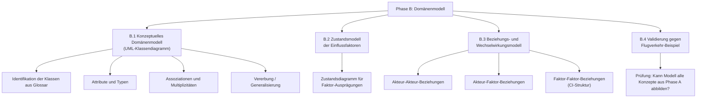
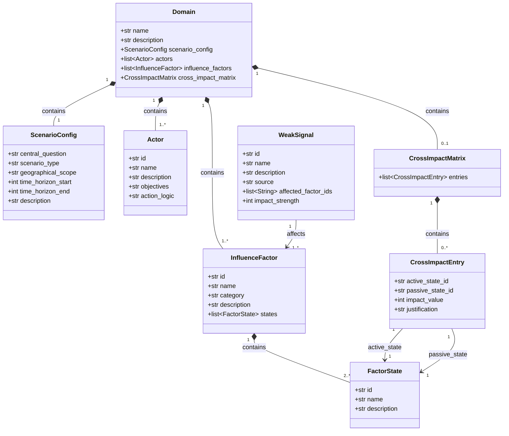
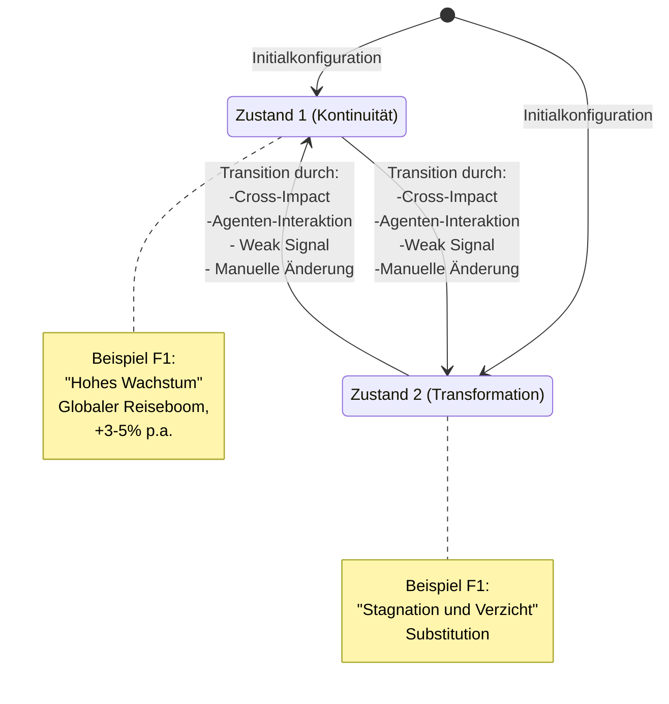
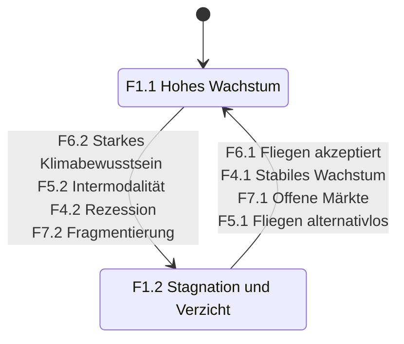

# Challenge 1: Domänenrepräsentation – Phase B: Domänenmodell

## Projektkontext

| Attribut | Wert |
|----------|------|
| **Forschungsprojekt** | Entwicklung einer prototypischen multiagentischen Simulationsumgebung für die Szenarioplanung im Strategic Foresight |
| **Challenge** | C1 – Domänenrepräsentation |
| **Domäne** | System Flugverkehr (Europa) |
| **Methodik** | Ludewig, J. & Lichter, H. (2023): Software Engineering – Grundlagen, Menschen, Prozesse, Techniken. 4. Aufl., dpunkt.verlag. |
| **Technischer Stack** | Python, LangGraph, Ollama (lokale LLMs) |
| **Stand** | Phase B: Konzeptuelles Domänenmodell, Zustände, Beziehungen |
| **Vorgänger** | Phase A: Analyse (Systemabgrenzung, Glossar, Stakeholder, Anforderungen) |

---

## Inhaltsverzeichnis

- [Methodische Grundlage](#methodische-grundlage)
- [Vorgehensweise](#vorgehensweise)
- [B.1 Konzeptuelles Domänenmodell](#b1-konzeptuelles-domänenmodell)
  - [B.1.1 Identifikation der Klassen](#b11-identifikation-der-klassen)
  - [B.1.2 UML-Klassendiagramm (Kernmodell)](#b12-uml-klassendiagramm-kernmodell)
  - [B.1.3 Erläuterung der Klassen und Attribute](#b13-erläuterung-der-klassen-und-attribute)
- [B.2 Zustandsmodell der Einflussfaktoren](#b2-zustandsmodell-der-einflussfaktoren)
---

## Methodische Grundlage

> Gemäß **Ludewig & Lichter, Kap. 1.5**: Jedem Modell sind die drei Merkmale "Abbildungsmerkmal, Verkürzungsmerkmal und pragmatisches Merkmal" zugeordnet, ansonsten handelt es sich nicht um ein Modell. Das bedeutet es gibt zu jedem Modell ein Original, jedes Modell erfasst nicht alle Attribute des Originals sondern nur einen Ausschnitt davon, und Modelle können unter bestimmten Bedingungen das Original ersetzen (S. 5-6).

> Gemäß **Ludewig & Lichter, Kap. 15.3**: Aus dem Begriffslexikon wird ein Begriffsmodell abgeleitet. "Es hat sich bewehrt, die Begriffe und ihre Beziehungen explizit zu modellieren" (S. 350). Die Modellierung erfolgt typischerweise als UML-Klassendiagramm.

---

## Vorgehensweise

## B.1 Konzeptuelles Domänenmodell

### B.1.1 Identifikation der Klassen

Aus dem Glossar (Phase A.2) leiten sich die fachlichen Konzepte der Problemdomäne ab. Das konzeptuelle Domänenmodell beschränkt sich bewusst auf Konfigurationskonzepte, also die Struktur des zu simulierenden soziotechnischen Systems. Technische Laufzeitkonzepte (z.B. LangGraph-State, Messages, Simulationsstand) gehören nicht ins Domänenmodell, sondern in die technologische Konzeption bzw. in die Implementierung (Challenge 2/3). Die Klasse `Actor` beschreibt die fachliche Konfiguration eines Akteurs. Die technische Umsetzung als LLM-basierter Agent, der mit anderen Agenten kommuniziert, wird in der technologischen Konzeption und Challenge 2 (Workbench) behandelt.

| Glossar-Begriff | Klasse im Modell | Begründung |
|---|---|---|
| Domäne | `Domain` | Root, enthält die gesamte Systemkonfiguration |
| Szenarioplanung | `ScenarioConfig` | Konfiguration der Fragestellung, Zeit, Scope |
| Akteur | `Actor` | Handlungsträger im System mit eigener Logik |
| Einflussfaktor | `InfluenceFactor` | Key Unsicherheit mit definierten Ausprägungen |
| Faktor-Zustand | `FactorState` | Konkrete Ausprägung eines Einflussfaktors |
| Cross-Impact-Bilanz | `CrossImpactMatrix` | Bewertung der Faktor-Faktor-Wechselwirkungen |
| Cross-Impact-Bewertung | `CrossImpactEntry` | Wechselwirkungsbeziehnug zwischen zwei Zuständen |
| Weak Signal | `WeakSignal` | Externer Impuls zur Dynamisierung (Challenge 4?) |

**Bewusst nicht als eigene Klassen modelliert:**

| Glossar-Begriff | Verbleib | Begründung |
|---|---|---|
| Akteur-Akteur-Beziehung | Integriert in `Actor.description` und `Actor.action_logic` | Beziehungswissen wird über Prompts transportiert; eigene Klasse wäre redundant |
| Akteur-Faktor-Beziehung | Integriert in `Actor.description` und `Actor.action_logic` | Beziehungswissen wird über Prompts transportiert; eigene Klasse wäre redundant |
| Simulationsstand | Technische Implementierung | Laufzeitkonzept, kein Domänenkonzept; wird durch LangGraph-State abgedeckt |
| Szenario | Technische Implementierung (Challenge 3) | Ergebnis-Artefakt, kein Eingabe-/Konfigurationskonzept |

### B.1.2 UML-Klassendiagramm (Kernmodell)

Das konzeptuelle Domänenmodell beschränkt sich auf die fachlichen Konzepte der Problemdomäne, also die Konfiguration des soziotechnischen Systems. Technische Laufzeitkonzepte (z.B. LangGraph-State, Messages) gehören nicht ins Domänenmodell, sondern in technologische Konzeption.

**Design-Entscheidung:** Beziehungen zwischen Akteuren sowie Akteur-Faktor-Zuordnungen werden nicht als eigene Klassen modelliert, sondern als Bestandteil der natürlichsprachlichen Akteursbeschreibung (`Actor.description`, `Actor.action_logic`). Entspricht der Arbeitsweise von LangGraph, bei dem Beziehungswissen über Prompts transportiert wird.

### B.1.3 Erläuterung der Klassen und Attribute

#### Übersicht

Das Domänenmodell umfasst **8 Klassen** in vier logischen Gruppen:

| Gruppe | Klassen | Beschreibung |
|--------|---------|-------------|
| **Systemkonfiguration** | `Domain`, `ScenarioConfig` | Rahmen des zu simulierenden Systems |
| **Systeminhalt** | `Actor`, `InfluenceFactor`, `FactorState` | Akteure und Einflussfaktoren mit ihren Ausprägungen |
| **Wechselwirkungen** | `CrossImpactMatrix`, `CrossImpactEntry` | Bewertung der gegenseitigen Beeinflussung von Faktor-Zuständen |
| **Externe Impulse** | `WeakSignal` | Schwache Signale zur Dynamisierung (Challenge 4) |

#### Domain (Root)

| Attribut | Typ | Beschreibung |
|----------|-----|-------------|
| `name` | string | Name des modellierten Systems (z.B. "Flugverkehr Europa") |
| `description` | string | Übergeordnete Beschreibung der Domäne |
| `scenario_config` | ScenarioConfig | Konfiguration der Szenarioanalyse |
| `actors` | List[Actor] | Liste aller Akteure im System (mindestens 2) |
| `influence_factors` | List[InfluenceFactor] | Liste aller Einflussfaktoren (mindestens 2) |
| `cross_impact_matrix` | CrossImpactMatrix | Wechselwirkungsmatrix (optional, wird in Challenge 3 befüllt) |

**Design-Entscheidung:** `Domain` ist das zentrale Konfigurationsobjekt. Alle anderen Objekte sind darin enthalten. Eine `Domain`-Instanz repräsentiert eine vollständige, in sich geschlossene Systemkonfiguration.

#### ScenarioConfig

| Attribut | Typ | Beschreibung |
|----------|-----|-------------|
| `central_question` | String | Zentrale Fragestellung der Szenarioanalyse |
| `scenario_type` | String | Art des Szenarios: "explorative", "predictive" oder "normative" |
| `geographical_scope` | String | Geographischer Scope (z.B. "Europa") |
| `time_horizon_start` | int | Startjahr des Zeithorizonts (z.B. 2025) |
| `time_horizon_end` | int | Endjahr des Zeithorizonts (z.B. 2035). Muss nach `time_horizon_start` liegen. |
| `description` | String | Ergänzende Beschreibung (optional) |

#### Actor

| Attribut | Typ | Beschreibung |
|----------|-----|-------------|
| `id` | String | ID (z.B. "A1_regulatorien") |
| `name` | String | Name (z.B. "Regulatorien / Politik") |
| `description` | String | Beschreibung des Akteurs, seiner Rolle, seines Kontexts im System sowie seiner Beziehungen zu anderen Akteuren und zu den Einflussfaktoren |
| `objectives` | String | Ziele und Interessen des Akteurs |
| `action_logic` | String | Beschreibung der Handlungslogik: Wie trifft dieser Akteur Entscheidungen? Welche Prinzipien leiten sein Verhalten? Wie reagiert er auf andere Akteure und auf Veränderungen der Einflussfaktoren? |

**Design-Entscheidungen:**

- Die Felder `description` und `action_logic` enthalten bewusst auch Informationen über Beziehungen zu anderen Akteuren und relevante Einflussfaktoren. Damit werden die Konzepte Akteur-Akteur-Beziehung und Akteur-Faktor-Beziehung in natürlichsprachlicher Form integriert. Beispiel in `action_logic`: *"Du reagierst auf öffentlichen Druck der Zivilgesellschaft und Lobbyarbeit der Airlines. Die regulatorische Strenge (F2) ist dein direktes Handlungsfeld."*
- Die Trennung zwischen `description` (Was/Wer ist der Akteur?) und `action_logic` (Wie handelt er?) ermöglicht unterschiedliche Verwendung: `description` liefert Kontext, `action_logic` steuert das Verhalten.
- Felder wie `synonyms` aus dem Glossar (Phase A.2) werden in `description` integriert, anstatt als eigene Attribute modelliert zu werden. Die detaillierten Informationen sind weiterhin im Glossar-Dokument nachschlagbar.

#### InfluenceFactor

| Attribut | Typ | Beschreibung |
|----------|-----|-------------|
| `id` | String | ID (z.B. "F1_mobilitaet") |
| `name` | String | Name (z.B. "Mobilitätsbedürfnis / Nachfrage") |
| `category` | String | PESTLE-Kategorie: "political", "economic", "social", "technological", "legal" oder "environmental"  |
| `description` | String | Definition des Faktors, einschließlich Abgrenzung zu verwandten Faktoren, Synonymen und Megatrend-Referenzen |
| `states` | List[FactorState] | Mögliche Ausprägungen/Zustände (mindestens 2). Erweiterbar auf mehr als 2 Zustände, da `states` eine Liste beliebiger Länge ist. |

**Design-Entscheidung:** Felder wie `synonyms` und `abgrenzung` aus dem Glossar (Phase A.2) werden in das Feld `description` integriert, anstatt als eigene Attribute modelliert zu werden. Dies hält das Modell schlank. Die detaillierten Informationen sind weiterhin im Glossar-Dokument nachschlagbar.

#### FactorState

| Attribut | Typ | Beschreibung |
|----------|-----|-------------|
| `id` | String | ID (z.B. "F1.1_hohes_wachstum") |
| `name` | String | Name des Zustands (z.B. "Hohes Wachstum") |
| `description` | String | Ausführliche Beschreibung, was dieser Zustand konkret bedeutet |

#### CrossImpactMatrix

| Attribut | Typ | Beschreibung |
|----------|-----|-------------|
| `entries` | List[CrossImpactEntry] | Alle bewerteten Wechselwirkungen. Kann initial leer sein (wird in Challenge 3 befüllt). |

#### CrossImpactEntry

| Attribut | Typ | Beschreibung |
|----------|-----|-------------|
| `active_state_id` | String | Faktor-Zustand der wirkt (Ursache). Referenz auf `FactorState.id`. |
| `passive_state_id` | String | Faktor-Zustand, der beeinflusst wird (Wirkung). Referenz auf `FactorState.id`. |
| `impact_value` | int | Wirkungsstärke: -3 (stark hemmend) bis +3 (stark fördernd), 0 = kein Einfluss |
| `justification` | String | Begründung für die Bewertung. |

**Einschränkung:** `active_state_id` und `passive_state_id` dürfen nicht auf Zustände desselben Einflussfaktors verweisen (ein Faktor beeinflusst sich nicht selbst in der CIB).

#### WeakSignal (relevant ab Challenge 4)

| Attribut | Typ | Beschreibung |
|----------|-----|-------------|
| `id` | String | ID |
| `name` | String | Name  Signals (z.B. "EU-Kurzstreckenverbot") |
| `description` | String | Beschreibung Signals |
| `source` | String | Quelle Signals (z.B. "Pressemitteilung EU-Kommission") |
| `affected_factor_ids` | List[String] | Betroffene Einflussfaktoren (Referenzen auf `InfluenceFactor.id`) |
| `impact_strength` | int | Wirkungsstärke: 1 (schwach) bis 3 (stark) |

**Design-Entscheidung:** `WeakSignal` ist nicht Teil der `Domain`-Klasse, sondern ein eigenständiges Konzept, das von außen in Simulation integriert wird.

---

## B.2 Zustandsmodell der Einflussfaktoren

Jeder Einflussfaktor befindet sich zu jedem Simulationszeitpunkt in genau einem seiner definierten Zustände.

### Generisches Zustandsdiagramm

**Erläuterung:**
- Während (C3) wird der Zustand initial gesetzt und bleibt während einer Simulationsrunde konstant. Die CIB-Matrix bewertet die Konsistenz der Zustandskombination.
- Während (C4) können Zustandsübergänge durch CI-Effekte, Agenten-Interaktionen, Weak Signals oder manuelle Eingriffe ausgelöst werden (dynamisch).
- Das Modell ist erweiterbar auf mehr als zwei Zustände pro Faktor weil `InfluenceFactor.states` eine Liste beliebiger Länge ist.

### Angewandtes Zustandsmodell: Biespiel Faktor F1 (Mobilitätsbedürfnis)

---

