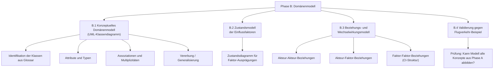
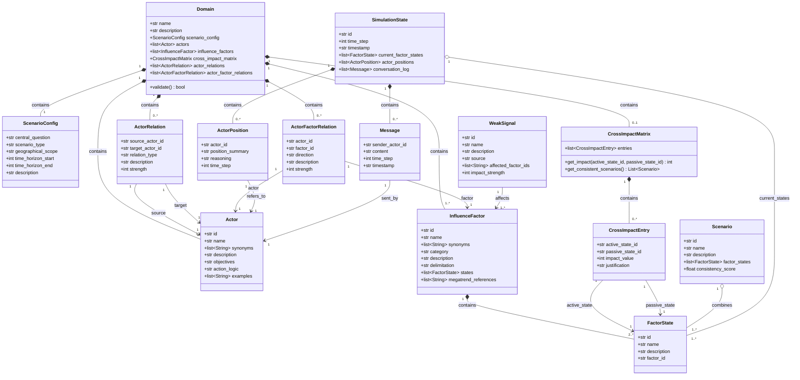
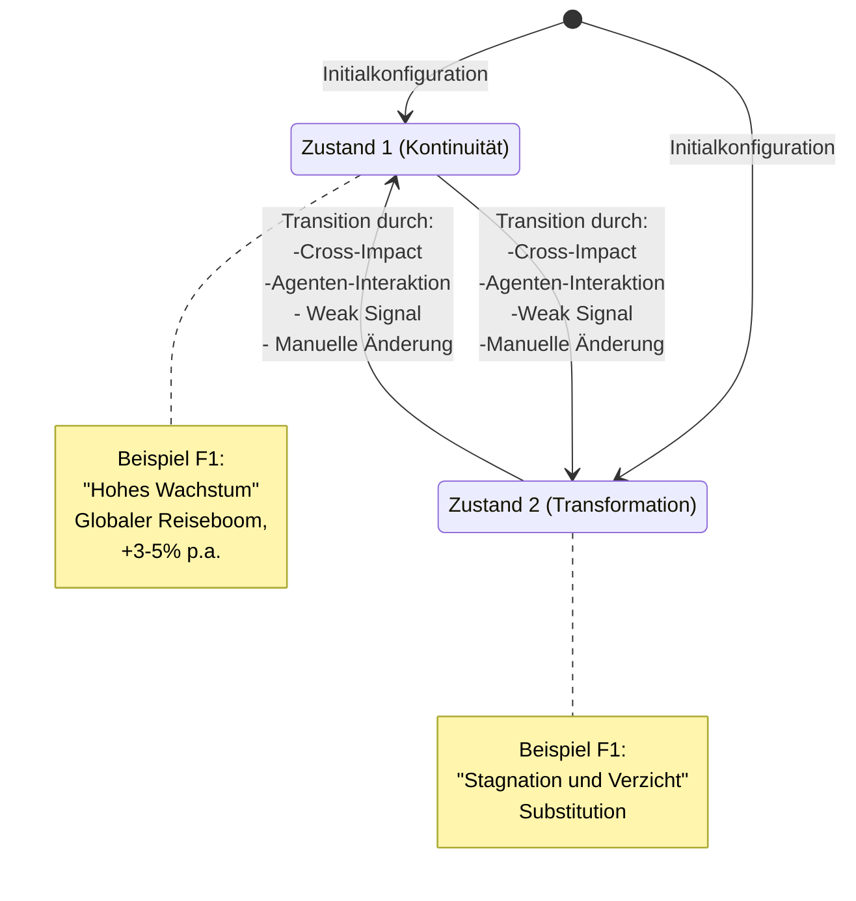
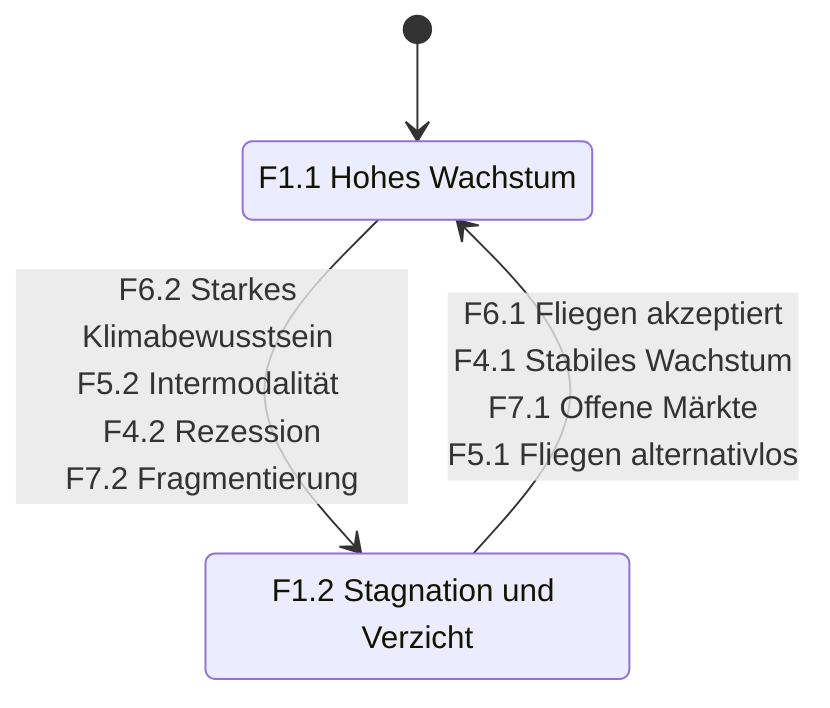

# Challenge 1: Domänenrepräsentation – Phase B: Domänenmodell

## Projektkontext

| Attribut | Wert |
|----------|------|
| **Forschungsprojekt** | Entwicklung einer prototypischen multiagentischen Simulationsumgebung für die Szenarioplanung im Strategic Foresight |
| **Challenge** | C1 – Domänenrepräsentation |
| **Domäne** | System Flugverkehr (Europa) |
| **Methodik** | Ludewig, J. & Lichter, H. (2023): Software Engineering – Grundlagen, Menschen, Prozesse, Techniken. 4. Aufl., dpunkt.verlag. |
| **Technischer Stack** | Python, LangGraph, Ollama (lokale LLMs) |
| **Stand** | Phase B: Konzeptuelles Domänenmodell, Zustände, Beziehungen |
| **Vorgänger** | Phase A: Analyse (Systemabgrenzung, Glossar, Stakeholder, Anforderungen) |

---

## Inhaltsverzeichnis

- [Methodische Grundlage](#methodische-grundlage)
- [Vorgehensweise](#vorgehensweise)
- [B.1 Konzeptuelles Domänenmodell](#b1-konzeptuelles-domänenmodell)
  - [B.1.1 Identifikation der Klassen](#b11-identifikation-der-klassen)
  - [B.1.2 UML-Klassendiagramm (Kernmodell)](#b12-uml-klassendiagramm-kernmodell)
  - [B.1.3 Erläuterung der Klassen und Attribute](#b13-erläuterung-der-klassen-und-attribute)
- [B.2 Zustandsmodell der Einflussfaktoren](#b2-zustandsmodell-der-einflussfaktoren)
---

## Methodische Grundlage

> Gemäß **Ludewig & Lichter, Kap. 1.5**: Jedem Modell sind die drei Merkmale "Abbildungsmerkmal, Verkürzungsmerkmal und pragmatisches Merkmal" zugeordnet, ansonsten handelt es sich nicht um ein Modell. Das bedeutet es gibt zu jedem Modell ein Original, jedes Modell erfasst nicht alle Attribute des Originals sondern nur einen Ausschnitt davon, und Modelle können unter bestimmten Bedingungen das Original ersetzen (S. 5-6).

> Gemäß **Ludewig & Lichter, Kap. 15.3**: Aus dem Begriffslexikon wird ein Begriffsmodell abgeleitet. "Es hat sich bewehrt, die Begriffe und ihre Beziehungen explizit zu modellieren" (S. 350). Die Modellierung erfolgt typischerweise als UML-Klassendiagramm.

---

## Vorgehensweise

---

## B.1 Konzeptuelles Domänenmodell

### B.1.1 Identifikation der Klassen

Aus dem Glossar (Phase A.2) leiten sich folgende Klassen ab:

| Glossar-Begriff | Klasse im Modell | Begründung |
|---|---|---|
| Domäne | `Domain` | Root, enthält gesamte Systemkonfiguration |
| Soziotechnisches System | (implizit in `Domain`) | Die Domain ist die Repräsentation des soziotechnischen Systems |
| Szenarioplanung | `ScenarioConfig` | Konfiguration der Fragestellung, Zeit, Scope |
| Akteur | `Actor` | Handlungsträger im System mit eigener Logik |
| Einflussfaktor | `InfluenceFactor` | Key Unsicherheit mit definierten Ausprägungen |
| Faktor-Zustand | `FactorState` | Konkrete Ausprägung eines Einflussfaktors |
| Cross-Impact-Bilanz | `CrossImpactMatrix` | Bewertung der Faktor-Faktor-Wechselwirkungen |
| Cross-Impact-Bewertung | `CrossImpactEntry` | Wechselwirkungsbeziehnug zwischen zwei Zuständen |
| Beziehung (Akteur↔Akteur) | `ActorRelation` | Gerichteter Einfluss zwischen zwei Akteuren |
| Beziehung (Akteur↔Faktor) | `ActorFactorRelation` | Zuordnung von Akteuren zu Faktoren |
| Simulationsstand | `SimulationState` | Gesamtzustand zu einem Zeitpunkt (relevant ab C3?) |
| Szenario | `Scenario` | Konsistente Kombination von Faktor-Zuständen (relevant ab C3?) |
| Weak Signal | `WeakSignal` | Externer Impuls (relevant ab C4?) |

### B.1.2 UML-Klassendiagramm (Kernmodell)

### B.1.3 Erläuterung der Klassen und Attribute

#### Domain (root)

| Attribut | Typ | Beschreibung |
|----------|-----|-------------|
| `name` | string | Name des modellierten Systems ("Flugverkehr Europa") |
| `description` | string | Übergeordnete Beschreibung der Domäne |
| `scenario_config` | ScenarioConfig | Szenario Konfiguration |
| `actors` | list[Actor] | Liste aller Akteure |
| `influence_factors` | list[InfluenceFactor] | Liste aller Einflussfaktoren |
| `cross_impact_matrix` | CrossImpactMatrix | Wechselwirkungsmatrix (optional, wird in C3 befüllt?) |
| `actor_relations` | list[ActorRelation] | Beziehungen zwischen Akteuren |
| `actor_factor_relations` | list[ActorFactorRelation] | Beziehungen zwischen Akteuren und Faktoren |

**Design-Entscheidung:** `Domain` ist zentrale Konfigurationsobjekt, alle anderen Objekte sind darin enthalten oder referenziert.

#### ScenarioConfig

| Attribut | Typ | Beschreibung |
|----------|-----|-------------|
| `central_question` | string | zentrale Fragestellung (US-1.06) |
| `scenario_type` | string | Szenario Typ: "explorative", "predictive", "normative" |
| `geographical_scope` | string | Geographischer Geltungsbereich |
| `time_horizon_start` | int | Startjahr (z.B. 2025) |
| `time_horizon_end` | int | Endjahr (z.B. 2035) |
| `description` | string | *Ergänzende Beschreibung?* |

#### Actor

| Attribut | Typ | Beschreibung |
|----------|-----|-------------|
| `id` | string/int | ID (z.B. "A1_regulatorien") oder nur numeric 0000001? |
| `name` | string | Anzeigename (z.B. "Regulatorien / Politik") |
| `synonyms` | list[String] | Alternative Bezeichnungen |
| `description` | string | Ausführliche Beschreibung (→ wird zum LLM-System-Prompt? Humanmessage? ) |
| `objectives` | string | Ziele und Interessen des Akteurs |
| `action_logic` | string | Handlungslogik (→ US-1.02) Systemprompt? |
| `examples` | list[String] | Konkrete Beispiele (z.B. "EU-Kommission", "EASA") |

#### InfluenceFactor

| Attribut | Typ | Beschreibung |
|----------|-----|-------------|
| `id` | string | ID (z.B. "F1_mobilitaetsbeduernis") |
| `name` | string | Anzeigename |
| `synonyms` | list[String] | Alternative Bezeichnungen |
| `category` | string | PESTLE oder STEEP-Kategorie (Social, Technological, Economic, Environmental, Political, Legal) |
| `description` | string | Definition |
| `delimitation` | string | *Abgrenzung zu verwandten Faktoren?* |
| `states` | list[FactorState] | Mögliche Ausprägungen (mindestens 2) |
| `megatrend_references` | list[String] | *Zuordnung zu Megatrends?* |

#### FactorState

| Attribut | Typ | Beschreibung |
|----------|-----|-------------|
| `id` | string | ID (z.B. "F1.1_hohes_wachstum") |
| `name` | string | Name (z.B. "Hohes Wachstum") |
| `description` | string | Beschreibung des Zustands |
| `factor_id` | string | *Rückreferenz auf übergeordneten Faktor?* |

#### CrossImpactMatrix

| Attribut / Methode | Typ | Beschreibung |
|----------|-----|-------------|
| `entries` | list[CrossImpactEntry] | Alle bewerteten Wechselwirkungen |
| `get_impact()` | Methode | Gibt den Wirkungswert zwischen zwei Zuständen zurück |
| `get_consistent_scenarios()` | Methode | Berechnet konsistente Szenariokombinationen |

#### CrossImpactEntry

| Attribut | Typ | Beschreibung |
|----------|-----|-------------|
| `active_state_id` | string | Zustand der wirkt (Ursache) |
| `passive_state_id` | string | Zustand der beeinflusst wird (Wirkung) |
| `impact_value` | int | Stärke: -3 (stark hemmend) bis +3 (stark fördernd), 0 = kein Einfluss |
| `justification` | string | Begründung für Bewertung |

**Design-Entscheidung:** Jeder Eintrag enthält eine `justification`, um die Nachvollziehbarkeit zu gewährleisten (→ NFA-01). Begründung kann vom Foresight-Analysten vorgegeben werden.

#### ActorRelation

| Attribut | Typ | Beschreibung |
|----------|-----|-------------|
| `source_actor_id` | string | Akteur, der beeinflusst |
| `target_actor_id` | string | Akteur, der beeinflusst wird |
| `relation_type` | string | Art der Beziehung (z.B. "regulatory_pressure", "market_demand", "lobbying") |
| `description` | string | Beschreibung Beziehung |
| `strength` | int | Stärke: 1 (schwach) bis 3 (stark) |

#### ActorFactorRelation

| Attribut | Typ | Beschreibung |
|----------|-----|-------------|
| `actor_id` | string | Betroffener Akteur |
| `factor_id` | string | Betroffener Einflussfaktor |
| `direction` | string | "actor_influences_factor" oder "factor_influences_actor" |
| `description` | string | Beschreibung der Beziehung |
| `strength` | int | Stärke: 1 (schwach) bis 3 (stark) |

#### Scenario (Ergebnisobjekt, relevant ab C3? - Nochmal Absprechen)

| Attribut | Typ | Beschreibung |
|----------|-----|-------------|
| `id` | string | ID |
| `name` | string | Sprechender Name (z.B. "Business as Usual") |
| `description` | string | Szenariobeschreibung |
| `factor_states` | list[FactorState] | Kombination der Faktor-Zustände |
| `consistency_score` | float | Konsistenzbewertung auf Basis der CIB |

#### SimulationState (relevant ab C2/C3? - Nochmal Absprechen)

| Attribut | Typ | Beschreibung |
|----------|-----|-------------|
| `id` | string | ID |
| `time_step` | int | Simulationszeitschrift |
| `timestamp` | string | Zeitstempel Creation |
| `current_factor_states` | List[FactorState] | Aktuelle Ausprägungen aller Faktoren |
| `actor_positions` | list[ActorPosition] | Zusammenfassung Akteur Positionen |
| `conversation_log` | list[Message] | Gesprächsprotokoll der Agenten |

#### ActorPosition (relevant ab C2/C3? - Nochmal Absprechen)

| Attribut | Typ | Beschreibung |
|----------|-----|-------------|
| `actor_id` | string | Referenz auf Akteur |
| `position_summary` | string | Zusammenfassung der aktuellen Position |
| `reasoning` | string | Begründung Position |
| `time_step` | int | Zeitschritt, zu dem Position erfasst wurde |

#### Message (relevant ab C2/C3? - Nochmal Absprechen)

| Attribut | Typ | Beschreibung |
|----------|-----|-------------|
| `sender_actor_id` | string | Akteur/Sender Nachricht |
| `content` | string | Inhalt der Nachricht |
| `time_step` | int | Simulationszeitschritt |
| `timestamp` | string | Zeitstempel |

#### WeakSignal (relevant ab C4? - Nochmal Absprechen)

| Attribut | Typ | Beschreibung |
|----------|-----|-------------|
| `id` | string | ID |
| `name` | string | Name Signal |
| `description` | string | Beschreibung |
| `source` | string | Quelle Signal |
| `affected_factor_ids` | List[String] | Betroffene Einflussfaktoren |
| `impact_strength` | int | Wirkungsstärke (1-3) |

---

## B.2 Zustandsmodell der Einflussfaktoren

Jeder Einflussfaktor befindet sich zu jedem Simulationszeitpunkt in genau einem seiner definierten Zustände.

### Generisches Zustandsdiagramm

**Erläuterung:**
- Während (C3) wird der Zustand initial gesetzt und bleibt während einer Simulationsrunde konstant. Die CIB-Matrix bewertet die Konsistenz der Zustandskombination.
- Während (C4) können Zustandsübergänge durch CI-Effekte, Agenten-Interaktionen, Weak Signals oder manuelle Eingriffe ausgelöst werden (dynamisch).
- Das Modell ist erweiterbar auf mehr als zwei Zustände pro Faktor weil `InfluenceFactor.states` eine Liste beliebiger Länge ist.

### Angewandtes Zustandsmodell: Biespiel Faktor F1 (Mobilitätsbedürfnis)

---

