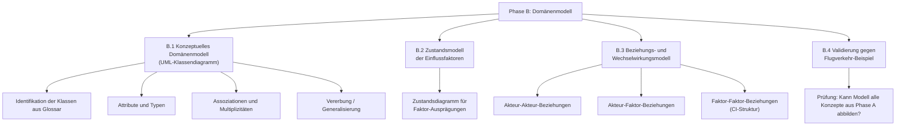

# Challenge 1: Domänenrepräsentation – Phase B: Domänenmodell

## Projektkontext

| Attribut | Wert |
|----------|------|
| **Forschungsprojekt** | Entwicklung einer prototypischen multiagentischen Simulationsumgebung für die Szenarioplanung im Strategic Foresight |
| **Challenge** | C1 – Domänenrepräsentation |
| **Domäne** | System Flugverkehr (Europa) |
| **Methodik** | Ludewig, J. & Lichter, H. (2023): Software Engineering – Grundlagen, Menschen, Prozesse, Techniken. 4. Aufl., dpunkt.verlag. |
| **Technischer Stack** | Python, LangGraph, Ollama (lokale LLMs) |
| **Stand** | Phase B: Konzeptuelles Domänenmodell, Zustände, Beziehungen |
| **Vorgänger** | Phase A: Analyse (Systemabgrenzung, Glossar, Stakeholder, Anforderungen) |

---

## Inhaltsverzeichnis

- [Methodische Grundlage](#methodische-grundlage)
- [Vorgehensweise](#vorgehensweise)
- [B.1 Konzeptuelles Domänenmodell](#b1-konzeptuelles-domänenmodell)
  - [B.1.1 Identifikation der Klassen](#b11-identifikation-der-klassen)
---

## Methodische Grundlage

> Gemäß **Ludewig & Lichter, Kap. 1.5**: Jedem Modell sind die drei Merkmale "Abbildungsmerkmal, Verkürzungsmerkmal und pragmatisches Merkmal" zugeordnet, ansonsten handelt es sich nicht um ein Modell. Das bedeutet es gibt zu jedem Modell ein Original, jedes Modell erfasst nicht alle Attribute des Originals sondern nur einen Ausschnitt davon, und Modelle können unter bestimmten Bedingungen das Original ersetzen (S. 5-6).

> Gemäß **Ludewig & Lichter, Kap. 15.3**: Aus dem Begriffslexikon wird ein Begriffsmodell abgeleitet. "Es hat sich bewehrt, die Begriffe und ihre Beziehungen explizit zu modellieren" (S. 350). Die Modellierung erfolgt typischerweise als UML-Klassendiagramm.

---

## Vorgehensweise

---

## B.1 Konzeptuelles Domänenmodell

### B.1.1 Identifikation der Klassen

Aus dem Glossar (Phase A.2) leiten sich folgende Klassen ab:

| Glossar-Begriff | Klasse im Modell | Begründung |
|---|---|---|
| Domäne | `Domain` | Root, enthält gesamte Systemkonfiguration |
| Soziotechnisches System | (implizit in `Domain`) | Die Domain ist die Repräsentation des soziotechnischen Systems |
| Szenarioplanung | `ScenarioConfig` | Konfiguration der Fragestellung, Zeit, Scope |
| Akteur | `Actor` | Handlungsträger im System mit eigener Logik |
| Einflussfaktor | `InfluenceFactor` | Key Unsicherheit mit definierten Ausprägungen |
| Faktor-Zustand | `FactorState` | Konkrete Ausprägung eines Einflussfaktors |
| Cross-Impact-Bilanz | `CrossImpactMatrix` | Bewertung der Faktor-Faktor-Wechselwirkungen |
| Cross-Impact-Bewertung | `CrossImpactEntry` | Wechselwirkungsbeziehnug zwischen zwei Zuständen |
| Beziehung (Akteur↔Akteur) | `ActorRelation` | Gerichteter Einfluss zwischen zwei Akteuren |
| Beziehung (Akteur↔Faktor) | `ActorFactorRelation` | Zuordnung von Akteuren zu Faktoren |
| Simulationsstand | `SimulationState` | Gesamtzustand zu einem Zeitpunkt (relevant ab C3?) |
| Szenario | `Scenario` | Konsistente Kombination von Faktor-Zuständen (relevant ab C3?) |
| Weak Signal | `WeakSignal` | Externer Impuls (relevant ab C4?) |

