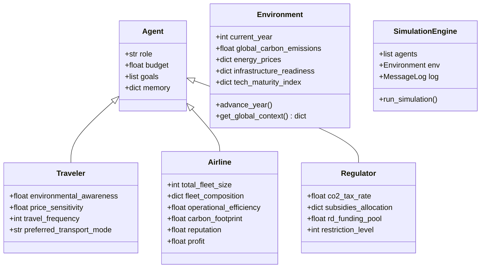

***Softwareentwicklungsmodell***

*XP (Extreme Programming):*

XP-Primärtechniken
- Pair Programming: Zwei Entwickler arbeiten gemeinsam an einem Rechner (Pilot/Copilot) – erhöht die Codequalität und den Wissenstransfer.
- Continuous Integration: Code wird mehrmals täglich integriert und automatisiert getestet, um Integrationsprobleme frühzeitig zu lösen.
- Whole Team: Alle Rollen arbeiten eng zusammen, um Abhängigkeiten zu minimieren.
- Informative Workspace: Projektstatus und Fortschritt sind für alle Teammitglieder jederzeit visuell im Arbeitsraum sichtbar. -> eventuell aufsetzen von Kanban-Board?
- User Stories: Anforderungen werden als kurze Geschichten aus Nutzersicht formuliert, um den Fokus auf den echten Mehrwert zu legen. -> ist genau unsere Anforderung
- Continuous Feedback: Regelmäßige Rückkopplungsschleifen durch Tests, Kundenfeedback und Team-Reviews zur Kurskorrektur. -> wir müssen die ganze Zeit testen und behalten/merken was gut ist
- Test-driven Development (TDD): Automatisierte Tests werden vor dem eigentlichen Code geschrieben, was Design und Stabilität verbessert. -> wir haben bestimmte anforderungen die wir erfüllen sollen
- Wöchentliche Iterationen: Kurze Entwicklungszyklen mit wöchentlicher Planung und Review ermöglichen maximale Flexibilität. -> wir machen tägliche commits für thies und kunz, also macht es sinn kurze entwicklungszyklen zu haben
- Incremental Design: Die Systemarchitektur entwickelt sich schrittweise durch ständiges Refactoring weiter, statt sie vorab starr festzulegen. -> wir wissen nicht wie das ende aussieht, können es immer nur ausbauen 
- Sit Together: Das Team arbeitet in einem gemeinsamen Raum, um Kommunikationswege kurz zu halten und die Dynamik zu fördern. -> sind eh im austausch
- Energized Work: Ein nachhaltiges Arbeitstempo ohne Überstunden sichert langfristige Produktivität und Konzentration -> wir wollen schnell vorankommen
(Kopiert aus: https://www.it-agile.de/agiles-wissen/agile-entwicklung/was-ist-extreme-programming/, als Bulletpoints von KI erstellt)

Warum XP für das Projekt?
- Starre Modelle wie Wasserfall oder V-Modell ist für so Prototypen nicht geeignet, da keine Iteration erlaub ist. Wir sind immer am testen und haben kein richtiges Ziel. Dazu müssen wir tägliche Commits machen

***UML-Klassendiagramme***

- Bevor Architekturüberlegung Recherche bzgl. der heutigen Situation und Abschätzung was passieren kann
- Benötigt, um realistische/branchenspezifische Vorhersagen zu können -> ohne Hintergrundwissen bringt uns die Modellierung nichts
- Strategic Foresight a la Börjeson et al.  (gefunden im Moodle Kurs) 
- Developing qualitative scenario storylines for environmental change assessment. auch interessant für das Projekt (auch aus Moodle)
- Da verschiedene äußere Faktoren eine Rolle spielen, kann PESTEL-Analyse eventuell -> evtl. einbauen im Prozess, damit auch diese Faktoren immer wieder generiert werden? -> Aktualität im Monat / Jahr, und alle Akteure wissen, welche äußerlichen Faktoren entstehen
-> Folgefrage: wie stellen wir innere Faktoren nach?
- Branchenspezifische Parameter, wie Größe der Flotte und SAF-Verfügbarkeit (sustainable aviation fuel) -> Ableitung durch IATA Net Zero Roadmap für den Anfang, dann weitere Simulation im späteren Verlauf

 

Info der Parameter:
- fleet_composition: z.B. {"kerosene": 80, "saf": 20, "hydrogen": 0}
- subsidies_allocation: z.B. {"saf": 500M, "hydrogen_tech": 200M}
- energy_prices: z.B. {"kerosene": 1.2, "saf": 3.5, "hydrogen": 8.0}
- infrastructure_readiness: z.B. {"saf_refineries": 0.4, "h2_airports": 0.1}
- tech_maturity_index: Wie marktreif sind neue Antriebe?
- Agent: budget -> evtl. unnötig da Regulator kein Geld hat

Abkürzungen fürs Verständnis:
- SAF = Sustainable Aviation Fule = Nachhaltiger Luftfahrttreibstoff aus nichtfossilen Rohstoffen

Erklärungen zu den ersten Überlegungen
- Agent hat mehrere Unterklassen Traveler, Airline, Regulator und erben von Agent -> Damit werden die Hauptmechanismen mitgegeben und spezifiziert in einzelnen Agenten
- Environment isoliert den Markt von der Ausführungslogik. Man hätte es auch theoretisch zusammen machen können, aber ich denke, dass wir damit besser voran kommen
- SimulationEngine brauchen wir für jeden Iterationsschritt (Ausführung je Monat x 20 Monate, Jahre oder etc.)
- SimulationEngine steuert Workflow von langgraph. Da wir genau spezifizieren, können wir wie in der gezeigten Demo leicht den Ablauf steuern
- MessageLog für uns, damit wir pro Iteration nachvollziehen können was passiert und Parameter etc. anpassen können. -> direktes Logging von dem was wir ausarbeiten

***ERM***

tbd

***User Stories***

Systemnutzer
Traveler
Airline
Regulator

tbd.